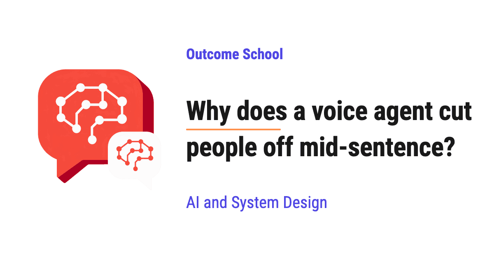

# Why does a voice agent cut people off mid-sentence?

> Archived from <https://outcomeschool.com/blog/voice-agents-cutting-users-off> on 2026-11-25.

A voice agent cuts people off mid-sentence because it often decides that a person has finished talking just by noticing a short silence, and people pause in the middle of their sentences all the time. When the agent hears that pause, it wrongly thinks it is its turn to speak, and it starts replying while the person still has more to say.

In this blog, we will learn about why a voice agent cuts people off mid-sentence. We will also see how a voice agent listens and decides when to reply, why a simple silence timer gets it wrong, the common situations that cause it, why making the agent wait longer creates a new problem, how modern voice agents fix it by understanding the meaning of what we said, and how they recover when they still get it wrong.

We will cover the following:
<ul><li>How a voice agent decides it is time to reply</li><li>The silence timer</li><li>Why a pause is not the end of a sentence</li><li>Common reasons a voice agent cuts us off</li><li>Why not just wait longer?</li><li>How does semantic turn detection fix it?</li><li>Recovering when the agent still gets it wrong</li></ul>
I am <strong>Amit Shekhar</strong>, Founder @ <a target="_blank" rel="noopener noreferrer" href="https://outcomeschool.com">Outcome School</a>, I have taught and mentored many developers, and their efforts landed them high-paying tech jobs, helped many tech companies in solving their unique problems, and created many open-source libraries being used by top companies. I am passionate about sharing knowledge through open-source, blogs, and videos.

I teach <a target="_blank" rel="noopener noreferrer" href="https://outcomeschool.com/program/ai-and-machine-learning">AI and Machine Learning</a> at Outcome School.

Let&#x27;s get started.
<h2 id="how-a-voice-agent-decides-it-is-time-to-reply">How a voice agent decides it is time to reply</h2>
A <a target="_blank" rel="noopener noreferrer" href="design-a-real-time-voice-ai-agent.md"><strong>voice agent</strong></a> is an AI system that we can talk to using our voice, and it replies to us with a voice of its own. We find them in customer support phone lines, in voice assistants, and in apps where we speak instead of typing.

Many voice agents work in a few steps, like below:

<pre><code class="code-highlight">+-----------------------------+
|  User speaks into the mic   |
+-----------------------------+
              ↓
+-----------------------------+
|  Speech-to-Text (STT)       |
|  converts voice into text   |
+-----------------------------+
              ↓
+-----------------------------+
|  LLM reads the text and     |
|  writes a reply             |
+-----------------------------+
              ↓
+-----------------------------+
|  Text-to-Speech (TTS)       |
|  converts reply into voice  |
+-----------------------------+
              ↓
+-----------------------------+
|  Agent speaks the reply     |
+-----------------------------+
</code></pre>

Here, we can notice that the <a target="_blank" rel="noopener noreferrer" href="large-language-model-llm.md">LLM (Large Language Model)</a> needs our full sentence before it can write a good reply, because half a sentence gives it only half the meaning. So, before the LLM starts writing, the voice agent must answer one question:

<strong>Has the user finished speaking, or are they still talking?</strong>

Deciding this is called <a target="_blank" rel="noopener noreferrer" href="what-is-turn-taking-in-a-voice-ai-agent.md"><strong>turn detection</strong></a>, and the moment when it decides &quot;the user is done&quot; is called the <strong>end of turn</strong>. In a conversation, a <strong>turn</strong> is one person&#x27;s chance to speak. When we finish our turn, the other person takes theirs.

Humans do this without thinking. We look at the face of the other person, we listen to their tone, and we understand the meaning of their words. A simple voice agent has none of this when it decides the end of turn. It only has a stream of sound coming from the microphone.

So, how does it decide? The answer is a silence timer.
<h2 id="the-silence-timer">The silence timer</h2>
The simplest way to detect the end of turn has two parts.

The first part is <strong>Voice Activity Detection (VAD)</strong>. VAD is a small, fast model that listens to the audio and answers one question again and again, many times per second: &quot;Is someone speaking right now, or is it silent?&quot;

The second part is a timer. The rule is simple:

<strong>If VAD hears silence for longer than a fixed time, the user has finished speaking.</strong>

This fixed time is called the <strong>silence threshold</strong>. It is often set somewhere between a few hundred milliseconds and one second.

Let&#x27;s say the silence threshold is 500 milliseconds (half a second). We can write the logic as below:

<pre><code class="language-python code-highlight">SILENCE_THRESHOLD_MS = 500
silence_ms = 0
user_is_talking = False

for chunk in audio_stream:          # each chunk is 20 ms of audio
    if vad.is_speech(chunk):
        user_is_talking = True
        silence_ms = 0              # user is talking, reset the timer
    elif user_is_talking:
        silence_ms += 20            # silence after speech, add to the timer

    if user_is_talking and silence_ms &gt;= SILENCE_THRESHOLD_MS:
        end_of_turn()               # send the text to the LLM and reply
        user_is_talking = False
        silence_ms = 0
</code></pre>

Here, we have:
<ul><li><code>audio_stream</code> gives us small pieces of audio, 20 milliseconds each.</li><li><code>vad.is_speech(chunk)</code> tells us if that small piece has a human voice in it.</li><li>Whenever the user speaks, we mark <code>user_is_talking</code> as <code>True</code> and reset <code>silence_ms</code> to 0.</li><li>Whenever it is silent after the user has spoken, we keep adding 20 to <code>silence_ms</code>.</li><li>Once the silence reaches 500 milliseconds, we call <code>end_of_turn()</code>, and the agent starts replying.</li></ul>
This approach is simple and fast. But it has one big problem. It only looks at the silence. It does not care about what we said.

<strong>Planning your move into AI?</strong>

No matter which tech domain you work in today, with your effort, you can transition to these roles:
<ul><li>AI Engineer</li><li>Forward Deployed Engineer</li><li>AI Agent Engineer</li><li>Harness Engineer</li><li>Voice AI Engineer</li><li>AI Architect</li><li>LLM Engineer</li><li>LLM Inference Engineer</li><li>Gen AI Engineer</li><li>MLOps Engineer</li><li>ML Engineer</li><li>Deep Learning Engineer</li></ul>
Our <a target="_blank" rel="noopener noreferrer" href="https://outcomeschool.com/program/ai-and-machine-learning">AI and Machine Learning Program</a> at Outcome School takes you there.
<h2 id="why-a-pause-is-not-the-end-of-a-sentence">Why a pause is not the end of a sentence</h2>
People do not speak in one smooth stream. We pause all the time, and that too in the middle of our sentences.

The best way to learn this is by taking an example.

Suppose we call a voice agent to book a table at a restaurant, and we say:

&quot;I want to book a table for... [pause of 0.7 seconds] ...four people tomorrow evening.&quot;

Let&#x27;s see what happens with a silence threshold of 500 milliseconds, step by step:

<strong>Step 1:</strong> We say &quot;I want to book a table for&quot;. VAD hears speech, and the timer stays at 0.

<strong>Step 2:</strong> We <a target="_blank" rel="noopener noreferrer" href="long-pauses-in-voice-agents.md">pause to think</a>. VAD hears silence. The timer goes 20, 40, 60, and so on.

<strong>Step 3:</strong> The timer reaches 500 milliseconds. Our pause is not over yet, because it is 700 milliseconds long. But the agent has already decided that we are done.

<strong>Step 4:</strong> The agent sends &quot;I want to book a table for&quot; to the LLM, and the agent starts saying &quot;Sure. For how many people?&quot;

<strong>Step 5:</strong> We continue with &quot;...four people tomorrow evening.&quot; at the same time. Now, both of us are <a target="_blank" rel="noopener noreferrer" href="overlapping-speech-in-voice-agents.md">talking over each other</a>.

This is exactly what it means when a voice agent cuts people off mid-sentence. The timer worked as designed, but the rule behind it is wrong. A pause of 500 milliseconds does not always mean the end of a sentence.

Now, the question is: what makes the agent hear a gap when we are not done yet? Let&#x27;s see the most common reasons.
<h2 id="common-reasons-a-voice-agent-cuts-us-off">Common reasons a voice agent cuts us off</h2>
<strong>Thinking pauses:</strong> We pause while we think about what to say next. &quot;My order number is... let me check... 4 5 7 2.&quot;

<strong>Filler words:</strong> We say &quot;um&quot;, &quot;uh&quot;, or &quot;so...&quot; and then stop for a moment. These words are usually a sign that we are not done, but a silence timer does not understand words.

<strong>Reading out numbers and lists:</strong> When we <a target="_blank" rel="noopener noreferrer" href="unfinished-input-in-voice-agents.md">read a phone number, a card number, or an address</a>, we naturally pause between the groups. &quot;My number is 98765... 43210.&quot; The agent can jump in after the first group.

<strong>Slow speakers:</strong> <a target="_blank" rel="noopener noreferrer" href="dynamic-endpointing.md">Some people speak slowly</a>, for example elderly people, or people who are speaking in a language that is not their first language. Their normal gaps between words can be longer than the threshold.

<strong>Background noise:</strong> Sometimes VAD gets confused by noise. A car horn, a fan, or another person talking can make it think speech has stopped or started at the wrong moment.

<strong>Network delays:</strong> On phone and internet calls, small pieces of audio can arrive late or get lost on the way. For a moment, the agent receives nothing, and it can look like silence even though we are still speaking.

Here, we can notice one common thing. In every case, the agent hears a gap, but the meaning is &quot;I am not done yet.&quot; The silence timer cannot see the meaning.

<strong>A quick note for you</strong>

No matter which tech domain you work in, get familiar with these topics:
<ul><li>LLM</li><li>RAG</li><li>MCP</li><li>Agent</li><li>Fine-tuning</li><li>Quantization</li></ul>
We put it all together in one video:

<a target="_blank" rel="noopener noreferrer" href="https://www.youtube.com/watch?v=lnfWvX66FUk">AI Engineering Explained: LLM, RAG, MCP, Agent, Fine-Tuning, and Quantization</a>

No need to stop reading - bookmark it and watch later when you get time. Future you will thank you.

Now, let&#x27;s get back to the topic.
<h2 id="why-not-just-wait-longer">Why not just wait longer?</h2>
The first idea that comes to mind is simple. Let&#x27;s increase the silence threshold from 500 milliseconds to 2 seconds. Then, most of the thinking pauses will be shorter than the threshold, and the agent will stop cutting us off.

But this creates a new problem. Now, every time we really finish speaking, the agent waits 2 full seconds <a target="_blank" rel="noopener noreferrer" href="speculative-generation-in-voice-agents.md">before it even starts preparing a reply</a>. Then, the LLM needs time to write the reply, and the TTS needs time to turn it into voice. The <a target="_blank" rel="noopener noreferrer" href="voice-agent-latency-budget.md">total delay</a> becomes long, and the conversation feels slow. We start wondering if the agent heard us at all, and some people say &quot;Hello?&quot; again, which confuses the agent further.

So, we are stuck between two bad options:
<table><thead><tr><th>Silence threshold</th><th>What goes well</th><th>What goes wrong</th></tr></thead><tbody><tr><td>Short (300 ms)</td><td>Agent replies quickly</td><td>Agent cuts people off mid-sentence</td></tr><tr><td>Long (2 seconds)</td><td>Agent rarely cuts people off</td><td>Agent feels slow, awkward silences</td></tr></tbody></table>
The people who build voice agents want them to feel fast, so they often keep the threshold short, and a short threshold means more interruptions.

A single fixed number can never be right for every pause. The agent needs something smarter than a timer.

To learn how to balance fast replies and accurate turn detection when we Design a Real-Time Voice AI Agent, we can check out our <a target="_blank" rel="noopener noreferrer" href="https://outcomeschool.com/program/ai-and-machine-learning">AI and Machine Learning Program</a> at Outcome School.
<h2 id="how-does-semantic-turn-detection-fix-it">How does semantic turn detection fix it?</h2>
So, here comes the <strong>semantic turn detection</strong> to the rescue.

<strong>Semantic turn detection is a way of deciding the end of turn by looking at the meaning of what the user said, and not only at the silence.</strong>

The word <strong>semantic</strong> means &quot;related to meaning&quot;. Means, instead of asking &quot;How long has it been silent?&quot;, the agent asks &quot;Does what the user said so far sound like a complete thought?&quot;

Let&#x27;s take our restaurant example again:
<ul><li>&quot;I want to book a table for&quot; sounds incomplete. A sentence like this does not end with &quot;for&quot;. So, the agent must keep listening.</li><li>&quot;I want to book a table for four people tomorrow evening.&quot; sounds complete. So, the agent can reply.</li></ul>
To do this, a small, fast model looks at what the user has said so far, and it gives a score for how likely it is that the user has finished. This is often called a <strong>turn detection model</strong>. Some turn detection models read the text from Speech-to-Text, and some listen to the audio itself, because the voice carries extra clues. For example, our pitch often drops at the end of a statement, and it often stays level when we are still in the middle of a thought.

Now, the agent combines both signals, the silence and the meaning, as below:

<pre><code class="language-python code-highlight">silence_ms = get_silence_duration()
done_score = turn_model.predict(transcript)   # 0.0 = not done, 1.0 = done

if done_score &gt; 0.8 and silence_ms &gt;= 300:
    end_of_turn()        # complete thought and a short pause, reply quickly
elif silence_ms &gt;= 2000:
    end_of_turn()        # incomplete thought, but a very long pause
# otherwise, keep listening
</code></pre>

Here, we have:
<ul><li><code>turn_model.predict(transcript)</code> reads the text so far and gives a score between 0 and 1 for how complete the sentence is. We are using a text-based turn detection model here for the sake of understanding.</li><li>If the sentence looks complete and there is a short pause, the agent replies quickly.</li><li>If the sentence looks incomplete, the agent keeps waiting, even after the pause crosses 300 milliseconds.</li><li>If the pause becomes very long, the agent replies anyway, because the user has probably stopped.</li></ul>
The values 0.8, 300, and 2000 here are just for the sake of understanding. Real systems tune them based on their use case.

Let&#x27;s see the restaurant example again with this approach:

<strong>Step 1:</strong> We say &quot;I want to book a table for&quot; and pause. The turn detection model gives a low score, because the sentence is incomplete.

<strong>Step 2:</strong> The silence crosses 300 milliseconds, but the score is low. So, the agent keeps listening.

<strong>Step 3:</strong> We say &quot;four people tomorrow evening.&quot; and stop. The turn detection model gives a high score.

<strong>Step 4:</strong> The silence crosses 300 milliseconds, and the score is high. The agent replies quickly.

The agent waited during the thinking pause, and it replied fast when we were really done.

We have a detailed blog on <a target="_blank" rel="noopener noreferrer" href="silence-vs-model-based-turn-detection.md">how silence-based and model-based turn detection differ</a> that explains this in depth.

There are a few more fixes that help along with it:
<ul><li><strong>Context-aware waiting:</strong> If the agent has just asked &quot;What is your phone number?&quot;, it can wait longer, because people pause while reading numbers.</li><li><strong>Filler word awareness:</strong> If the last word is &quot;um&quot; or &quot;uh&quot;, the agent can wait longer, because the user is still thinking.</li><li><strong>Signals from Speech-to-Text:</strong> Some Speech-to-Text services send their own signal when they <a target="_blank" rel="noopener noreferrer" href="endpointing-in-voice-agents.md">think the user has stopped speaking</a>, and the agent can use it as one more clue.</li><li><strong>Better VAD and noise removal:</strong> A cleaner audio signal means fewer fake silences and fewer false alarms of speech.</li></ul>
<strong>Stay updated:</strong> Subscribe to our <a target="_blank" rel="noopener noreferrer" href="https://outcomeschool.substack.com/subscribe">newsletter</a> to get our latest AI and Machine Learning blogs straight to your inbox.
<h2 id="recovering-when-the-agent-still-gets-it-wrong">Recovering when the agent still gets it wrong</h2>
No turn detection is perfect. Sometimes, the agent will still start speaking too early. So, a good voice agent must also know how to recover.

Here comes the <a target="_blank" rel="noopener noreferrer" href="what-is-barge-in-in-a-voice-ai-agent.md"><strong>barge-in</strong></a> into the picture. Barge-in is the ability of the user to interrupt the agent while it is speaking. When the agent is speaking and it hears the user start talking again, it must do the following:
<ul><li><a target="_blank" rel="noopener noreferrer" href="stopping-speech-on-interruption.md">Stop speaking immediately</a>.</li><li>Throw away the rest of the reply it was speaking, and <a target="_blank" rel="noopener noreferrer" href="truncating-context-on-interruption.md">remember only the part that the user really heard</a>.</li><li>Keep listening to the user.</li><li>Join the new words with the old words, so that &quot;I want to book a table for&quot; and &quot;four people tomorrow evening&quot; become one sentence.</li><li>Write a fresh reply for the full sentence.</li></ul>
One more thing to notice is that not every sound from the user means &quot;stop&quot;. When we say &quot;uh-huh&quot;, &quot;okay&quot;, or &quot;right&quot; while the agent is talking, we usually mean &quot;I am listening, go on&quot;. These short sounds are called <a target="_blank" rel="noopener noreferrer" href="backchannels-in-voice-agents.md"><strong>backchannels</strong></a>. If the agent stops every time it hears &quot;uh-huh&quot;, it will keep stopping for no reason. So, a good voice agent must <a target="_blank" rel="noopener noreferrer" href="interruption-vs-background-noise.md">tell the difference between a real interruption and a backchannel</a>.

Also, the agent must not mistake its own voice for the user. On a speakerphone, the voice of the agent comes out of the speaker and goes back into the microphone. Without <strong>echo cancellation</strong>, which removes the agent&#x27;s own voice from the microphone audio, the agent can think the user is talking and interrupt itself.

Now we must have understood why a voice agent cuts people off mid-sentence, how the silence timer causes it, why waiting longer is not the answer, how semantic turn detection fixes it, and how barge-in handling helps the agent recover when it still gets it wrong.
<h2 id="frequently-asked-questions">Frequently Asked Questions</h2><h3 id="what-is-a-silence-threshold-in-a-voice-agent">What is a silence threshold in a voice agent?</h3>
A silence threshold is the fixed time of silence after which a simple voice agent decides that the user has finished speaking. It is often set somewhere between a few hundred milliseconds and one second. If VAD hears silence for longer than this time, the agent ends the turn and starts replying.
<h3 id="what-is-voice-activity-detection-vad">What is Voice Activity Detection (VAD)?</h3>
Voice Activity Detection (VAD) is a small, fast model that listens to the audio and answers, many times per second, whether someone is speaking or it is silent. A simple voice agent pairs VAD with a timer to decide the end of turn. VAD can get confused by noise like a car horn, a fan, or another person talking.
<h3 id="what-is-a-backchannel-in-a-voice-conversation">What is a backchannel in a voice conversation?</h3>
A backchannel is a short sound like &quot;uh-huh&quot;, &quot;okay&quot;, or &quot;right&quot; that we make while the other person is talking, and it means &quot;I am listening, go on&quot;. A good voice agent must tell the difference between a backchannel and a real interruption. Otherwise, it keeps stopping its reply for no reason.
<h3 id="why-does-a-voice-agent-sometimes-interrupt-itself-on-a-speakerphone">Why does a voice agent sometimes interrupt itself on a speakerphone?</h3>
On a speakerphone, the voice of the agent comes out of the speaker and goes back into the microphone. Without echo cancellation, which removes the agent&#x27;s own voice from the microphone audio, the agent can think that the user is talking. Then, it stops and interrupts itself.
<h3 id="can-a-turn-detection-model-listen-to-the-audio-instead-of-reading-the-text">Can a turn detection model listen to the audio instead of reading the text?</h3>
Yes. Some turn detection models read the text from Speech-to-Text, and some listen to the audio itself, because the voice carries extra clues. For example, our pitch often drops at the end of a statement, and it often stays level when we are still in the middle of a thought.

That&#x27;s it for now.

Thanks

<strong>Amit Shekhar</strong> Founder @ <a target="_blank" rel="noopener noreferrer" href="https://outcomeschool.com">Outcome School</a>

You can connect with me on:
<ul><li><a target="_blank" rel="noopener noreferrer" href="https://x.com/amitiitbhu">X</a></li><li><a target="_blank" rel="noopener noreferrer" href="https://www.linkedin.com/in/amit-shekhar-iitbhu">LinkedIn</a></li><li><a target="_blank" rel="noopener noreferrer" href="https://github.com/amitshekhariitbhu">GitHub</a></li></ul>
Follow Outcome School on:
<ul><li><a target="_blank" rel="noopener noreferrer" href="https://x.com/outcome_school">X</a></li><li><a target="_blank" rel="noopener noreferrer" href="https://youtube.com/@OutcomeSchool">YouTube</a></li><li><a target="_blank" rel="noopener noreferrer" href="https://www.linkedin.com/company/outcomeschool">LinkedIn</a></li><li><a target="_blank" rel="noopener noreferrer" href="http://github.com/OutcomeSchool">GitHub</a></li></ul>
<a target="_blank" rel="noopener noreferrer" href="https://outcomeschool.com/blog"><strong>Read all of our high-quality blogs here.</strong></a>

