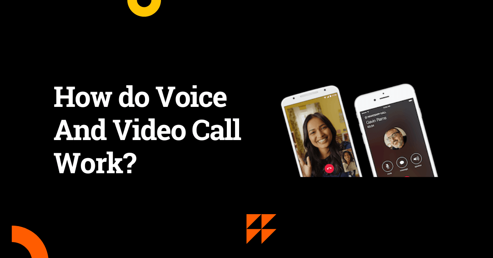

# How do Voice And Video Call Work?

> Archived from <https://outcomeschool.com/blog/voice-and-video-call> on 2026-11-25.

Voice and video calls work by streaming media between two clients using WebRTC. First, the clients exchange details through signaling, then they connect peer-to-peer using a STUN server, and if that fails, a TURN server passes the data between them.

This blog is all about how voice and video call works on a high level.

I am <strong>Amit Shekhar</strong>, Founder @ <a target="_blank" rel="noopener noreferrer" href="https://outcomeschool.com">Outcome School</a>, I have taught and mentored many developers, and their efforts landed them high-paying tech jobs, helped many tech companies in solving their unique problems, and created many open-source libraries being used by top companies. I am passionate about sharing knowledge through open-source, blogs, and videos.

I teach <strong>AI and Machine Learning</strong>, and <strong>Android</strong> at Outcome School.

Join <strong>Outcome School</strong> and get a high-paying tech job:
<ul><li><a target="_blank" rel="noopener noreferrer" href="https://outcomeschool.com/program/ai-and-machine-learning">Outcome School AI and Machine Learning Program</a></li><li><a target="_blank" rel="noopener noreferrer" href="https://outcomeschool.com/program/android">Outcome School Android Program</a></li></ul>
Let&#x27;s get started.

Voice over Internet Protocol (VoIP) is one of the most popular standards for voice and video calling over the web.

We all use voice and video on various platforms like WhatsApp, Skype, Messenger, Facebook, etc.

Both voice and video calls depend on how we stream media between the two clients which are connected to each other. So, there must be something that can do the work of media streaming from one client to another client.

<strong>Planning your move into AI?</strong>

No matter which tech domain you work in today, with your effort, you can transition to these roles:
<ul><li>AI Engineer</li><li>Forward Deployed Engineer</li><li>AI Agent Engineer</li><li>Harness Engineer</li><li>Voice AI Engineer</li><li>AI Architect</li><li>LLM Engineer</li><li>LLM Inference Engineer</li><li>Gen AI Engineer</li><li>MLOps Engineer</li><li>ML Engineer</li><li>Deep Learning Engineer</li></ul>
Our <a target="_blank" rel="noopener noreferrer" href="https://outcomeschool.com/program/ai-and-machine-learning">AI and Machine Learning Program</a> at Outcome School takes you there.

For media streaming, we need to know about WebRTC.

WebRTC is a free, open project that provides browsers and mobile applications with Real-Time Communications (RTC) capabilities via simple APIs. The WebRTC components have been optimized to best serve this purpose.

But there are many other things that we need to do as WebRTC is not enough for complete implementation.

Other things are:
<ul><li>Signaling</li><li>STUN Server</li><li>TURN Server</li></ul><h2 id="signaling">Signaling</h2>
What is Signaling?

In order to set up a call between two clients, both clients must conform to each other by sending key data, messages, and metadata about the media. Over signaling, we do these things.

We can use <a target="_blank" rel="noopener noreferrer" href="http-request-long-polling-websocket-sse.md">WebSocket</a> for the purpose of signaling.

Signaling is just used to know that these two clients want to connect to each other for the call.

<strong>A quick note for you</strong>

No matter which tech domain you work in, get familiar with these topics:
<ul><li>LLM</li><li>RAG</li><li>MCP</li><li>Agent</li><li>Fine-tuning</li><li>Quantization</li></ul>
We put it all together in one video:

<a target="_blank" rel="noopener noreferrer" href="https://www.youtube.com/watch?v=lnfWvX66FUk">AI Engineering Explained: LLM, RAG, MCP, Agent, Fine-Tuning, and Quantization</a>

No need to stop reading - bookmark it and watch later when you get time. Future you will thank you.

Now, let&#x27;s get back to the topic.
<h2 id="peer-to-peer-connection">Peer-to-Peer Connection</h2>
After signaling, we need to connect both the client peer to peer. And for connecting, we must have the public IP address of both clients.

So, in order to get the public IP address, we use the STUN Server.
<h2 id="stun-server">STUN Server</h2>
STUN Server is used to get the public IP address.

Why do we need a public IP address?

A <strong>Public</strong> IP Address is an IP address that is globally unique across the Internet. Only one device may be in possession of a public IP address.

A <strong>Private</strong> IP Address is an IP address that is not globally unique and may exist simultaneously on many different devices. A private IP address is never directly connected to the Internet.

The NAT(Network Address Translation) provides the local IP address of the device which can&#x27;t be used publicly to connect peer to peer. And for WebRTC, we need to have a public IP address. STUN Server provides that.

If everything is fine, we get the public IP addresses of both clients, and then, we connect both clients through WebRTC to start the call. WebRTC handles all the media streaming.
<blockquote>
The real-world connectivity is not ideal.
</blockquote>
In case, we are not able to get the public IP address of both clients. Then we can&#x27;t connect peer to peer. In that case, we need the TURN Server.

<strong>Stay updated:</strong> Subscribe to our <a target="_blank" rel="noopener noreferrer" href="https://outcomeschool.substack.com/subscribe">newsletter</a> to get our latest AI and Machine Learning blogs straight to your inbox.
<h2 id="turn-server">TURN Server</h2>
TURN Server is used to connect both clients if peer-to-peer fails by acting as a mediator. Basically, it takes the data from one client and sends it to another client. So, its job is to relay the media.

This way, the two clients start talking to each other.

The other small data which are not related to media like a client cuts the call, any setting changes, messages and etc are sent over the signaling process.

The following question arises.

<strong>Why WebRTC can&#x27;t do signaling?</strong>

Answer: To avoid redundancy and to maximize compatibility with established technologies, the signaling methods and protocols are not specified by the WebRTC Standards.

WebRTC is optimized for media.

So, this way the voice and video call works.

We have a detailed blog on <a target="_blank" rel="noopener noreferrer" href="design-a-real-time-voice-ai-agent.md">Design a Real-Time Voice AI Agent</a> that explains how the same WebRTC audio stream is used to talk to an AI instead of a person.
<h2 id="frequently-asked-questions">Frequently Asked Questions</h2><h3 id="is-webrtc-enough-to-build-a-voice-or-video-call">Is WebRTC enough to build a voice or video call?</h3>
No. WebRTC handles the media streaming between the two clients, but it is not enough for a complete implementation. We also need signaling to set up the call, a STUN server to get the public IP addresses, and a TURN server for cases where the peer-to-peer connection fails.
<h3 id="what-is-the-difference-between-a-stun-server-and-a-turn-server">What is the difference between a STUN server and a TURN server?</h3>
A STUN server gives us the public IP address of a client so that the two clients can connect peer to peer. A TURN server is used when that peer-to-peer connection fails. It acts as a mediator that takes the media from one client and relays it to the other client.
<h3 id="do-we-always-need-a-turn-server-for-a-call">Do we always need a TURN server for a call?</h3>
No. If we get the public IP addresses of both clients, we connect them directly through WebRTC and do not need a TURN server. Since real-world connectivity is not ideal, we need the TURN server only when we cannot get the public IP addresses and the peer-to-peer connection is not possible.
<h3 id="how-are-non-media-events-like-ending-a-call-sent">How are non-media events like ending a call sent?</h3>
They are sent over the signaling process. WebRTC is optimized for media, so it handles the voice and video streaming. Other small data that is not related to media, such as a client cutting the call, setting changes, or messages, goes through signaling, which we can build using WebSocket.

That&#x27;s it for now.

Thanks

<strong>Amit Shekhar</strong> Founder @ <a target="_blank" rel="noopener noreferrer" href="https://outcomeschool.com">Outcome School</a>

You can connect with me on:
<ul><li><a target="_blank" rel="noopener noreferrer" href="https://x.com/amitiitbhu">X</a></li><li><a target="_blank" rel="noopener noreferrer" href="https://www.linkedin.com/in/amit-shekhar-iitbhu">LinkedIn</a></li><li><a target="_blank" rel="noopener noreferrer" href="https://github.com/amitshekhariitbhu">GitHub</a></li></ul>
Follow Outcome School on:
<ul><li><a target="_blank" rel="noopener noreferrer" href="https://x.com/outcome_school">X</a></li><li><a target="_blank" rel="noopener noreferrer" href="https://youtube.com/@OutcomeSchool">YouTube</a></li><li><a target="_blank" rel="noopener noreferrer" href="https://www.linkedin.com/company/outcomeschool">LinkedIn</a></li><li><a target="_blank" rel="noopener noreferrer" href="https://github.com/OutcomeSchool">GitHub</a></li></ul>
<a target="_blank" rel="noopener noreferrer" href="https://outcomeschool.com/blog"><strong>Read all of our high-quality blogs here.</strong></a>

