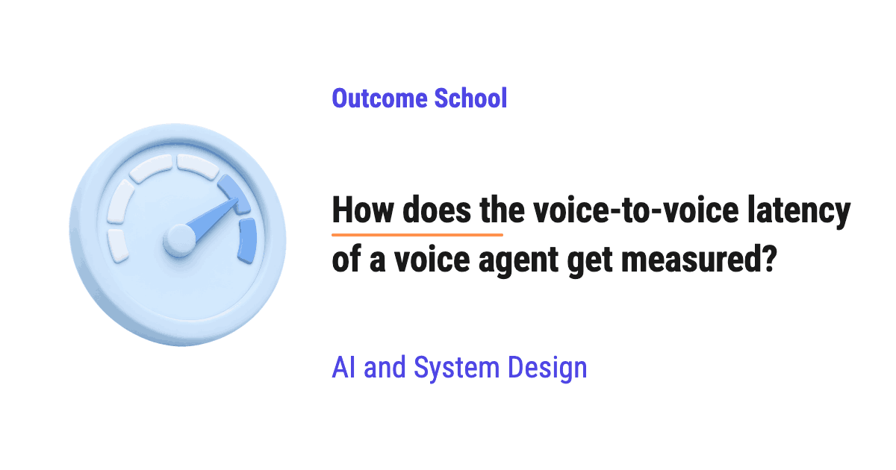

# How does the voice-to-voice latency of a voice agent get measured?

> Archived from <https://outcomeschool.com/blog/voice-to-voice-latency> on 2026-11-25.

Voice-to-voice latency of a voice agent gets measured as the time from the moment the user stops speaking to the moment the user hears the first sound of the agent&#x27;s reply. We measure it by recording both voices on one timeline, finding the end of the user&#x27;s speech and the start of the agent&#x27;s speech, and subtracting the two.

In this blog, we will learn about how the voice-to-voice latency of a voice agent gets measured. We will also see where the time goes inside a voice agent, why the server logs give the wrong answer, how a two-channel recording gives the right answer, how we automate it over many calls, why we look at percentiles instead of the average, and where it works well and where it fails.

We will cover the following:
<ul><li>What is voice-to-voice latency?</li><li>Why is this latency important?</li><li>Where does the time go?</li><li>Approach 1: Using the logs on the server</li><li>Approach 2: Adding timestamps at every step</li><li>Approach 3: Recording the call on one timeline</li><li>Automating the measurement over many calls</li><li>Why do we look at percentiles and not the average?</li><li>Where it works well and where it fails</li></ul>
I am <strong>Amit Shekhar</strong>, Founder @ <a target="_blank" rel="noopener noreferrer" href="https://outcomeschool.com">Outcome School</a>, I have taught and mentored many developers, and their efforts landed them high-paying tech jobs, helped many tech companies in solving their unique problems, and created many open-source libraries being used by top companies. I am passionate about sharing knowledge through open-source, blogs, and videos.

I teach <a target="_blank" rel="noopener noreferrer" href="https://outcomeschool.com/program/ai-and-machine-learning">AI and Machine Learning</a> at Outcome School.

Let&#x27;s get started.
<h2 id="what-is-voice-to-voice-latency">What is voice-to-voice latency?</h2>
A <strong><a target="_blank" rel="noopener noreferrer" href="design-a-real-time-voice-ai-agent.md">voice agent</a></strong> is an AI system that we talk to with our voice, and it talks back to us with its voice. A support agent on a phone call is a good example.

<strong>Latency</strong> is the waiting time between an action and its result.

<strong>Voice-to-voice latency is the time from the moment the user stops speaking to the moment the user hears the first sound of the agent&#x27;s reply.</strong>

The best way to learn this is by taking an example.

Let&#x27;s say we call a pizza shop voice agent and say:

<pre><code class="code-highlight">&quot;I want one large cheese pizza.&quot;
</code></pre>

We finish the word &quot;pizza&quot; and go quiet. Then we wait. After some time, we hear the agent say &quot;Sure, one large cheese pizza.&quot;

The silent gap between the end of our word &quot;pizza&quot; and the first sound of &quot;Sure&quot; is the voice-to-voice latency.

<pre><code class="code-highlight">User speaking:   [I want one large cheese pizza.]
                                                 |&lt;-- gap --&gt;|
Agent speaking:                                              [Sure, one large...]
</code></pre>

Here, we can notice two things:
<ul><li>The start point is the end of the user&#x27;s voice, not the moment the agent decided the user was done.</li><li>The end point is the first sound that reaches the user&#x27;s ear, not the moment the agent created the reply. We count only up to the first sound, because <a target="_blank" rel="noopener noreferrer" href="time-to-first-audio.md">the user stops waiting as soon as the agent starts speaking</a>.</li></ul>
If we pick the wrong start point or the wrong end point, we get a wrong number. We will see this in detail.
<h2 id="why-is-this-latency-important">Why is this latency important?</h2>
When two humans talk, the gap between one person finishing and the other person starting is very short. A well-known study on conversations across ten languages found that this gap is often only about 200 milliseconds, which is one-fifth of a second.

So, our brain expects a quick reply from a voice agent too.

When a voice agent takes too long, the user starts to feel that something is wrong. The user says &quot;Hello?&quot;, or starts speaking again, and now both are talking at the same time. The conversation breaks.

Hence, teams building voice agents watch this number closely. And, in order to improve a number, we must first measure it correctly.
<h2 id="where-does-the-time-go">Where does the time go?</h2>
Before jumping into the measurement, we must know what happens inside a voice agent between the end of our voice and the start of its reply.

A common voice agent works like a <a target="_blank" rel="noopener noreferrer" href="cascaded-vs-speech-to-speech.md">chain of steps</a>:
<ul><li><strong>Speech-to-Text (STT)</strong>: It converts our voice into text.</li><li><strong>LLM (Large Language Model)</strong>: It reads the text and writes the reply text.</li><li><strong>Text-to-Speech (TTS)</strong>: It converts the reply text into voice.</li></ul>
But, the time is not spent only in these three steps. Let&#x27;s see the full journey of one turn, with some example numbers just for the sake of understanding:

<pre><code class="code-highlight">User stops speaking
        ↓
Audio travels from the phone to the server           50 ms
        ↓
Agent waits in silence to be sure the user is done   500 ms
        ↓
STT gives the final text                             100 ms
        ↓
LLM gives the first part of the reply                300 ms
        ↓
TTS gives the first piece of audio                   150 ms
        ↓
Audio travels from the server to the phone           50 ms
        ↓
Phone buffers the audio before playing it            50 ms
        ↓
User hears the first sound
</code></pre>

Total = 50 + 500 + 100 + 300 + 150 + 50 + 50 = 1200 milliseconds.

Here, we can see that the voice-to-voice latency is the sum of all these steps, not just the AI models.

We have a detailed blog on <a target="_blank" rel="noopener noreferrer" href="voice-agent-latency-budget.md">how to build a latency budget for a voice AI agent</a> that explains how to split this total across every step.

Two steps here need a little explanation.

<strong>The silence wait:</strong> The agent cannot know the user is done the moment the voice stops. The user can be taking a breath. So, the agent waits for some silence before it decides the turn is over. This decision is called <strong><a target="_blank" rel="noopener noreferrer" href="what-is-turn-taking-in-a-voice-ai-agent.md">endpointing</a></strong>. This wait is often one of the biggest parts of the total, and it is also the part that a wrong measurement misses most easily.

We have a detailed blog on <a target="_blank" rel="noopener noreferrer" href="endpointing-in-voice-agents.md">how endpointing decides when the user has finished speaking</a> that explains this wait step by step.

<strong>The buffer on the phone:</strong> Audio comes over the internet in small pieces, and the pieces do not arrive at a perfectly even speed. So, the phone keeps a few pieces in a small waiting area before it plays them, so that the sound does not break. This waiting area is called a <a target="_blank" rel="noopener noreferrer" href="jitter-buffer.md"><strong>jitter buffer</strong></a>. It adds a little delay.

<strong>Planning your move into AI?</strong>

No matter which tech domain you work in today, with your effort, you can transition to these roles:
<ul><li>AI Engineer</li><li>Forward Deployed Engineer</li><li>AI Agent Engineer</li><li>Harness Engineer</li><li>Voice AI Engineer</li><li>AI Architect</li><li>LLM Engineer</li><li>LLM Inference Engineer</li><li>Gen AI Engineer</li><li>MLOps Engineer</li><li>ML Engineer</li><li>Deep Learning Engineer</li></ul>
Our <a target="_blank" rel="noopener noreferrer" href="https://outcomeschool.com/program/ai-and-machine-learning">AI and Machine Learning Program</a> at Outcome School takes you there.

Now, the question is: how do we measure this total correctly? Let&#x27;s see the approaches one by one.
<h2 id="approach-1-using-the-logs-on-the-server">Approach 1: Using the logs on the server</h2>
Our server already writes logs. So, the first idea is to use them.

The server writes a log line when the agent decides the user is done. Then, it writes a log line when the first piece of reply audio leaves the server.

<pre><code class="code-highlight">10:15:02.300  End of user turn detected
10:15:02.850  First reply audio sent
</code></pre>

Here, the difference is 550 milliseconds. It looks good.

But, this number is wrong. Let&#x27;s see why.
<ul><li>The log starts the clock when the agent decided the user was done, not when the user actually stopped speaking. So, the silence wait of 500 ms is not counted. Also, the 50 ms the audio took to reach the server is not counted.</li><li>The log stops the clock when the audio leaves the server, not when the user hears it. So, the 50 ms on the way back and the 50 ms in the phone buffer are not counted.</li></ul>
In our example, the real latency is 1200 ms, but the server log says 550 ms. Means, the server log hides more than half of the waiting time.

The issue with this approach is that it measures only the part of the journey that happens inside the server. Let&#x27;s see how the next approach solve this issue.
<h2 id="approach-2-adding-timestamps-at-every-step">Approach 2: Adding timestamps at every step</h2>
Now, we can <a target="_blank" rel="noopener noreferrer" href="ai-agent-observability.md">add a timestamp at every step of the journey</a>, including on the user&#x27;s phone.

The phone writes the time when the user&#x27;s voice ends. The server writes the time at every step. The phone again writes the time when the first reply sound plays.

This approach is useful for one thing. It tells us how much time each step takes. If the LLM suddenly becomes slow, we can see it at once.

But, there is a problem. The phone and the server have two different clocks. These clocks are never perfectly in sync. The phone clock can be ahead or behind the server clock by tens of milliseconds, or even more.

Let&#x27;s say the phone clock is 80 ms ahead of the server clock. When we subtract a phone time from a server time to find how long a step took, we get an error of 80 ms in our result, and the result does not show this error.

There is one more problem. Even the total, which uses only the two phone times, is not exact.
<ul><li>&quot;When the user&#x27;s voice ends&quot; is not easy for the phone to know exactly. The phone must use its own silence detector, and it marks the end a little late or a little early.</li><li>&quot;When the first reply sound plays&quot; is also not exact. The app writes the time when it hands the audio to the speaker, but the audio system of the phone adds its own small delay before the sound actually comes out.</li></ul>
The issue with this approach is that the per-step timestamps come from different clocks, and the start and end points of the total are still not exact. Let&#x27;s see how the next approach solve this issue.
<h2 id="approach-3-recording-the-call-on-one-timeline">Approach 3: Recording the call on one timeline</h2>
Here comes the <strong>two-channel recording</strong> into the picture.

The idea is to record the whole conversation, the way the user hears it, into one audio file with two channels.
<ul><li>The <strong>left channel</strong> has the user&#x27;s voice.</li><li>The <strong>right channel</strong> has the agent&#x27;s voice, exactly as it is played on the user&#x27;s side.</li></ul>
Now, both voices are on the same timeline, recorded by the same clock. So, there is no difference between two clocks.

<pre><code class="code-highlight">Left  (user):   ~~~~~~~~~~~~~~~~~~~~~~~______________________________
Right (agent):  _____________________________________~~~~~~~~~~~~~~~~
                                       ^             ^
                                 user stops     agent starts
</code></pre>

Here, <code>~</code> means sound and <code>_</code> means silence.

Now, the measurement is simple:

<strong>Step 1:</strong> Find the moment where the user&#x27;s voice ends on the left channel.

<strong>Step 2:</strong> Find the moment where the agent&#x27;s voice starts on the right channel.

<strong>Step 3:</strong> Subtract the first moment from the second moment.

Let&#x27;s say the user&#x27;s voice ends at 4.20 seconds in the file and the agent&#x27;s voice starts at 5.40 seconds. Then the voice-to-voice latency is 5.40 - 4.20 = 1.20 seconds, which is 1200 milliseconds.

One more thing to notice. We measure on the recording after the call is over. So, we can look at the audio both before and after any moment. We do not need to wait in silence to be sure the user is done, like the agent did during the live call. We can find where the user&#x27;s voice really ended much more accurately.

This approach captures every part of the journey:
<ul><li>The travel time in both directions.</li><li>The silence wait.</li><li>The time taken by all the AI models.</li><li>The buffer on the phone.</li></ul>
That&#x27;s why this approach gives the measurement that is closest to what the user experiences.

<strong>A quick note for you</strong>

No matter which tech domain you work in, get familiar with these topics:
<ul><li>LLM</li><li>RAG</li><li>MCP</li><li>Agent</li><li>Fine-tuning</li><li>Quantization</li></ul>
We put it all together in one video:

<a target="_blank" rel="noopener noreferrer" href="https://www.youtube.com/watch?v=lnfWvX66FUk">AI Engineering Explained: LLM, RAG, MCP, Agent, Fine-Tuning, and Quantization</a>

No need to stop reading - bookmark it and watch later when you get time. Future you will thank you.

Now, let&#x27;s get back to the topic.

In practice, teams get this recording in two ways. They record the call on the user&#x27;s device. Or, they place a test call from a computer that plays a recorded user voice into the call and records what comes back. Then, they open the recording in an audio editor and read the gap by eye on the sound waves.

Looking by eye works for a few calls. But, we cannot do this for thousands of turns. Now, let&#x27;s automate it.
<h2 id="automating-the-measurement-over-many-calls">Automating the measurement over many calls</h2>
To automate it, we need a program that can tell where speech is present and where it is silent. Such a program is called a <strong>Voice Activity Detector (VAD)</strong>. It looks at small pieces of audio, for example 20 milliseconds each, and says &quot;speech&quot; or &quot;no speech&quot; for each piece. The silence detectors we saw earlier are also VADs.

We run the VAD on each channel separately. Then, for every turn, we find the end of the user&#x27;s speech and the start of the agent&#x27;s next speech.

We can write the code as below:

<pre><code class="code-highlight language-python">def measure_latencies(user_speech, agent_speech):
    # user_speech and agent_speech are lists of (start, end) times in seconds
    latencies = []
    for user_start, user_end in user_speech:
        # find the first agent speech that starts after the user stopped
        for agent_start, agent_end in agent_speech:
            if agent_start &gt; user_end:
                latencies.append(round(agent_start - user_end, 2))
                break
    return latencies
</code></pre>

Here, we have:
<ul><li><code>user_speech</code>: the list of speech segments that the VAD found on the left channel.</li><li><code>agent_speech</code>: the list of speech segments that the VAD found on the right channel.</li><li>For each user segment, we search for the first agent segment that starts after the user ends.</li><li>The difference between the two is the voice-to-voice latency for that turn.</li></ul>
Let&#x27;s say the VAD gives us this:

<pre><code class="code-highlight language-python">user_speech = [(0.5, 2.1), (6.0, 8.3)]
agent_speech = [(3.0, 5.2), (9.1, 11.0)]

print(measure_latencies(user_speech, agent_speech))
</code></pre>

It will print the following:

<pre><code class="code-highlight">[0.9, 0.8]
</code></pre>

So, the first turn took 900 ms and the second turn took 800 ms.

This code is kept simple. A real version must handle a few more cases. The user can pause in the middle of a sentence, so two user segments with a short gap must be joined into one turn. The user can also <a target="_blank" rel="noopener noreferrer" href="what-is-barge-in-in-a-voice-ai-agent.md">interrupt the agent</a>, and such turns must be skipped, because there is no clean gap to measure.

Now, we can run this on hundreds of test calls every day and get a large list of latency numbers.

<strong>Stay updated:</strong> Subscribe to our <a target="_blank" rel="noopener noreferrer" href="https://outcomeschool.substack.com/subscribe">newsletter</a> to get our latest AI and Machine Learning blogs straight to your inbox.
<h2 id="why-do-we-look-at-percentiles-and-not-the-average">Why do we look at percentiles and not the average?</h2>
Now, we have many numbers. The next big question is: how do we summarize them into one number?

The first idea is the average. But, the average mixes the fast turns and the slow turns into one number that describes neither of them well.

Let&#x27;s say we measure 10 turns and get these numbers in milliseconds, sorted from small to big:

<pre><code class="code-highlight">700, 750, 800, 800, 850, 900, 950, 1000, 1100, 2400
</code></pre>

The average is 10250 / 10 = 1025 ms.

But, look at the numbers. Most of the turns are at or below 1000 ms, so the average makes the normal turn look slower than it is. At the same time, the last turn took 2400 ms. That user waited almost two and a half seconds in silence, and the average does not tell us about this user at all.

So, we use the <strong>percentile</strong>.

<strong>A percentile tells us the value below which a given percentage of our measurements fall.</strong>
<ul><li><strong>p50</strong> (also called the median): half of the turns are faster than this. Here, the two middle values are 850 and 900, so p50 = (850 + 900) / 2 = 875 ms.</li><li><strong>p90</strong>: 90 percent of the turns are this fast or faster. Here, 9 out of 10 turns are at or below 1100 ms, so p90 = 1100 ms.</li><li><strong>p95</strong> and <strong>p99</strong>: the same idea for 95 percent and 99 percent. We need many more turns to calculate them reliably.</li></ul>
The p50 tells us the typical experience. The p90, p95, and p99 tell us how slow the slowest turns are. In real testing, we measure thousands of turns, so the p95 and p99 show us turns like the 2400 ms one clearly.

A voice agent with a good p50 but a very bad p99 still makes some users feel ignored. Hence, teams track the p50 along with a high percentile like p95, and they try to bring both down.

If we want to go deep into LLM Inference Performance Metrics, Monitoring and Logging, and how to Design a Real-Time Voice AI Agent, our <a target="_blank" rel="noopener noreferrer" href="https://outcomeschool.com/program/ai-and-machine-learning">AI and Machine Learning Program</a> at Outcome School covers them end to end.
<h2 id="where-it-works-well-and-where-it-fails">Where it works well and where it fails</h2>
<strong>Where it works well:</strong>
<ul><li>The two-channel recording measures what the user experiences, from the end of the user&#x27;s voice to the first sound in the user&#x27;s ear.</li><li>It uses one clock, so there is no error from clocks that are not in sync.</li><li>It works the same way for any voice agent, whether it uses separate STT, LLM, and TTS steps or one single speech-to-speech model.</li><li>When we combine it with the timestamps from Approach 2, we get both the true total and the time taken by each step.</li></ul>
<strong>Where it fails:</strong>
<ul><li>The VAD itself is not perfect. A soft last word or a breath at the end can move the detected end point by tens of milliseconds.</li><li>Background noise on the user&#x27;s channel can look like speech, and this creates wrong measurements.</li><li>If the agent starts with a short <a target="_blank" rel="noopener noreferrer" href="filler-phrases-in-voice-agents.md">filler sound</a> like &quot;Hmm&quot; before the real answer, we must decide which sound counts as the start of the reply.</li><li>Test calls from a computer usually run on a clean network. Many real users call from weak mobile networks, so the real numbers are often worse than the test numbers.</li></ul>
Now we must have understood how the voice-to-voice latency of a voice agent gets measured, where the time goes, and why we look at percentiles over many turns.
<h2 id="frequently-asked-questions">Frequently Asked Questions</h2><h3 id="where-does-the-clock-start-and-stop-for-voice-to-voice-latency">Where does the clock start and stop for voice-to-voice latency?</h3>
The clock starts at the end of the user&#x27;s voice, not at the moment the agent decides the user is done. It stops at the first sound of the reply that reaches the user&#x27;s ear, not at the moment the agent creates the reply. If we pick the wrong start point or the wrong end point, we get a wrong number.
<h3 id="which-part-of-a-voice-agent-adds-the-most-latency">Which part of a voice agent adds the most latency?</h3>
The silence wait is often one of the biggest parts of the total. The agent cannot know the user is done the moment the voice stops, because the user can be taking a breath, so it waits for some silence first. This wait is also the part that a wrong measurement misses most easily.
<h3 id="can-we-use-one-clock-on-the-phone-and-another-on-the-server">Can we use one clock on the phone and another on the server?</h3>
Not for exact results. The phone and the server have two different clocks that are never perfectly in sync, and they can differ by tens of milliseconds or more. When we subtract a phone time from a server time, the result carries this error without showing it. A two-channel recording avoids the problem by using one clock.
<h3 id="is-a-two-channel-recording-useful-for-a-speech-to-speech-model">Is a two-channel recording useful for a speech-to-speech model?</h3>
Yes. The two-channel recording works the same way for any voice agent, whether it uses separate STT, LLM, and TTS steps or one single speech-to-speech model. It only looks at the end of the user&#x27;s voice and the start of the agent&#x27;s voice on one timeline.
<h3 id="why-are-test-call-numbers-often-better-than-real-user-numbers">Why are test call numbers often better than real user numbers?</h3>
Test calls from a computer usually run on a clean network. Many real users call from weak mobile networks, so the real numbers are often worse than the test numbers.

That&#x27;s it for now.

Thanks

<strong>Amit Shekhar</strong> Founder @ <a target="_blank" rel="noopener noreferrer" href="https://outcomeschool.com">Outcome School</a>

You can connect with me on:
<ul><li><a target="_blank" rel="noopener noreferrer" href="https://x.com/amitiitbhu">X</a></li><li><a target="_blank" rel="noopener noreferrer" href="https://www.linkedin.com/in/amit-shekhar-iitbhu">LinkedIn</a></li><li><a target="_blank" rel="noopener noreferrer" href="https://github.com/amitshekhariitbhu">GitHub</a></li></ul>
Follow Outcome School on:
<ul><li><a target="_blank" rel="noopener noreferrer" href="https://x.com/outcome_school">X</a></li><li><a target="_blank" rel="noopener noreferrer" href="https://youtube.com/@OutcomeSchool">YouTube</a></li><li><a target="_blank" rel="noopener noreferrer" href="https://www.linkedin.com/company/outcomeschool">LinkedIn</a></li><li><a target="_blank" rel="noopener noreferrer" href="http://github.com/OutcomeSchool">GitHub</a></li></ul>
<a target="_blank" rel="noopener noreferrer" href="https://outcomeschool.com/blog"><strong>Read all of our high-quality blogs here.</strong></a>

