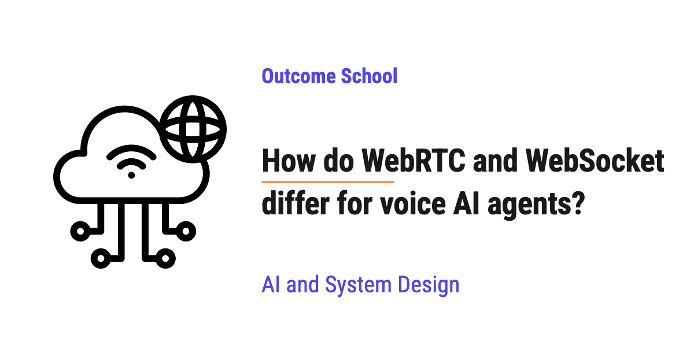

# How do WebRTC and WebSocket differ for voice AI agents?

> Archived from <https://outcomeschool.com/blog/webrtc-vs-websocket-for-voice-ai> on 2026-11-25.

WebRTC and WebSocket are two ways to carry live audio between a user and a voice AI agent. WebSocket sends every piece of audio over one reliable connection and waits for anything that is lost, while WebRTC is built for live voice, so it skips lost or late audio and keeps the conversation moving.

In this blog, we will learn about how WebRTC and WebSocket differ for voice AI agents. We will also see what a voice AI agent needs from the network, how WebSocket carries audio, how WebRTC carries audio, why a lost packet hurts one of them more than the other, what extra work WebRTC does for voice, and when to use which one.

We will cover the following:
<ul><li>What a voice AI agent needs from the network</li><li>How audio travels over the internet</li><li>What is WebSocket?</li><li>How a voice agent uses WebSocket</li><li>What is WebRTC?</li><li>How a voice agent uses WebRTC</li><li>What happens when a packet is lost</li><li>The extra work WebRTC does for voice</li><li>WebRTC vs WebSocket</li><li>When to use which one</li></ul>
I am <strong>Amit Shekhar</strong>, Founder @ <a target="_blank" rel="noopener noreferrer" href="https://outcomeschool.com">Outcome School</a>, I have taught and mentored many developers, and their efforts landed them high-paying tech jobs, helped many tech companies in solving their unique problems, and created many open-source libraries being used by top companies. I am passionate about sharing knowledge through open-source, blogs, and videos.

I teach <a target="_blank" rel="noopener noreferrer" href="https://outcomeschool.com/program/ai-and-machine-learning">AI and Machine Learning</a> at Outcome School.

Let&#x27;s get started.
<h2 id="what-a-voice-ai-agent-needs-from-the-network">What a voice AI agent needs from the network</h2>
A <strong><a target="_blank" rel="noopener noreferrer" href="design-a-real-time-voice-ai-agent.md">voice AI agent</a></strong> is a system that listens to a person, understands what they said, and speaks back in a natural voice. We talk to it the same way we talk to a person on a phone call.

Let&#x27;s say we open an app and say, &quot;What is the weather in Delhi today?&quot; The following things happen:
<ul><li>Our microphone captures our voice.</li><li>Our voice travels over the internet to the agent&#x27;s server.</li><li>The agent understands the question and prepares a reply.</li><li>The reply audio travels back over the internet to our device.</li><li>Our speaker plays the reply.</li></ul>
The agent can be very smart, but if the audio is slow to travel in either direction, the conversation feels broken. A gap of even one or two seconds feels awkward in a live conversation. We have a detailed blog on <a target="_blank" rel="noopener noreferrer" href="voice-agent-latency-budget.md">how to build a latency budget for a voice AI agent</a> that explains where every millisecond of this delay goes.

So, the network must give the voice agent three things:
<ul><li><strong>Low delay:</strong> audio must reach the other side as fast as possible.</li><li><strong>Steady flow:</strong> audio must keep flowing without long freezes.</li><li><strong>Both directions at once:</strong> the user can talk while the agent is talking, for example to <a target="_blank" rel="noopener noreferrer" href="what-is-barge-in-in-a-voice-ai-agent.md">interrupt it</a>.</li></ul>
Both WebRTC and WebSocket can carry audio in both directions at the same time. The difference is in how they handle delay and problems on the network. To understand that, we must first see how audio travels over the internet.
<h2 id="how-audio-travels-over-the-internet">How audio travels over the internet</h2>
Our voice is a continuous sound. The device records it and <a target="_blank" rel="noopener noreferrer" href="audio-frames-and-chunk-sizes.md">cuts it into small pieces</a>, for example 20 milliseconds of sound in each piece. Each piece is put inside a <strong>packet</strong> and sent over the internet.

So, one second of speech becomes around 50 packets, one after another.

These packets share the internet with everyone else. On the way, the following problems happen:
<ul><li>Some packets arrive late.</li><li>Some packets arrive in the wrong order.</li><li>Some packets get lost and never arrive.</li></ul>
There are two main rules, called <strong>protocols</strong>, for sending packets, and each one handles these problems differently.

<strong>TCP</strong> is the careful rule. It makes sure every packet arrives, and in the correct order. If a packet is lost, TCP asks for it again and holds back all the packets behind it until the lost one arrives.

<strong>UDP</strong> is the fast rule. It sends packets and does not wait. If a packet is lost, UDP does not resend it. The receiver gets whatever arrives.

Let&#x27;s say someone is reading a long message to us over a loudspeaker. With TCP, if we miss one word, everything stops until that word is repeated, and only then the reading continues. With UDP, if we miss one word, the reader does not stop. They keep going, and we understand the meaning from the words around it.

For a file download, TCP is perfect, because we need every byte. For a live voice, it is different. A piece of audio that arrives one second late is useless, because the conversation has already moved on.

Now, we know the two rules. WebSocket is built on TCP, and WebRTC sends its audio over UDP. Let&#x27;s understand each of them.
<h2 id="what-is-websocket">What is WebSocket?</h2>
<strong>WebSocket is a way to keep one connection open between a client, such as the user&#x27;s app, and a server, so that both sides can send messages to each other at any time.</strong>

Normally, the web works in a <a target="_blank" rel="noopener noreferrer" href="http-request-long-polling-websocket-sse.md">request-and-response style</a>. The client asks, the server answers, and that exchange ends.

WebSocket changes this. The client opens one connection, and it stays open. The connection starts as a normal web request, and then both sides agree to switch it to a WebSocket. Now, the server can push a message to the client whenever it wants, and the client can push a message to the server whenever it wants.

WebSocket runs on top of TCP. Means, every message we send over a WebSocket arrives completely, and in the same order in which we sent it.

WebSocket is simple to use. Almost every programming language and every browser supports it, and it talks directly to our server.

<strong>Planning your move into AI?</strong>

No matter which tech domain you work in today, with your effort, you can transition to these roles:
<ul><li>AI Engineer</li><li>Forward Deployed Engineer</li><li>AI Agent Engineer</li><li>Harness Engineer</li><li>Voice AI Engineer</li><li>AI Architect</li><li>LLM Engineer</li><li>LLM Inference Engineer</li><li>Gen AI Engineer</li><li>MLOps Engineer</li><li>ML Engineer</li><li>Deep Learning Engineer</li></ul>
Our <a target="_blank" rel="noopener noreferrer" href="https://outcomeschool.com/program/ai-and-machine-learning">AI and Machine Learning Program</a> at Outcome School takes you there.
<h2 id="how-a-voice-agent-uses-websocket">How a voice agent uses WebSocket</h2>
The best way to learn this is by taking an example.

Consider there is a user with a browser and a voice agent on a server. The flow is like below:

<pre><code class="code-highlight">+--------------------------+
| User&#x27;s microphone        |
+--------------------------+
             ↓
+--------------------------+
| Cut audio into chunks    |
+--------------------------+
             ↓
+--------------------------+
| Send chunks on WebSocket |
+--------------------------+
             ↓
+--------------------------+
| Voice agent on server    |
+--------------------------+
</code></pre>

The reply comes back over the same WebSocket in the opposite direction.

Here, our code does all the work by itself:
<ul><li>Our code reads raw audio from the microphone.</li><li>Our code cuts it into chunks, for example 20 to 100 milliseconds each.</li><li>Our code sends each chunk as a WebSocket message, often with a small label that says &quot;this is audio&quot;.</li><li>The server sends back reply audio as messages, and our code plays them in order.</li></ul>
Let&#x27;s see a simple sketch of the client side in JavaScript as below:

<pre><code class="code-highlight language-javascript">const socket = new WebSocket(&#x27;wss://our-agent.example.com/voice&#x27;)

// send every small audio chunk to the agent
function onAudioChunk(chunk) {
  socket.send(chunk)
}

// play every audio chunk that comes back
socket.onmessage = (event) =&gt; {
  playAudio(event.data)
}
</code></pre>

Here, we have opened one WebSocket connection to our agent. The <code>wss://</code> at the start means a secure WebSocket connection. Every time the microphone gives us a small chunk, we send it. Every time the agent sends a chunk back, we play it. The <code>playAudio</code> function is our own code, and it must handle the timing and smooth playback by itself.

This works well on a good network. The problem starts when the network is not good.

Now that we have learned about WebSocket, it&#x27;s time to learn about WebRTC.
<h2 id="what-is-webrtc">What is WebRTC?</h2>
<strong>WebRTC (Web Real-Time Communication) is an open standard for sending live audio, video, and data between devices with very low delay.</strong>

It was designed for <a target="_blank" rel="noopener noreferrer" href="voice-and-video-call.md">audio and video calls</a> in the browser. It is built into all major browsers, and there are libraries for mobile apps and servers.

WebRTC is not one single thing. It is a complete package for live media. It includes:
<ul><li>A way to send audio and video over UDP, so that late packets do not block new ones.</li><li>Encryption, so that the audio is always protected while it travels.</li><li>A way to find a path between two devices, even when they sit behind home routers and office firewalls.</li><li>Tools that measure the network and adjust the audio quality when the network gets worse.</li><li>Audio cleanup in the browser, such as echo cancellation and noise suppression.</li></ul>
WebRTC also has a <strong>data channel</strong>, which can send text and other data next to the audio. A voice agent can use it to send events like &quot;the user started speaking&quot; or the text of the reply.

<strong>A quick note for you</strong>

No matter which tech domain you work in, get familiar with these topics:
<ul><li>LLM</li><li>RAG</li><li>MCP</li><li>Agent</li><li>Fine-tuning</li><li>Quantization</li></ul>
We put it all together in one video:

<a target="_blank" rel="noopener noreferrer" href="https://www.youtube.com/watch?v=lnfWvX66FUk">AI Engineering Explained: LLM, RAG, MCP, Agent, Fine-Tuning, and Quantization</a>

No need to stop reading - bookmark it and watch later when you get time. Future you will thank you.

Now, let&#x27;s get back to the topic.
<h2 id="how-a-voice-agent-uses-webrtc">How a voice agent uses WebRTC</h2>
Again consider there is a user with a browser and a voice agent on a server.

With WebRTC, the two sides first need to agree on how to talk. They exchange a short description of the call, such as which audio format to use and which network addresses to try. This step is called <strong>signaling</strong>. WebRTC does not define how signaling happens, so it is usually done with a normal HTTP request or a WebSocket.

After signaling, the audio flows as a live media stream, like below:

<pre><code class="code-highlight">+------------------------------+
| User&#x27;s microphone            |
+------------------------------+
               ↓
+------------------------------+
| Echo cancel + noise suppress |
+------------------------------+
               ↓
+------------------------------+
| Encode with Opus codec       |
+------------------------------+
               ↓
+------------------------------+
| Send over UDP, encrypted     |
+------------------------------+
               ↓
+------------------------------+
| Voice agent on server        |
+------------------------------+
</code></pre>

Here, the browser does most of the work for us. We hand the microphone to WebRTC, and it cleans the audio, compresses it with the <a target="_blank" rel="noopener noreferrer" href="opus-codec.md"><strong>Opus</strong> codec</a>, and sends it. A <strong>codec</strong> is a tool that shrinks audio so that it needs fewer bytes, and Opus works very well for speech with low delay.

On the receiving side, WebRTC uses a <a target="_blank" rel="noopener noreferrer" href="jitter-buffer.md"><strong>jitter buffer</strong></a>. <strong>Jitter</strong> means the uneven changes in how long each packet takes to arrive. The jitter buffer holds incoming audio for a very short time, so that packets that arrive a little late or out of order can be put back in the right place before playing. The size of this buffer grows and shrinks with the network.

So, with WebRTC, we do not write the timing and playback logic by ourselves. It comes built in.

Now, let&#x27;s see the most important difference between the two.
<h2 id="what-happens-when-a-packet-is-lost">What happens when a packet is lost</h2>
Let&#x27;s say the user is speaking, and the device sends five audio packets: 1, 2, 3, 4, and 5. On the way, packet 2 gets lost.

With WebSocket over TCP:
<ul><li>Packet 1 arrives and is handed to the agent.</li><li>Packet 2 is lost. TCP notices and asks for it again.</li><li>Packets 3, 4, and 5 arrive, but TCP holds them back, because they must be delivered in order.</li><li>The resent packet 2 arrives later, after at least one more trip across the network.</li><li>Only now, packets 2, 3, 4, and 5 are handed over together.</li></ul>
This waiting is called <strong>head-of-line blocking</strong>. One lost packet blocks every packet behind it. The audio freezes for a moment, and then a burst of old audio arrives at once. The voice agent hears the user late, and the user hears the agent&#x27;s reply late.

Packet loss is rare on a stable connection. But on a weak mobile network, with many lost packets, these small freezes add up, and the audio can fall further and further behind.

With WebRTC over UDP:
<ul><li>Packet 1 arrives and is handed to the agent.</li><li>Packet 2 is lost. Nobody waits for it.</li><li>Packets 3, 4, and 5 arrive and are handed over on time.</li><li>To cover the gap of packet 2, WebRTC fills in a short guessed sound based on the audio just before it. This is called <strong><a target="_blank" rel="noopener noreferrer" href="packet-loss-concealment.md">packet loss concealment</a></strong>.</li></ul>
A missing 20 milliseconds is so short that the listener usually does not notice it. The conversation stays on time.

This is how WebRTC keeps the delay low on a bad network. It accepts a tiny loss of quality in return for a steady, live flow of audio.

If we want to go deep into AI and ML System Design and how to Design a Real-Time Voice AI Agent, our <a target="_blank" rel="noopener noreferrer" href="https://outcomeschool.com/program/ai-and-machine-learning">AI and Machine Learning Program</a> at Outcome School covers them from the ground up.
<h2 id="the-extra-work-webrtc-does-for-voice">The extra work WebRTC does for voice</h2>
Apart from UDP, WebRTC gives a voice agent many features that we would have to build by ourselves with WebSocket.

<strong>Echo cancellation:</strong> When the agent speaks through the user&#x27;s speaker, the microphone picks up that sound again. Without echo cancellation, the agent hears its own voice and thinks the user is interrupting. WebRTC in the browser removes this echo.

<strong>Noise suppression and gain control:</strong> WebRTC lowers background noise and keeps the voice at a steady loudness. This helps the speech recognition part of the agent.

<strong>Adapting to the network:</strong> WebRTC watches how many packets are lost and how long they take. When the network gets worse, it lowers the audio quality to keep the audio flowing, and raises it again when the network improves. This is called <strong>congestion control</strong>.

<strong>Recovering lost audio:</strong> Opus can add a little extra information to each packet about the previous one. If one packet is lost, the receiver can rebuild a rough version of it from the next packet. This is called <strong>forward error correction</strong>.

<strong>Finding a path:</strong> Most devices sit behind a home router or a firewall. WebRTC uses helper servers called <strong>STUN</strong> and <strong>TURN</strong> to find a working path. STUN helps a device learn its public address, which is the address that the rest of the internet sees, and TURN relays the audio when a direct path is not possible.

With WebSocket, most of these are not available. We can ask the browser&#x27;s microphone for echo cancellation and noise suppression, but the timing, the buffering, the recovery from loss, and the adjustment to the network are all our own job.

But WebRTC has a cost too. It has many moving parts: signaling, STUN and TURN servers, encryption keys, and media servers. It is harder to set up and harder to debug than a WebSocket. And on the server side, we need a WebRTC library or a media server that understands all of this.
<h2 id="webrtc-vs-websocket">WebRTC vs WebSocket</h2>
Let me tabulate the differences between WebRTC and WebSocket for your better understanding so that you can decide which one to use based on your use case.
<table><thead><tr><th>Point</th><th>WebSocket</th><th>WebRTC</th></tr></thead><tbody><tr><td>Built on</td><td>TCP</td><td>UDP for audio</td></tr><tr><td>Lost packet</td><td>Resent, and later packets wait</td><td>Skipped, and the gap is filled in</td></tr><tr><td>Delay on a bad network</td><td>Grows with freezes and bursts</td><td>Stays low with a small quality loss</td></tr><tr><td>Audio cleanup</td><td>Browser mic settings only</td><td>Echo cancellation and noise suppression</td></tr><tr><td>Timing and playback</td><td>Our own job</td><td>Jitter buffer built in</td></tr><tr><td>Network adaptation</td><td>Our own job</td><td>Congestion control built in</td></tr><tr><td>Setup</td><td>Simple, one connection</td><td>Signaling, STUN, TURN, media server</td></tr><tr><td>Best fit</td><td>Server to server, stable networks</td><td>Users on browsers and mobile apps</td></tr></tbody></table>
<strong>Stay updated:</strong> Subscribe to our <a target="_blank" rel="noopener noreferrer" href="https://outcomeschool.substack.com/subscribe">newsletter</a> to get our latest AI and Machine Learning blogs straight to your inbox.
<h2 id="when-to-use-which-one">When to use which one</h2>
Now, the question is: which one must we pick for our voice AI agent?

<strong>Use WebRTC when the audio comes from the user&#x27;s device.</strong> A user on a phone or a laptop is on a network that we do not control. It can be weak Wi-Fi, a moving train, or a crowded mobile network. Here, WebRTC keeps the delay low, removes the echo, and handles packet loss. This is why realtime voice APIs commonly recommend WebRTC for browser and mobile clients.

<strong>Use WebSocket when the audio moves between servers.</strong> Let&#x27;s say our backend receives the user&#x27;s audio and passes it to a speech model in the cloud. Both servers sit in data centers with fast and stable networks. Packet loss is very rare, so head-of-line blocking rarely hurts, and the simplicity of WebSocket matters more. This is why realtime voice APIs commonly offer a WebSocket connection for server-to-server use.

<strong>Use WebSocket for phone calls coming through a telephony provider.</strong> When a user calls a phone number, <a target="_blank" rel="noopener noreferrer" href="phone-calls-in-voice-agents.md">the phone network carries the call to the telephony provider</a>, which is a company that connects phone calls to the internet. The provider then often streams that call audio to our server over a WebSocket. Here, the phone network already carries the call from the user, and the last step is between two servers.

<strong>Use WebSocket for a quick prototype.</strong> When we are building and testing an idea, WebSocket lets us get a working voice agent quickly. Later, when real users start using it on real networks, we can move the user-facing part to WebRTC.

A common setup in production uses both: WebRTC between the user and our media server, and WebSocket between our server and the AI models behind it.

Now we must have understood how WebRTC and WebSocket differ for voice AI agents, why a lost packet affects them differently, and when to use which one.
<h2 id="frequently-asked-questions">Frequently Asked Questions</h2><h3 id="what-is-head-of-line-blocking">What is head-of-line blocking?</h3>
Head-of-line blocking happens when one lost packet blocks every packet behind it. WebSocket runs on TCP, and TCP delivers packets in order, so it holds back the later packets until the lost one is resent and arrives. For a voice agent, this means the audio freezes for a moment, and then a burst of old audio arrives at once.
<h3 id="how-does-webrtc-signaling-work">How does WebRTC signaling work?</h3>
Signaling is the first step, where the two sides exchange a short description of the call, such as which audio format to use and which network addresses to try. WebRTC does not define how signaling happens. So, it is usually done with a normal HTTP request or a WebSocket, and the audio starts flowing after it.
<h3 id="can-a-voice-ai-agent-use-both-webrtc-and-websocket-together">Can a voice AI agent use both WebRTC and WebSocket together?</h3>
Yes. A common setup in production uses both. WebRTC carries the audio between the user and our media server, because the user&#x27;s network is not under our control. WebSocket carries the audio between our server and the AI models behind it, because servers in data centers have fast and stable networks.
<h3 id="why-does-a-voice-ai-agent-need-echo-cancellation">Why does a voice AI agent need echo cancellation?</h3>
A voice AI agent needs echo cancellation because the microphone picks up the agent&#x27;s own voice from the user&#x27;s speaker. Without it, the agent hears itself and thinks the user is interrupting. WebRTC in the browser removes this echo, while with WebSocket we can only ask the browser&#x27;s microphone for echo cancellation.

That&#x27;s it for now.

Thanks

<strong>Amit Shekhar</strong> Founder @ <a target="_blank" rel="noopener noreferrer" href="https://outcomeschool.com">Outcome School</a>

You can connect with me on:
<ul><li><a target="_blank" rel="noopener noreferrer" href="https://x.com/amitiitbhu">X</a></li><li><a target="_blank" rel="noopener noreferrer" href="https://www.linkedin.com/in/amit-shekhar-iitbhu">LinkedIn</a></li><li><a target="_blank" rel="noopener noreferrer" href="https://github.com/amitshekhariitbhu">GitHub</a></li></ul>
Follow Outcome School on:
<ul><li><a target="_blank" rel="noopener noreferrer" href="https://x.com/outcome_school">X</a></li><li><a target="_blank" rel="noopener noreferrer" href="https://youtube.com/@OutcomeSchool">YouTube</a></li><li><a target="_blank" rel="noopener noreferrer" href="https://www.linkedin.com/company/outcomeschool">LinkedIn</a></li><li><a target="_blank" rel="noopener noreferrer" href="http://github.com/OutcomeSchool">GitHub</a></li></ul>
<a target="_blank" rel="noopener noreferrer" href="https://outcomeschool.com/blog"><strong>Read all of our high-quality blogs here.</strong></a>

