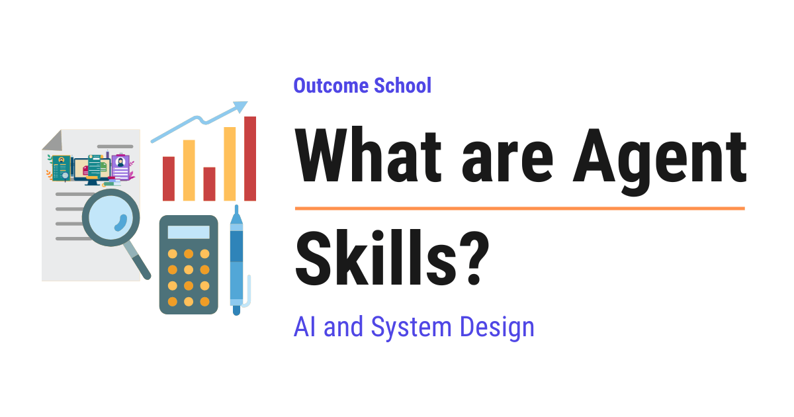

# What are Agent Skills?

> Archived from <https://outcomeschool.com/blog/what-are-agent-skills> on 2026-11-25.

An Agent Skill is a folder of instructions, and optionally scripts and reference files, that an AI agent loads by itself only when the task actually needs it.

In this blog, we will learn about Agent Skills. We will also see why we need them, what is inside a Skill, how the description makes an agent pick up the right Skill by itself, how progressive disclosure keeps the context window free, how Agent Skills differ from MCP, and how we can create our own Skill.

We will cover the following:
<ul><li>The problem before Agent Skills</li><li>What are Agent Skills?</li><li>What is inside a Skill?</li><li>The description is the trigger</li><li>Progressive disclosure, the main idea</li><li>A Skill can carry real code</li><li>Where Skills live</li><li>How do we create our own Skill?</li><li>Agent Skills vs MCP</li><li>A real example</li><li>Importance of Agent Skills</li><li>Things we must be careful about</li><li>Summary</li></ul>
I am <strong>Amit Shekhar</strong>, Founder @ <a target="_blank" rel="noopener noreferrer" href="https://outcomeschool.com">Outcome School</a>, I have taught and mentored many developers, and their efforts landed them high-paying tech jobs, helped many tech companies in solving their unique problems, and created many open-source libraries being used by top companies. I am passionate about sharing knowledge through open-source, blogs, and videos.

I teach <a target="_blank" rel="noopener noreferrer" href="https://outcomeschool.com/program/ai-and-machine-learning">AI and Machine Learning</a> at Outcome School.

Let&#x27;s get started.
<h2 id="the-problem-before-agent-skills">The problem before Agent Skills</h2>
Before jumping into Agent Skills, we must understand the problem they solve.

An <a target="_blank" rel="noopener noreferrer" href="ai-agent.md">AI agent</a> is an AI that takes actions step by step to finish a job for us. It can read files, run commands, and use tools.

Now, an agent is very capable in general, but it does not know how our team does things. It does not know our company&#x27;s report format. It does not know the exact steps our team follows to release software. It does not know that our brand never uses a certain word.

So, what do we do? We type all of it into the chat, every single time.

We must have faced this. We explain the same eight steps on Monday. We explain them again on Wednesday. We explain them once more the next week to a teammate. The knowledge lives in our head, and we keep paying the cost of typing it out.

<pre><code class="code-highlight">   Monday:     we type the 8 steps again
   Wednesday:  we type the 8 steps again
   Next week:  our teammate types the 8 steps again
</code></pre>

Here, we can see the waste. The knowledge is stable, but the effort repeats forever.

Now, we can think that the answer is simple. Let&#x27;s write all of it into one big instruction file, and keep that file loaded at all times.

But, here is the catch. That does not work either, and we must understand why.

An agent reads everything through a limited space called the <strong><a target="_blank" rel="noopener noreferrer" href="context-window.md">context window</a></strong>. Think of it as the agent&#x27;s desk. Only so many pages fit on the desk at one time. Every instruction we keep loaded occupies that desk space forever, even when it has nothing to do with the current job. Load twenty procedures, and the agent is reading nineteen irrelevant ones while trying to do the twentieth.

Deciding what deserves that limited space is a discipline of its own. We have a detailed blog on <a target="_blank" rel="noopener noreferrer" href="context-engineering.md">Context Engineering</a> that covers this end to end.

So, we need a way to give the agent deep knowledge without keeping all of it on the desk at all times.

We needed a solution for that. So, here come Agent Skills to the rescue.
<h2 id="what-are-agent-skills">What are Agent Skills?</h2>
<strong>An Agent Skill is a folder of instructions, and optionally scripts and reference files, that an AI agent loads by itself only when the task actually needs it.</strong>

Agent Skills were introduced by Anthropic in October 2025, and the format is open, so anyone can write one and anyone can use one.

In simple words, a Skill is a set of written instructions that teaches an agent how to do one particular job well. We write it once, and the agent picks it up on its own whenever that job comes up.

Let&#x27;s decompose the term for the sake of understanding.
<blockquote>
Agent Skills = Agent + Skills
</blockquote>
The <strong>agent</strong> is the AI that does the work. A <strong>skill</strong> is one specific ability it has learned. So, Agent Skills are simply the specific abilities we hand to our agent.

Consider a new employee joining our team. They are already smart and already know their profession. But they do not know our office. So, we do not retrain them from zero. We hand them our team handbook. Inside that handbook, there are separate chapters. One chapter for filing an expense. One chapter for releasing software. One chapter for writing a report.

The new employee does not read the whole handbook every morning. They open one chapter, only when they face that particular job.

A Skill is exactly one such chapter. And the agent is smart enough to open the right chapter by itself.
<h2 id="what-is-inside-a-skill">What is inside a Skill?</h2>
Now, let&#x27;s open a Skill and see what is inside. A Skill is just a folder on a computer, which means we can read it, edit it, and share it like any other folder.

Inside that folder, there is one required file called <code>SKILL.md</code>. The <code>.md</code> ending means it is a markdown file, which is simply a plain text file with light formatting. <strong>Note:</strong> There is nothing special or secret about it. We can open it in any text editor.

A <code>SKILL.md</code> file has two parts.

The first part sits at the very top, between two lines of dashes. This top part is called the <strong>frontmatter</strong>, and it holds the labels that describe the Skill. The two important labels are the <code>name</code> and the <code>description</code>.

The second part is the body, which is everything below the frontmatter. The body holds the actual instructions, written in plain English.

Let&#x27;s see a small one as below:

<pre><code class="code-highlight language-markdown">---
name: weekly-report
description: Creates the weekly team report in our company format. Use this whenever the user asks for a weekly report or a team update.
---

# Weekly report

Follow these steps.

First, collect all the tasks finished in the last seven days.
Then, group them under three headings: Shipped, In Progress, and Blocked.
After that, write one short line for each task. Never write more than one line.
Finally, put the total count at the top.

Never include internal ticket numbers in the final report.
</code></pre>

Here, we can see the whole idea in one small file. The top part tells the agent what this Skill is and when to reach for it. The body tells the agent exactly how to do the job. Both parts are plain English, and we did not write a single line of programming code.

<strong>Note:</strong> The <code>name</code> must be written in small letters, with hyphens in place of spaces, like <code>weekly-report</code>. The <code>description</code> is plain English, and we must keep it short enough to read in one breath.

A Skill folder can also hold other files next to <code>SKILL.md</code>, like a reference document, a template, or a script. We will come to those shortly.
<h2 id="the-description-is-the-trigger">The description is the trigger</h2>
Now, the most important question is: how does the agent know when to use our Skill?

The answer is the <code>description</code>.

The agent reads the <code>name</code> and the <code>description</code> of every available Skill. Then, when we ask for something, it compares our request against those descriptions and decides which Skill fits.

So, the <code>description</code> is not decoration. It is the trigger. A vague description means the Skill sits unused. A clear description means the Skill fires at the right moment.

Let&#x27;s compare two descriptions.

<pre><code class="code-highlight">   Weak:    &quot;Report helper.&quot;
            The agent cannot tell when this applies. It stays unused.

   Strong:  &quot;Creates the weekly team report in our company format.
             Use this whenever the user asks for a weekly report
             or a team update.&quot;
            The agent knows exactly what it does and when to use it.
</code></pre>

Here, we can see the difference clearly. The strong one says what the Skill does and when to use it. Those are the two things the agent needs.

<strong>Note:</strong> We must write the description for the agent to read, not for a human to admire.

<strong>Planning your move into AI?</strong>

No matter which tech domain you work in today, with your effort, you can transition to these roles:
<ul><li>AI Engineer</li><li>Forward Deployed Engineer</li><li>AI Agent Engineer</li><li>Harness Engineer</li><li>Voice AI Engineer</li><li>AI Architect</li><li>LLM Engineer</li><li>LLM Inference Engineer</li><li>Gen AI Engineer</li><li>MLOps Engineer</li><li>ML Engineer</li><li>Deep Learning Engineer</li></ul>
Our <a target="_blank" rel="noopener noreferrer" href="https://outcomeschool.com/program/ai-and-machine-learning">AI and Machine Learning Program</a> at Outcome School takes you there.
<h2 id="progressive-disclosure-the-main-idea">Progressive disclosure, the main idea</h2>
Now, we come to the heart of Agent Skills. This one idea is what makes them work, so let&#x27;s go slowly.

Remember our problem. The agent&#x27;s desk is small, and we cannot keep everything on it.

Agent Skills solve this with something called <strong>progressive disclosure</strong>. The words sound heavy, but the idea is simple. It means revealing information in stages, and only as much as is needed right now.

It works in three levels.

<strong>Level 1.</strong> At the start, the agent loads only the <code>name</code> and the <code>description</code> of each Skill. That is a couple of lines each. So even fifty Skills cost almost nothing on the desk. At this point the agent knows only that the Skill exists, and nothing more about it.

<strong>Level 2.</strong> We ask for something. The agent matches our request to a description and decides this Skill is needed. Only now does it read the full body of <code>SKILL.md</code>. The detailed instructions arrive exactly when they become useful.

<strong>Level 3.</strong> If the body points to another file in the folder, like a long reference document, the agent opens that file only if it actually needs it.

<pre><code class="code-highlight">   Level 1  -&gt;  name + description only          (always loaded, tiny)
   Level 2  -&gt;  the full SKILL.md instructions   (loaded when it matches)
   Level 3  -&gt;  extra files in the folder        (loaded only if needed)
</code></pre>

Let&#x27;s put some real numbers on this, because they show why it works so well.

The unit we measure desk space in is called a <strong>token</strong>, which is roughly a piece of a word. Level 1 costs only about a hundred tokens for each Skill. Level 2, the full body, is normally kept under five thousand tokens, and we pay that cost only for the one Skill we are actually using.

Now, let&#x27;s compare the two numbers, because the comparison is striking. Fifty Skills at Level 1 cost around five thousand tokens in total. That is the same as the body of one single Skill. So knowing that fifty procedures exist costs us no more than reading one of them in full.

Here, we can see why this is clever. The agent behaves as if it knows fifty procedures in depth, while its desk stays almost empty. Nothing is loaded until it earns its place.

This is exactly what a good handbook does. The table of contents is short and always in front of us. The chapter is long, and we open it only when we need it.

<strong>A quick note for you</strong>

No matter which tech domain you work in, get familiar with these topics:
<ul><li>LLM</li><li>RAG</li><li>MCP</li><li>Agent</li><li>Fine-tuning</li><li>Quantization</li></ul>
We put it all together in one video:

<a target="_blank" rel="noopener noreferrer" href="https://www.youtube.com/watch?v=lnfWvX66FUk">AI Engineering Explained: LLM, RAG, MCP, Agent, Fine-Tuning, and Quantization</a>

No need to stop reading - bookmark it and watch later when you get time. Future you will thank you.

Now, let&#x27;s get back to the topic.
<h2 id="a-skill-can-carry-real-code">A Skill can carry real code</h2>
Now, let&#x27;s learn one more thing that makes Skills powerful.

A Skill folder can hold a script, which is a small program that can be run. When the job involves an exact, repeatable operation, we put a script in the folder and the instructions tell the agent to run it.

Now, why does this matter so much? Let&#x27;s understand the difference.

Without a script, the agent has to write the code itself, every single time. It thinks, it writes, it sometimes writes it slightly differently, and it fills up the desk with all of that writing.

With a script, the agent runs one ready-made, tested file. The result is the same every time, and it costs almost nothing on the desk.

<pre><code class="code-highlight">   Without a script:  the agent writes the code again each time
                      (slower, and the result can vary)

   With a script:     the agent runs one tested file
                      (fast, and the result is the same every time)
</code></pre>

Here, we can see a simple rule. If the task needs judgment, we write instructions in plain English and let the agent think. If the task needs exactness, we write a script and let the agent run it.
<h2 id="where-skills-live">Where Skills live</h2>
Now, let&#x27;s see where we keep these folders. There are two common places, and the difference matters.

<strong>Personal Skills.</strong> These live in our own home folder, in a place like <code>~/.claude/skills/</code>. <strong>Note:</strong> That <code>~</code> symbol is just a short way of writing our home folder. These Skills are ours alone, and they are available in every project we work on. Good for our personal working habits.

<strong>Project Skills.</strong> These live inside the project itself, in a place like <code>.claude/skills/</code>. Because they sit inside the project, they travel along with it. When a teammate copies the project onto their own computer, they get all the Skills automatically, without anybody telling them.

<pre><code class="code-highlight">   ~/.claude/skills/   -&gt;  our personal Skills, in every project
   .claude/skills/     -&gt;  the project&#x27;s Skills, shared with the whole team
</code></pre>

Here, we can notice the real benefit of Project Skills. Our team&#x27;s knowledge stops living inside one person&#x27;s head and starts living inside the project, where everybody gets it for free.

The <code>.claude</code> name in these paths belongs to a coding agent that reads such folders at the start of a session. We have a detailed blog on <a target="_blank" rel="noopener noreferrer" href="how-does-claude-code-work.md">How does Claude Code work?</a> that explains how it picks up our project files.
<h2 id="how-do-we-create-our-own-skill">How do we create our own Skill?</h2>
Now, let&#x27;s create one ourselves. The best part is that there is nothing to install and no code to write.

<strong>Step 1:</strong> Inside our project, create a folder path <code>.claude/skills/</code>.

<strong>Step 2:</strong> Inside that, create one folder named after our Skill, like <code>weekly-report</code>.

<strong>Step 3:</strong> Inside that folder, create a file named <code>SKILL.md</code>.

<strong>Step 4:</strong> At the top of that file, write the frontmatter with the <code>name</code> and the <code>description</code>.

<strong>Step 5:</strong> Below the frontmatter, write the steps in plain English, exactly as we would explain them to a new teammate.

The whole thing will look like below:

<pre><code class="code-highlight">   our-project/
     .claude/
       skills/
         weekly-report/
           SKILL.md
</code></pre>

Here, we can see how small this really is. One folder and one text file, and our Skill is ready.

Now, here is the best way to write the body. We must imagine we are writing for a capable new teammate, somebody who already knows the profession but does not know our office. So, we skip everything they already know, and we write down only what is specific to us. That single habit produces good Skills.

To master Agent Architecture, Tool use in Agents, and Agentic AI, we can build an AI Coding Agent from scratch in our <a target="_blank" rel="noopener noreferrer" href="https://outcomeschool.com/program/ai-and-machine-learning">AI and Machine Learning Program</a> at Outcome School.
<h2 id="agent-skills-vs-mcp">Agent Skills vs MCP</h2>
Now, the following question arises. There is another thing called MCP that also gives an agent new abilities, so how are the two different?

First, let&#x27;s recall what MCP is. <strong>MCP</strong>, which stands for <a target="_blank" rel="noopener noreferrer" href="what-is-mcp-model-context-protocol.md">Model Context Protocol</a>, is one common standard that lets an AI application connect to outside tools and data, like our database or our GitHub.

Both are useful, and they are not competing at all. They answer two different questions.

<strong>MCP</strong> connects the agent to the outside world. It answers the question &quot;what can the agent reach?&quot; It gives the agent hands.

<strong>Agent Skills</strong> teach the agent our way of working. They answer the question &quot;how should the agent do this?&quot; They give the agent know-how, so it follows our exact steps and our exact format.

So, one gives reach and the other gives know-how.

Let me tabulate the differences between Agent Skills and MCP for your better understanding.
<table><thead><tr><th>Point</th><th>Agent Skills</th><th>MCP</th></tr></thead><tbody><tr><td>What it gives</td><td>Know-how, our steps and our format</td><td>Reach, a connection to outside systems</td></tr><tr><td>What it is made of</td><td>A folder of instructions, and sometimes scripts</td><td>A running program that offers tools and data</td></tr><tr><td>Question it answers</td><td>How should this be done?</td><td>What can the agent reach?</td></tr><tr><td>Needs a server running</td><td>No</td><td>Yes</td></tr><tr><td>Best for</td><td>Procedures, formats, style, checklists</td><td>Databases, apps, live data, actions</td></tr></tbody></table>
In real work we often use both together. MCP connects the agent to our issue tracker, and a Skill tells it how our team writes an issue.

There is also a third piece in this space, built almost exactly like a Skill. OKF (Open Knowledge Format) writes down the knowledge about our data as a folder of plain markdown files, so the agent knows what our tables actually mean. We have a detailed blog on <a target="_blank" rel="noopener noreferrer" href="what-is-okf-open-knowledge-format.md">What is OKF (Open Knowledge Format)?</a> that explains where it sits along with these two.

<strong>Stay updated:</strong> Subscribe to our <a target="_blank" rel="noopener noreferrer" href="https://outcomeschool.substack.com/subscribe">newsletter</a> to get our latest AI and Machine Learning blogs straight to your inbox.
<h2 id="a-real-example">A real example</h2>
The best way to learn this is by taking an example. Let&#x27;s follow one request from start to finish, using the <code>weekly-report</code> Skill from earlier.

<strong>Step 1:</strong> The session begins. The agent loads only the names and descriptions of the available Skills. Our <code>weekly-report</code> description is now known to it, but the instructions are not loaded yet.

<strong>Step 2:</strong> We type, &quot;prepare this week&#x27;s team update.&quot;

<strong>Step 3:</strong> The agent compares our sentence with the descriptions it holds. Our description mentions &quot;a weekly report or a team update&quot;, so it matches.

<strong>Step 4:</strong> The agent now reads the full body of <code>SKILL.md</code>. At this moment, it learns the three headings, the one-line rule, the total count at the top, and the rule about never including ticket numbers.

<strong>Step 5:</strong> It follows those steps and produces the report in our exact format.

Here, we can notice the best part. We never mentioned the format. We never mentioned the headings. We never reminded it about ticket numbers. We wrote all of that down once, weeks ago, and the agent applied it by itself at the right moment.

This way we can use Agent Skills to solve the interesting problem of teaching an agent our way of working, permanently, without repeating ourselves.

We have a complete program on AI Agents, Context Engineering, and Model Context Protocol (MCP) - check out our <a target="_blank" rel="noopener noreferrer" href="https://outcomeschool.com/program/ai-and-machine-learning">AI and Machine Learning Program</a> at Outcome School to learn all of these in depth.
<h2 id="importance-of-agent-skills">Importance of Agent Skills</h2>
Now, we have understood how Agent Skills work. Let&#x27;s see why they are important.
<ul><li><strong>Write once, use forever.</strong> We stop repeating the same instructions in every chat.</li><li><strong>The desk stays clean.</strong> Because of progressive disclosure, deep knowledge costs almost nothing until the moment it is used.</li><li><strong>Team knowledge becomes shared.</strong> A Project Skill turns one person&#x27;s experience into something the whole team gets automatically.</li><li><strong>No programming needed.</strong> A Skill is plain English in a plain text file. Anyone who can write clear steps can write one.</li><li><strong>They are portable.</strong> Because the format is open and it is just a folder, the same Skill works across different tools that support it.</li><li><strong>They compose.</strong> The agent can combine more than one Skill in a single job, using one for the format and another for the checks.</li></ul><h2 id="things-we-must-be-careful-about">Things we must be careful about</h2>
Skills change how an agent behaves, so we must use them with care.

<strong>A Skill can run code.</strong> If a Skill folder contains a script, the agent can run it. That is exactly like installing any program on our computer. So, we must use Skills only from sources we trust, and we must read a Skill before using it.

<strong>A vague description is a wasted Skill.</strong> This is the most common mistake. We write good instructions, but the description does not say when to use them, so the Skill never fires. If a Skill seems to be ignored, the description is almost always the reason.

<strong>Too long is as bad as too vague.</strong> The body must hold only what the agent cannot guess by itself, which means our steps, our format, and our rules. It must not explain general knowledge that the agent already has. A tight Skill beats a long one.

<strong>One Skill, one job.</strong> It feels tempting to put everything into one giant Skill. We must not do that. Many small and focused Skills match better and load less.

Here, we can see that the rule is simple. Keep each Skill small and specific, write the description for the agent, and trust only the Skills we have read.
<h2 id="summary">Summary</h2>
Let&#x27;s quickly recap what we have learned.
<ul><li>An agent does not know our team&#x27;s procedures, formats, and rules, so we end up typing them again and again.</li><li>We cannot simply keep everything loaded, because the agent&#x27;s context window is limited.</li><li>An Agent Skill is a folder of instructions, and optionally scripts and files, that the agent loads by itself only when the task needs it.</li><li>The folder needs one file called <code>SKILL.md</code>, which has a frontmatter with a <code>name</code> and a <code>description</code>, plus a body with the instructions.</li><li>The <code>description</code> is the trigger. The agent uses it to decide when the Skill applies.</li><li>Progressive disclosure works in three levels. Names and descriptions always, the full instructions when matched, and extra files only if needed.</li><li>A Skill can carry a script, so exact and repeatable work runs the same way every time.</li><li>Personal Skills live in our home folder, and Project Skills live in the project and travel to the whole team.</li><li>Creating one needs no installation and no code. One folder and one <code>SKILL.md</code> file is a complete Skill.</li><li>The best way to write a Skill is to write for a capable new teammate, skipping what they already know and recording only what is specific to us.</li><li>MCP gives the agent reach, while Skills give the agent know-how. We often use both together.</li></ul>
This is what Agent Skills are, a simple folder that turns our own way of working into something our agent knows and applies on its own.
<h2 id="frequently-asked-questions">Frequently Asked Questions</h2><h3 id="who-created-agent-skills">Who created Agent Skills?</h3>
Agent Skills were introduced by Anthropic in October 2025. The format is open, so anyone can write a Skill and anyone can use one. Because a Skill is just a folder with a <code>SKILL.md</code> file, the same Skill works across the different tools that support the format.
<h3 id="why-is-my-agent-skill-not-being-used-by-the-agent">Why is my Agent Skill not being used by the agent?</h3>
The reason is almost always a vague description. The agent decides when to use a Skill by comparing our request against each Skill&#x27;s description. If the description does not clearly say what the Skill does and when to use it, the Skill never fires, even when its instructions are good.
<h3 id="does-adding-many-skills-fill-up-the-context-window">Does adding many Skills fill up the context window?</h3>
No. At the start, the agent loads only the name and description of each Skill, which costs about a hundred tokens per Skill. So, fifty Skills cost around five thousand tokens in total. The full instructions of a Skill are loaded only when a request matches it.
<h3 id="can-an-agent-use-more-than-one-skill-in-a-single-task">Can an agent use more than one Skill in a single task?</h3>
Yes. Skills compose, so the agent can combine more than one Skill in a single job. For example, it can use one Skill for the format and another Skill for the checks. Also, many small and focused Skills match better and load less than one giant Skill.
<h3 id="is-it-safe-to-use-agent-skills-from-the-internet">Is it safe to use Agent Skills from the internet?</h3>
Only if we trust the source. A Skill folder can contain a script, and the agent can run it, which is exactly like installing a program on our computer. So, we must use Skills only from sources we trust, and we must read a Skill before using it.

That&#x27;s it for now.

Thanks

<strong>Amit Shekhar</strong> Founder @ <a target="_blank" rel="noopener noreferrer" href="https://outcomeschool.com">Outcome School</a>

You can connect with me on:
<ul><li><a target="_blank" rel="noopener noreferrer" href="https://x.com/amitiitbhu">X</a></li><li><a target="_blank" rel="noopener noreferrer" href="https://www.linkedin.com/in/amit-shekhar-iitbhu">LinkedIn</a></li><li><a target="_blank" rel="noopener noreferrer" href="https://github.com/amitshekhariitbhu">GitHub</a></li></ul>
Follow Outcome School on:
<ul><li><a target="_blank" rel="noopener noreferrer" href="https://x.com/outcome_school">X</a></li><li><a target="_blank" rel="noopener noreferrer" href="https://youtube.com/@OutcomeSchool">YouTube</a></li><li><a target="_blank" rel="noopener noreferrer" href="https://www.linkedin.com/company/outcomeschool">LinkedIn</a></li><li><a target="_blank" rel="noopener noreferrer" href="https://github.com/OutcomeSchool">GitHub</a></li></ul>
<a target="_blank" rel="noopener noreferrer" href="https://outcomeschool.com/blog"><strong>Read all of our high-quality blogs here.</strong></a>

