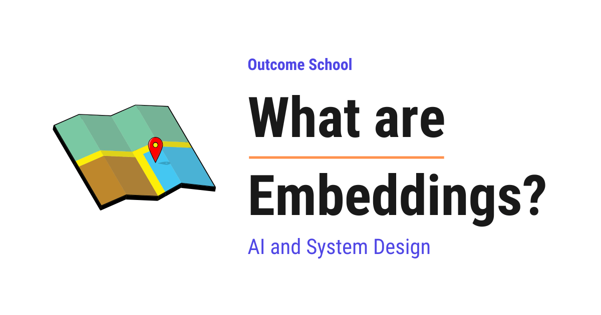

# What are Embeddings?

> Archived from <https://outcomeschool.com/blog/what-are-embeddings> on 2026-11-25.

An embedding is a list of numbers that represents the meaning of something, arranged so that things with similar meaning get similar numbers. In simple words, an embedding is meaning translated into numbers.

In this blog, we will learn about Embeddings, one of the most important ideas behind modern AI like search engines, <a target="_blank" rel="noopener noreferrer" href="recommendation-system.md">recommendations</a>, and chatbots. We will also see why a computer cannot compare meaning on its own, how an embedding turns meaning into numbers so that similar things sit close together, how we measure that closeness, and where we use embeddings in the real world.

We will cover the following:
<ul><li>The problem: computers cannot compare meaning</li><li>What are Embeddings?</li><li>A simple example with two numbers</li><li>Why we need many more than two numbers</li><li>How do we measure closeness?</li><li>Where do embeddings come from?</li><li>The famous word math example</li><li>Embeddings are not only for words</li><li>What we use embeddings for</li><li>Things we must be careful about</li><li>Summary</li></ul>
I am <strong>Amit Shekhar</strong>, Founder @ <a target="_blank" rel="noopener noreferrer" href="https://outcomeschool.com">Outcome School</a>, I have taught and mentored many developers, and their efforts landed them high-paying tech jobs, helped many tech companies in solving their unique problems, and created many open-source libraries being used by top companies. I am passionate about sharing knowledge through open-source, blogs, and videos.

I teach <a target="_blank" rel="noopener noreferrer" href="https://outcomeschool.com/program/ai-and-machine-learning">AI and Machine Learning</a> at Outcome School.

Let&#x27;s get started.
<h2 id="the-problem-computers-cannot-compare-meaning">The problem: computers cannot compare meaning</h2>
Before jumping into embeddings, we must understand the problem they solve.

A computer is brilliant at comparing numbers. Ask it whether 5 is bigger than 3, and it answers instantly. But a computer has no idea what words mean. To a computer, a word is just a set of letters.

Let&#x27;s see why that becomes a real problem.

Consider these two sentences.

<pre><code class="code-highlight">   Sentence A:  &quot;How do I reset my password?&quot;
   Sentence B:  &quot;I forgot my login details.&quot;
</code></pre>

We read them and see immediately that they are about the same thing. Now let&#x27;s look at them the way a plain computer does. It compares the letters. Not a single important word is shared. No &quot;reset&quot;, no &quot;password&quot;, no &quot;forgot&quot;, no &quot;login&quot; appears in both. So the computer concludes they have nothing in common.

Now consider another pair.

<pre><code class="code-highlight">   Sentence C:  &quot;The bank of the river was muddy.&quot;
   Sentence D:  &quot;I need to visit the bank today.&quot;
</code></pre>

Here, both sentences share the word &quot;bank&quot;. So the plain computer decides these two are related. But we know they are about completely different things, one about a riverside and one about money.

Here, we can see the problem clearly. Matching letters is not the same as understanding meaning. The computer got both cases backwards.

So, we need some way to hand the computer meaning in a form it is actually good at, which means numbers.

We needed a solution for that. So, here come embeddings to the rescue.
<h2 id="what-are-embeddings">What are Embeddings?</h2>
<strong>An embedding is a list of numbers that represents the meaning of something, arranged so that things with similar meaning get similar numbers.</strong>

In simple words, an embedding is meaning translated into numbers.

That is the whole idea, and everything else in this blog is just detail on top of it.

The word itself tells us what is happening. To <strong>embed</strong> something means to place it inside something else. We are taking a word, or a sentence, or a picture, and placing it inside a space made of numbers. Once it sits in that space, it has a position. And once things have positions, we can ask which ones are near each other.

This list of numbers has a name. A list of numbers is called a <strong>vector</strong>. So when somebody says &quot;the vector for this sentence&quot;, they mean exactly the same thing as &quot;the embedding for this sentence&quot;.

Let&#x27;s look at what it actually looks like.

<pre><code class="code-highlight">   &quot;How do I reset my password?&quot;   -&gt;   [0.21, -0.48, 0.83, 0.02, ... ]
   &quot;I forgot my login details.&quot;    -&gt;   [0.19, -0.44, 0.79, 0.05, ... ]
   &quot;The bank of the river.&quot;        -&gt;   [-0.71, 0.33, -0.12, 0.66, ... ]
</code></pre>

Here, we can notice the important part. The first two lists hold numbers that are close to each other, because the two sentences mean nearly the same thing. The third list looks completely different, because it means something else. The computer never had to understand English. It only has to notice that two lists of numbers are similar, and that is something a computer does perfectly.
<h2 id="a-simple-example-with-two-numbers">A simple example with two numbers</h2>
The best way to learn this is by taking an example. Real embeddings use hundreds of numbers, which we cannot picture, so let&#x27;s start with just two.

Suppose we want to place some fruits in a space. We choose two qualities and score each fruit from 0 to 10.
<ul><li>The first number is how sweet it is.</li><li>The second number is how big it is.</li></ul>
Let&#x27;s fill in the scores.

<pre><code class="code-highlight">   Fruit         Sweetness    Size        Embedding
   -----         ---------    ----        ---------
   Apple             7          5         [7, 5]
   Banana            8          5         [8, 5]
   Lemon             1          3         [1, 3]
   Watermelon        6         10         [6, 10]
</code></pre>

Now, each fruit has an embedding, which is simply its two scores written as a list. And because there are only two numbers, we can draw them on paper.

<pre><code class="code-highlight">   Size
    10 |                 W
       |
     8 |
       |
     5 |                    A  B
       |
     3 |  L
       |
     0 +--------------------------------- Sweetness
       0     2     4     6     8     10

   A = Apple [7, 5]        B = Banana [8, 5]
   L = Lemon [1, 3]        W = Watermelon [6, 10]
</code></pre>

Here, we can see something wonderful happen. We never told the computer that apples and bananas are similar fruits. We only gave it four pairs of numbers. And yet Apple and Banana have landed right next to each other, while Lemon sits far away in its own corner.

So now the computer can answer a real question. &quot;Which fruit is most like an apple?&quot; It does not need to know anything about fruit. It just measures which point is closest to <code>[7, 5]</code>, finds Banana at <code>[8, 5]</code>, and gives the right answer.

This is exactly how embeddings work. Meaning became position, and position can be measured.

<strong>Planning your move into AI?</strong>

No matter which tech domain you work in today, with your effort, you can transition to these roles:
<ul><li>AI Engineer</li><li>Forward Deployed Engineer</li><li>AI Agent Engineer</li><li>Harness Engineer</li><li>Voice AI Engineer</li><li>AI Architect</li><li>LLM Engineer</li><li>LLM Inference Engineer</li><li>Gen AI Engineer</li><li>MLOps Engineer</li><li>ML Engineer</li><li>Deep Learning Engineer</li></ul>
Our <a target="_blank" rel="noopener noreferrer" href="https://outcomeschool.com/program/ai-and-machine-learning">AI and Machine Learning Program</a> at Outcome School takes you there.
<h2 id="why-we-need-many-more-than-two-numbers">Why we need many more than two numbers</h2>
Now, two numbers were enough for fruit. But let&#x27;s see where two numbers break down.

With only sweetness and size, a lemon and a lime would get almost identical scores. They would sit on top of each other, and our computer would call them the same thing. We have no way to separate them, because we never gave it a number for color.

Language is far richer than fruit. A word carries a huge amount at once. Is it a thing or an action? Is it formal or casual? Is it positive or negative? Is it about people, or money, or nature, or time? Two numbers cannot hold all of that.

So, real embeddings use many more. A typical sentence embedding today has somewhere between 384 and 3072 numbers. Each of those numbers is called a <strong>dimension</strong>.

<pre><code class="code-highlight">   2 dimensions      -&gt;  a flat sheet of paper
   3 dimensions      -&gt;  a room
   768 dimensions    -&gt;  we cannot picture it, and that is fine
</code></pre>

<strong>Note:</strong> We must not try to picture 768 dimensions. Nobody can. The comforting part is that we do not need to. Everything we understood from the fruit drawing still holds true. Similar things are close, different things are far. The math for measuring distance works exactly the same, no matter how many numbers there are.

Now, one more honest point. In our fruit example, we chose the meaning of each number ourselves, sweetness and size. In a real embedding, nobody chooses.

The numbers come out of a trained <strong>model</strong>, which is a computer program that has learned patterns by studying an enormous number of examples. And here is the surprising part. No single one of those numbers stands for something we could name. Dimension 42 is not &quot;formality&quot;. The meaning is spread across all of them together, and we cannot point at one and say what it holds.

<strong>A quick note for you</strong>

No matter which tech domain you work in, get familiar with these topics:
<ul><li>LLM</li><li>RAG</li><li>MCP</li><li>Agent</li><li>Fine-tuning</li><li>Quantization</li></ul>
We put it all together in one video:

<a target="_blank" rel="noopener noreferrer" href="https://www.youtube.com/watch?v=lnfWvX66FUk">AI Engineering Explained: LLM, RAG, MCP, Agent, Fine-Tuning, and Quantization</a>

No need to stop reading - bookmark it and watch later when you get time. Future you will thank you.

Now, let&#x27;s get back to the topic.
<h2 id="how-do-we-measure-closeness">How do we measure closeness?</h2>
Now, we keep saying two embeddings are &quot;close&quot;. Let&#x27;s see how we actually measure that.

The straightforward way is to measure the plain distance between the two points, exactly as we would with a ruler on our fruit drawing. Apple is at <code>[7, 5]</code> and Banana is at <code>[8, 5]</code>, so they are 1 unit apart. Apple and Lemon are much further.

But in practice, the more common method is called <strong><a target="_blank" rel="noopener noreferrer" href="cosine-similarity.md">cosine similarity</a></strong>.

Let&#x27;s understand it simply. Instead of thinking of each embedding as a dot, we think of it as an arrow pointing out from the center. Cosine similarity ignores how long the arrows are, and only measures the angle between them.

<pre><code class="code-highlight">   Small angle between the arrows  -&gt;  very similar meaning
   Right angle between the arrows  -&gt;  unrelated
   Opposite directions             -&gt;  opposite meaning
</code></pre>

The result is a single number between -1 and 1.
<ul><li>A score near <strong>1</strong> means the two things mean nearly the same thing.</li><li>A score near <strong>0</strong> means they are unrelated.</li><li>A score near <strong>-1</strong> means they point in opposite directions.</li></ul>
Now, why do we prefer the angle over the plain distance? Because the length of the arrow often reflects something we do not care about, like how long the text was. A two-line answer and a two-page answer about the same topic should count as similar. Ignoring the length and keeping only the direction gives us that.

<strong>Note:</strong> In real use, we will rarely see scores anywhere near -1. With most modern text models, unrelated sentences still score around 0.1 to 0.3, and related ones score around 0.7 to 0.9. So we must not expect 0 to mean unrelated in practice. What matters is how the scores compare with each other, not the raw number on its own.

So, when a search system finds the best match for our question, this is all it is doing. It turns our question into an embedding, then finds the stored embedding with the highest cosine similarity.

To learn Embeddings and Vector Databases in depth, we cover both in our <a target="_blank" rel="noopener noreferrer" href="https://outcomeschool.com/program/ai-and-machine-learning">AI and Machine Learning Program</a> at Outcome School.
<h2 id="where-do-embeddings-come-from">Where do embeddings come from?</h2>
Now, the next big question is: who decides these numbers?

We do not write them by hand. They are produced by a trained model, called an <strong><a target="_blank" rel="noopener noreferrer" href="embedding-model.md">embedding model</a></strong>. We hand it a piece of text, and it hands back the list of numbers. There are many of these models available today, and we simply pick one and use it.

But how did that model learn to give good numbers? The idea behind it is beautifully simple.

The model reads an enormous amount of text, and it learns from one pattern: <strong>words that appear in similar situations tend to mean similar things.</strong>

This idea is old, and it was captured perfectly long before any of these models existed.
<blockquote>
You shall know a word by the company it keeps.

John Rupert Firth, linguist, 1957
</blockquote>
Let&#x27;s see this with an example.

<pre><code class="code-highlight">   &quot;I drank a cup of tea in the morning.&quot;
   &quot;I drank a cup of coffee in the morning.&quot;
   &quot;She poured the tea into a cup.&quot;
   &quot;She poured the coffee into a cup.&quot;
</code></pre>

Here, we can notice that &quot;tea&quot; and &quot;coffee&quot; keep turning up in the same kinds of sentences, surrounded by the same kinds of words. They get drunk, they get poured, they come in cups, they happen in the morning.

The model sees this happen millions of times across millions of sentences. So it places &quot;tea&quot; and &quot;coffee&quot; close together in the number space. It was never told that both are hot drinks. It worked that out purely from the company they keep.

And it does the opposite too. The word &quot;bicycle&quot; almost never appears in those same surroundings, so it lands far away.

This is how a machine builds something that behaves like an understanding of meaning, and that too without anybody explaining a single word to it.

We have a detailed blog on <a target="_blank" rel="noopener noreferrer" href="contrastive-learning.md">Contrastive Learning</a> that explains how a model is trained to pull similar things together and push different things apart.
<h2 id="the-famous-word-math-example">The famous word math example</h2>
Now, let&#x27;s look at the most famous demonstration of embeddings, because it shows how much structure is hidden inside these numbers.

Once words are positions in a space, we can do arithmetic on them. And something remarkable falls out.

<pre><code class="code-highlight">   king  -  man  +  woman   -&gt;  lands very close to  queen
</code></pre>

Let&#x27;s understand what happened. Take the position of &quot;king&quot;. Subtract the position of &quot;man&quot;, which removes the male part of the meaning. Add the position of &quot;woman&quot;, which adds the female part. The point we land on is closest to &quot;queen&quot;.

Similar patterns show up all over the place.

<pre><code class="code-highlight">   Paris  -  France  +  Italy   -&gt;  lands close to  Rome
</code></pre>

Here, subtracting France strips away the country, leaving something like &quot;the capital city of&quot;. Adding Italy applies it to Italy, and we land near Rome.

Here, we can see why this is so striking. Nobody programmed the concept of gender into the model. Nobody programmed the concept of a capital city. These relationships appeared on their own, simply because they exist in the way people write.

We have a detailed blog on <a target="_blank" rel="noopener noreferrer" href="word2vec.md">how Word2Vec works</a> that covers this word math end to end.
<h2 id="embeddings-are-not-only-for-words">Embeddings are not only for words</h2>
Now, we have been talking about text throughout. But nothing in the idea is specific to words.

The idea is general. If we can train a model to turn something into numbers so that similar things land close together, then that something can be embedded.
<ul><li><strong>Words and sentences.</strong> The case we have been discussing.</li><li><strong>Whole documents.</strong> A full page becomes one list of numbers, so we can find similar pages.</li><li><strong><a target="_blank" rel="noopener noreferrer" href="how-do-image-embeddings-work.md">Images</a>.</strong> A photo becomes a list of numbers. Two photos of dogs land near each other, while a photo of a car lands far away.</li><li><strong>Audio.</strong> Two recordings of the same song, or two voices with the same accent, land near each other.</li><li><strong>Products and users.</strong> A shop can embed its products and its shoppers, then recommend the products sitting nearest to a shopper.</li></ul>
There is one more thing here that is genuinely clever. Some models put different kinds of things into the <strong>same</strong> space. So a photo of a cat and the words &quot;a cat sitting on a chair&quot; can land in the same neighborhood, even though one is a picture and one is text.

Here, we can see what that gives us. We can search a collection of photos by typing a sentence, and no photo needs any labels or tags at all. We simply embed our sentence, and find the photos whose embeddings sit nearest to it.

We have a detailed blog on <a target="_blank" rel="noopener noreferrer" href="multimodal-ai.md">Multimodal AI</a> that explains how a single model works across text, images, and audio together.

<strong>Stay updated:</strong> Subscribe to our <a target="_blank" rel="noopener noreferrer" href="https://outcomeschool.substack.com/subscribe">newsletter</a> to get our latest AI and Machine Learning blogs straight to your inbox.
<h2 id="what-we-use-embeddings-for">What we use embeddings for</h2>
Now, we have understood what embeddings are. Let&#x27;s see where they earn their keep.

<strong><a target="_blank" rel="noopener noreferrer" href="how-does-semantic-search-work.md">Semantic search</a>.</strong> This is the biggest one. Instead of matching words, we match meaning. This is what fixes the very first problem in this blog, where &quot;reset my password&quot; and &quot;forgot my login details&quot; needed to be recognized as the same request.

<strong>RAG.</strong> This stands for <a target="_blank" rel="noopener noreferrer" href="retrieval-augmented-generation-rag.md">Retrieval-Augmented Generation</a>, and it means letting an AI answer using our own documents. We embed all our documents, we embed the user&#x27;s question, then we pull out the closest pieces and hand them to the AI along with the question. The whole thing rests on embeddings.

<strong>Recommendations.</strong> &quot;Others also liked this&quot; is often just finding the <a target="_blank" rel="noopener noreferrer" href="how-does-approximate-nearest-neighbor-ann-search-work.md">nearest neighbours</a> in the embedding space.

<strong>Grouping.</strong> Give a company ten thousand pieces of customer feedback, embed them all, and the complaints naturally form clusters. Nobody has to read them first to invent the categories.

<strong>Finding duplicates.</strong> Two support tickets worded completely differently but reporting the same bug will sit close together, so we can catch them.

<strong>Classification.</strong> To sort messages into categories, we can embed them and check which category&#x27;s examples they sit nearest to.

Now, a natural question follows. If we have millions of embeddings, how do we find the nearest ones quickly? Checking every single one would be far too slow. This is exactly what a <strong><a target="_blank" rel="noopener noreferrer" href="how-does-a-vector-database-work.md">vector database</a></strong> is built for. It stores embeddings and finds the nearest ones fast.

If we want to go deep into Embeddings, Vector Databases, and RAG, and even build an AI Tutor from scratch, we cover all of it in our <a target="_blank" rel="noopener noreferrer" href="https://outcomeschool.com/program/ai-and-machine-learning">AI and Machine Learning Program</a> at Outcome School.
<h2 id="things-we-must-be-careful-about">Things we must be careful about</h2>
Embeddings are useful, but there are traps. Let&#x27;s go through the important ones.

<strong>Embeddings from two different models cannot be compared.</strong> This is the mistake that bites people hardest. Each model builds its own private space with its own arrangement. A vector from model A and a vector from model B are two different languages. Comparing them produces numbers that look fine and mean nothing. <strong>Very important:</strong> If we change our embedding model, we must rebuild every stored embedding.

<strong>Similar is not the same as correct.</strong> Two sentences can sit close together and still not answer each other. Embeddings capture that things are about the same topic. They do not verify facts, and they do not catch a negation. &quot;The medicine is safe&quot; and &quot;The medicine is not safe&quot; are about exactly the same topic, and they can land uncomfortably close.

<strong>They carry the bias of their training text.</strong> The model learned from human writing, so whatever unfair associations exist in that writing get baked into the positions. This matters a great deal when embeddings are used in hiring or lending.

<strong>They are frozen in time.</strong> An embedding model knows only the language it was trained on. A brand new word, or our company&#x27;s internal jargon, has no good position in its space.

<strong>Long text loses detail.</strong> Squeezing a twenty-page document into one list of numbers averages everything into a blur. This is why we normally <a target="_blank" rel="noopener noreferrer" href="chunking-strategies-for-rag.md">cut long documents into smaller pieces</a> and embed each piece separately. We have a detailed blog on <a target="_blank" rel="noopener noreferrer" href="how-does-a-reranker-work.md">how a Reranker works</a> that explains how systems win back the precision lost in that squeeze.

Here, we can see the simple rule. One model for everything, rebuild when we change it, and never assume that close means correct.

When these traps hurt too much, we can also search our documents without embeddings at all. We have a detailed blog on <a target="_blank" rel="noopener noreferrer" href="vectorless-rag.md">Vectorless RAG</a> that explains how a model picks the right section by reading the structure of a document.
<h2 id="summary">Summary</h2>
Let&#x27;s quickly recap what we have learned.
<ul><li>A computer cannot compare meaning, but it is excellent at comparing numbers.</li><li>An embedding is a list of numbers that represents meaning, arranged so that similar things get similar numbers.</li><li>A list of numbers is called a vector, so an embedding and a vector mean the same thing here.</li><li>With two numbers we can draw it on paper, and similar items visibly land close together.</li><li>Real embeddings use hundreds or thousands of numbers, called dimensions, and no single dimension has a name we could give it.</li><li>We measure closeness with cosine similarity, which compares the angle between two arrows and returns a score between -1 and 1. In practice the scores sit in a narrow band, so we must compare them against each other rather than reading a single number on its own.</li><li>An embedding model produces them, having learned that words appearing in similar situations tend to mean similar things.</li><li>Word arithmetic like <code>king - man + woman</code> landing near <code>queen</code> shows the structure hidden inside these numbers.</li><li>Anything can be embedded, including images, audio, and products, and some models put pictures and text into one shared space.</li><li>They power semantic search, RAG, recommendations, grouping, duplicate detection, and classification, and a vector database is what searches them quickly.</li><li>We must never mix embeddings from two different models, and we must remember that close in meaning is not the same as correct.</li></ul>
This is what embeddings are, meaning turned into numbers, so that a machine which only understands arithmetic can still work with what things actually mean.
<h2 id="frequently-asked-questions">Frequently Asked Questions</h2><h3 id="is-an-embedding-the-same-as-a-vector">Is an embedding the same as a vector?</h3>
Yes. A list of numbers is called a vector, and an embedding is a list of numbers that represents meaning. So, when somebody says &quot;the vector for this sentence&quot;, they mean exactly the same thing as &quot;the embedding for this sentence&quot;. The only special part is that similar meanings get similar numbers.
<h3 id="what-does-a-single-dimension-of-an-embedding-represent">What does a single dimension of an embedding represent?</h3>
No single dimension stands for something we could name. The numbers come out of a trained model, and nobody chooses what each one means. For example, dimension 42 is not &quot;formality&quot;. The meaning is spread across all the dimensions together, so we cannot point at one number and say what it holds.
<h3 id="does-a-cosine-similarity-of-03-mean-two-sentences-are-related">Does a cosine similarity of 0.3 mean two sentences are related?</h3>
Usually not. With most modern text models, unrelated sentences still score around 0.1 to 0.3, while related ones score around 0.7 to 0.9. So, we must not expect 0 to mean unrelated in practice. What matters is how the scores compare with each other, not the raw number on its own.
<h3 id="do-we-need-to-re-embed-our-data-if-we-switch-embedding-models">Do we need to re-embed our data if we switch embedding models?</h3>
Yes. Each model builds its own private space with its own arrangement, so vectors from two different models cannot be compared. Comparing them produces numbers that look fine and mean nothing. If we change our embedding model, we must rebuild every stored embedding.
<h3 id="do-embeddings-understand-negation">Do embeddings understand negation?</h3>
No. Embeddings capture that two things are about the same topic, but they do not verify facts and they do not catch a negation. For example, &quot;The medicine is safe&quot; and &quot;The medicine is not safe&quot; are about the same topic and can land uncomfortably close. Close in meaning is not the same as correct.

That&#x27;s it for now.

Thanks

<strong>Amit Shekhar</strong> Founder @ <a target="_blank" rel="noopener noreferrer" href="https://outcomeschool.com">Outcome School</a>

You can connect with me on:
<ul><li><a target="_blank" rel="noopener noreferrer" href="https://x.com/amitiitbhu">X</a></li><li><a target="_blank" rel="noopener noreferrer" href="https://www.linkedin.com/in/amit-shekhar-iitbhu">LinkedIn</a></li><li><a target="_blank" rel="noopener noreferrer" href="https://github.com/amitshekhariitbhu">GitHub</a></li></ul>
Follow Outcome School on:
<ul><li><a target="_blank" rel="noopener noreferrer" href="https://x.com/outcome_school">X</a></li><li><a target="_blank" rel="noopener noreferrer" href="https://youtube.com/@OutcomeSchool">YouTube</a></li><li><a target="_blank" rel="noopener noreferrer" href="https://www.linkedin.com/company/outcomeschool">LinkedIn</a></li><li><a target="_blank" rel="noopener noreferrer" href="https://github.com/OutcomeSchool">GitHub</a></li></ul>
<a target="_blank" rel="noopener noreferrer" href="https://outcomeschool.com/blog"><strong>Read all of our high-quality blogs here.</strong></a>

