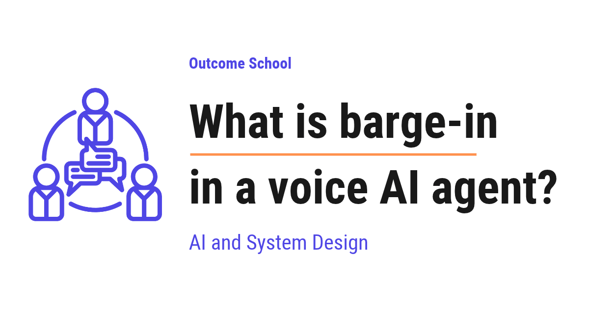

# What is barge-in in a voice AI agent?

> Archived from <https://outcomeschool.com/blog/what-is-barge-in-in-a-voice-ai-agent> on 2026-11-25.

Barge-in in a voice AI agent is the ability of the user to interrupt the agent while it is speaking, and the ability of the agent to stop talking right away and listen.

In this blog, we will learn about barge-in in a voice AI agent. We will also see where the word comes from, why it is hard for a machine to hear the user while it is talking, how the agent tells a real interruption apart from noise and &quot;uh-huh&quot;, what the agent must do the moment the user barges in, how it remembers what the user actually heard, and why all of this must happen fast.

We will cover the following:
<ul><li>What is barge-in?</li><li>Where the word barge-in comes from</li><li>How a voice AI agent speaks and listens</li><li>Problem 1: The agent hears itself</li><li>Problem 2: Not every sound is an interruption</li><li>How the agent detects barge-in</li><li>What the agent does after barge-in</li><li>Remembering what the user actually heard</li><li>Why barge-in must be fast</li><li>A complete walkthrough</li></ul>
I am <strong>Amit Shekhar</strong>, Founder @ <a target="_blank" rel="noopener noreferrer" href="https://outcomeschool.com">Outcome School</a>, I have taught and mentored many developers, and their efforts landed them high-paying tech jobs, helped many tech companies in solving their unique problems, and created many open-source libraries being used by top companies. I am passionate about sharing knowledge through open-source, blogs, and videos.

I teach <a target="_blank" rel="noopener noreferrer" href="https://outcomeschool.com/program/ai-and-machine-learning">AI and Machine Learning</a> at Outcome School.

Let&#x27;s get started.
<h2 id="what-is-barge-in">What is barge-in?</h2>
<strong>Barge-in is when the user starts speaking while the voice AI agent is still speaking, and the agent stops its own speech so that it can listen to the user.</strong>

A <strong>voice AI agent</strong> is a system that talks with us using voice. We speak, it listens, it thinks, and it speaks back. Customer support phone bots and voice assistants are voice AI agents.

The best way to learn this is by taking an example.

Let&#x27;s say we call a food delivery support line and the agent starts speaking:

<pre><code class="code-highlight">Agent: Thank you for calling. I can help you with new orders,
       order tracking, refunds, address changes, and...
User:  Refund.
Agent: Sure. Let&#x27;s start your refund. What is your order number?
</code></pre>

Here, the user already knew what they wanted and said &quot;Refund&quot; in the middle of the list. The agent stopped, listened, and moved to the refund.

This is barge-in.

Humans do this all the time. When a friend is giving us directions and we already know the place, we say, &quot;Yes, I know it,&quot; and the friend stops. A good voice AI agent must behave the same way.

Barge-in is one part of a bigger job called turn-taking. We have a detailed blog on <a target="_blank" rel="noopener noreferrer" href="what-is-turn-taking-in-a-voice-ai-agent.md">turn-taking in a voice AI agent</a> that explains how the agent decides whose turn it is to speak.
<h2 id="where-the-word-barge-in-comes-from">Where the word barge-in comes from</h2>
To &quot;barge in&quot; means to enter suddenly and interrupt. The user &quot;barges in&quot; on the agent&#x27;s turn.

The word comes from old telephone systems. We must have faced those phone menus that say, &quot;Press 1 for billing, press 2 for support.&quot; These are called <strong>IVR</strong> systems. IVR stands for Interactive Voice Response. In early IVR systems, we had to wait for the full menu to finish before we could press a key. Later, IVR systems allowed the caller to <a target="_blank" rel="noopener noreferrer" href="dtmf-in-voice-agents.md">press a key</a> or speak in the middle of the message, and the system would stop playing it. This feature was called barge-in.

Modern voice AI agents use the same word for the same idea. The difference is that the agent now speaks sentences generated by an AI model, not a fixed recorded menu.
<h2 id="how-a-voice-ai-agent-speaks-and-listens">How a voice AI agent speaks and listens</h2>
Before jumping into how barge-in works, we must know <a target="_blank" rel="noopener noreferrer" href="design-a-real-time-voice-ai-agent.md">how a voice AI agent is built</a>.

Most voice AI agents follow a <a target="_blank" rel="noopener noreferrer" href="cascaded-vs-speech-to-speech.md">pipeline</a> like below:

<pre><code class="code-highlight">+-------------------+
|  User speaks      |
+-------------------+
          ↓
+-------------------+
|  STT              |
|  (speech to text) |
+-------------------+
          ↓
+-------------------+
|  LLM              |
|  (writes reply)   |
+-------------------+
          ↓
+-------------------+
|  TTS              |
|  (text to speech) |
+-------------------+
          ↓
+-------------------+
|  Speaker plays    |
|  the reply        |
+-------------------+
</code></pre>

Here, we have:
<ul><li><strong>STT (Speech to Text):</strong> It turns the user&#x27;s voice into text.</li><li><strong>LLM (Large Language Model):</strong> It reads the text and writes the reply.</li><li><strong>TTS (Text to Speech):</strong> It turns the reply text into voice.</li></ul>
There is one more part that matters for barge-in. It is called <strong>VAD</strong>, which means <strong>Voice Activity Detection</strong>. VAD listens to the microphone audio in small pieces, for example every 20 or 30 milliseconds, and says only one thing: &quot;Is a human speaking right now, yes or no?&quot;

In a simple agent, the microphone is switched off, or ignored, while the agent is speaking. The agent talks, then it listens, then it talks again. This is like a walkie-talkie. <a target="_blank" rel="noopener noreferrer" href="half-duplex-vs-full-duplex-voice-agents.md">Only one side can talk at a time</a>.

With such an agent, barge-in is not possible. So, to support barge-in, the agent must keep listening even while it is speaking. Means, the microphone, the VAD, and the STT keep running during the agent&#x27;s speech.

But the following issues arise.
<h2 id="problem-1-the-agent-hears-itself">Problem 1: The agent hears itself</h2>
Let&#x27;s say we are using a voice agent on a phone with the speaker on. The microphone is a few centimeters away from the speaker. So, the microphone picks up the agent&#x27;s own voice.

Now, the VAD hears a human voice. It is the agent&#x27;s own voice, but the VAD does not know that. It says, &quot;Yes, a human is speaking.&quot; The agent thinks the user has barged in and stops itself.

So, the agent keeps interrupting itself. This is called <strong>self-interruption</strong>.

The solution to this problem is <strong>Acoustic Echo Cancellation</strong>, usually called <strong>AEC</strong>.

The agent knows exactly what audio it is sending to the speaker, because it generated that audio. So, AEC takes that known audio, predicts how it will sound when it comes back into the microphone, and subtracts it from the microphone signal.

<pre><code class="code-highlight">+--------------------------+
|  Microphone audio        |
|  (user + agent&#x27;s echo)   |
+--------------------------+
             ↓
+--------------------------+
|  AEC subtracts the       |
|  agent&#x27;s own audio       |
+--------------------------+
             ↓
+--------------------------+
|  Clean audio             |
|  (mostly the user)       |
+--------------------------+
             ↓
+--------------------------+
|  VAD                     |
+--------------------------+
</code></pre>

Here, we can see that the agent&#x27;s own voice is removed before the audio reaches the VAD. So, the VAD now hears mostly the user.

Phones, browsers, and operating systems often provide AEC. But it is never perfect. A loud speaker, a big empty room, or a low-quality phone can let some echo leak through. Hence, a good agent does not trust a single short burst of sound as a barge-in. This takes us to the next problem.
<h2 id="problem-2-not-every-sound-is-an-interruption">Problem 2: Not every sound is an interruption</h2>
Even with clean audio, not every sound that reaches the microphone means &quot;stop talking.&quot;

Let&#x27;s see a few cases:
<ul><li><strong>Backchannels:</strong> While listening, people say small things like &quot;uh-huh&quot;, &quot;okay&quot;, &quot;right&quot;, or &quot;hmm&quot;. These mean &quot;I am listening, please continue.&quot; They do not mean &quot;stop.&quot;</li><li><strong>Background noise:</strong> A door closes, a dog barks, a TV is on in the room, or a car horn sounds.</li><li><strong>Coughs and breaths:</strong> The user coughs or clears the throat.</li><li><strong>Other people:</strong> Someone else in the room talks to the user.</li></ul>
If the agent stops for every one of these, it keeps cutting its own sentences. When the agent stops for a sound that was not a real interruption, it is called a <strong>false barge-in</strong>.

We have a detailed blog on <a target="_blank" rel="noopener noreferrer" href="interruption-vs-background-noise.md">how a voice agent tells a real interruption from a cough or background noise</a> that explains each check step by step.

So, the agent has two opposite mistakes to avoid:
<table><thead><tr><th>Mistake</th><th>What happens</th><th>How it feels to the user</th></tr></thead><tbody><tr><td>False barge-in</td><td>The agent stops for noise, a cough, or &quot;uh-huh&quot;</td><td>The agent keeps cutting itself</td></tr><tr><td>Missed barge-in</td><td>The agent keeps talking when the user wants to speak</td><td>The agent does not listen</td></tr></tbody></table>
<strong>Planning your move into AI?</strong>

No matter which tech domain you work in today, with your effort, you can transition to these roles:
<ul><li>AI Engineer</li><li>Forward Deployed Engineer</li><li>AI Agent Engineer</li><li>Harness Engineer</li><li>Voice AI Engineer</li><li>AI Architect</li><li>LLM Engineer</li><li>LLM Inference Engineer</li><li>Gen AI Engineer</li><li>MLOps Engineer</li><li>ML Engineer</li><li>Deep Learning Engineer</li></ul>
Our <a target="_blank" rel="noopener noreferrer" href="https://outcomeschool.com/program/ai-and-machine-learning">AI and Machine Learning Program</a> at Outcome School takes you there.
<h2 id="how-the-agent-detects-barge-in">How the agent detects barge-in</h2>
Let&#x27;s see the approaches one by one, from the simplest to the most complete.
<h3 id="approach-1-stop-on-any-voice">Approach 1: Stop on any voice</h3>
The agent stops the moment the VAD says &quot;a human is speaking&quot;, even if the sound lasts only a fraction of a second.

<strong>Advantage:</strong> It is very fast. The user is heard right away.

<strong>Disadvantage:</strong> It stops for coughs, &quot;uh-huh&quot;, and leaked echo. False barge-in is very common.

The issue with this approach is that it reacts to every tiny sound. Let&#x27;s see how the next approach solve this issue.
<h3 id="approach-2-wait-for-enough-speech">Approach 2: Wait for enough speech</h3>
The agent stops only when the user has been speaking for a minimum amount of time, for example half a second, or has said a minimum number of words, for example two or three words. The word count comes from the STT, which keeps turning the user&#x27;s speech into text even while the agent is talking.

So, a short cough or a quick &quot;hmm&quot; does not cross the limit. A real sentence like &quot;Wait, I want to change my address&quot; crosses it quickly.

<strong>Advantage:</strong> Far fewer false barge-ins.

<strong>Disadvantage:</strong> It adds a small delay before the agent stops. And a long backchannel like &quot;okay, okay, yes&quot; can still cross the limit.

The issue with this approach is that it only measures how much the user said, not what the user meant. Let&#x27;s see how the next approach solve this issue.
<h3 id="approach-3-understand-the-meaning">Approach 3: Understand the meaning</h3>
The agent looks at the words the user said, and decides whether they are an interruption or a <a target="_blank" rel="noopener noreferrer" href="backchannels-in-voice-agents.md">backchannel</a>.
<ul><li>&quot;uh-huh&quot;, &quot;okay&quot;, &quot;right&quot;, &quot;yes, go on&quot; -&gt; backchannel, keep talking</li><li>&quot;wait&quot;, &quot;stop&quot;, &quot;no, that is wrong&quot;, &quot;actually I want a refund&quot; -&gt; interruption, stop and listen</li></ul>
This can be done with a simple list of backchannel words, or with a small model that is trained to label the user&#x27;s speech as &quot;interrupt&quot; or &quot;continue&quot;. Some newer systems use a model that looks at both the audio and the words together.

<strong>Advantage:</strong> It handles backchannels correctly.

<strong>Disadvantage:</strong> It needs the words first, so it is a little slower than the VAD alone.

In practice, agents combine these approaches. The VAD gives a fast first signal, and the agent gets ready to stop. Then the minimum speech check and the meaning check confirm whether it is a real barge-in. The meaning check also lets a single word like &quot;stop&quot; through, even though it is shorter than the minimum.

<strong>A quick note for you</strong>

No matter which tech domain you work in, get familiar with these topics:
<ul><li>LLM</li><li>RAG</li><li>MCP</li><li>Agent</li><li>Fine-tuning</li><li>Quantization</li></ul>
We put it all together in one video:

<a target="_blank" rel="noopener noreferrer" href="https://www.youtube.com/watch?v=lnfWvX66FUk">AI Engineering Explained: LLM, RAG, MCP, Agent, Fine-Tuning, and Quantization</a>

No need to stop reading - bookmark it and watch later when you get time. Future you will thank you.

Now, let&#x27;s get back to the topic.
<h2 id="what-the-agent-does-after-barge-in">What the agent does after barge-in</h2>
Now, let&#x27;s say the agent has confirmed that the user barged in. The agent must now stop everything that is producing its old reply.

The problem is that the old reply is not in one place. It is spread across the whole pipeline:
<ul><li>The LLM can still be generating the rest of the reply.</li><li>The TTS can still be turning text into audio.</li><li>Audio that is already generated can be waiting in a <a target="_blank" rel="noopener noreferrer" href="tts-audio-buffering.md"><strong>buffer</strong></a>, which is a small waiting area for audio that is ready to play.</li><li>The speaker can be in the middle of playing a piece of audio.</li></ul>
If the agent only stops the LLM, the audio that is already buffered will still play. The user will hear the agent continue talking after saying &quot;stop.&quot; So, the agent must stop all of them, starting with the speaker, then the buffer, then the TTS, and then the LLM. After that, it listens to the user&#x27;s full sentence and starts a new reply.

We have a detailed blog on <a target="_blank" rel="noopener noreferrer" href="sentence-chunking-for-tts.md">how sentence chunking feeds LLM output into TTS faster</a> that explains how the reply text moves from the LLM to the TTS step by step.

We can write the logic as below:

<pre><code class="code-highlight language-python">def on_user_started_speaking(agent):
    if not agent.is_speaking:
        return  # normal turn, nothing to interrupt

    if not is_real_interruption(agent.user_audio, agent.user_text):
        return  # cough, noise, or &quot;uh-huh&quot;, keep talking

    agent.speaker.stop()        # stop the sound right away
    agent.audio_buffer.clear()  # drop audio waiting to play
    agent.tts.cancel()          # stop making new audio
    agent.llm.cancel()          # stop writing the old reply
    agent.mark_heard_part()     # save what the user actually heard
    agent.is_speaking = False
    agent.start_listening()
</code></pre>

Here, we have:
<ul><li><code>agent.is_speaking</code> tells us whether the agent is talking right now. If it is not, this is a normal user turn.</li><li><code>is_real_interruption</code> is the check from the previous section. It returns <code>False</code> for noise and backchannels.</li><li>We stop the speaker first, so that the user stops hearing the agent as fast as possible.</li><li><code>agent.mark_heard_part()</code> saves how much of the reply the user actually heard. We will learn about this in the next section.</li><li>Finally, <code>agent.start_listening()</code> lets the agent hear the user&#x27;s full sentence.</li></ul>
<strong>Note:</strong> This code is just for the sake of understanding. A real agent runs these parts at the same time in separate tasks, and it uses its framework&#x27;s own cancel functions.

<strong>Stay updated:</strong> Subscribe to our <a target="_blank" rel="noopener noreferrer" href="https://outcomeschool.substack.com/subscribe">newsletter</a> to get our latest AI and Machine Learning blogs straight to your inbox.
<h2 id="remembering-what-the-user-actually-heard">Remembering what the user actually heard</h2>
Now, the next big question is: after barge-in, what does the agent remember about its own reply?

Let&#x27;s say the LLM wrote this full reply:

<pre><code class="code-highlight">Your order will arrive at 7 PM. The delivery partner is Ravi.
You can track the order in the app. Your total is 450 rupees.
</code></pre>

The LLM usually generates text much faster than the speaker can play it as audio. So, the full text is often ready long before the audio finishes playing. But the user barged in after hearing only this:

<pre><code class="code-highlight">Your order will arrive at 7 PM. The delivery partner is...
</code></pre>

Now, if the agent saves the full reply in the <a target="_blank" rel="noopener noreferrer" href="ai-agent-memory.md">conversation history</a>, the LLM believes the user knows the delivery partner&#x27;s name and the total amount. Later, the user asks, &quot;How much is it?&quot; and the agent says, &quot;As I told you, it is 450 rupees.&quot; But the user never heard that.

So, the agent must <a target="_blank" rel="noopener noreferrer" href="truncating-context-on-interruption.md">cut its saved reply to only the part that was actually played</a>.

<pre><code class="code-highlight">+---------------------------------------+
|  Full reply written by the LLM        |
|  (4 sentences)                        |
+---------------------------------------+
                    ↓
+---------------------------------------+
|  Part played before barge-in          |
|  (1.5 sentences)                      |
+---------------------------------------+
                    ↓
+---------------------------------------+
|  Saved in conversation history        |
|  &quot;Your order will arrive at 7 PM.     |
|   The delivery partner is...&quot;         |
+---------------------------------------+
</code></pre>

How does the agent know which part was played? The answer is timing. The agent knows when the audio started playing and when it stopped. Some TTS systems also return word-level timestamps, which tell the time at which each word is spoken. So, the agent can match the stop time to the last word that was spoken.

For example, the OpenAI Realtime API provides the <code>conversation.item.truncate</code> event. The agent sends how many milliseconds of its audio were played, and the API cuts the rest of that reply, including the text of the part that was not played.

Some agents also add a small note to the history, like &quot;the user interrupted here&quot;, so that the LLM understands why its sentence is incomplete.

To learn Memory in Agents, Agent Architecture, and how to Design a Real-Time Voice AI Agent, check out our <a target="_blank" rel="noopener noreferrer" href="https://outcomeschool.com/program/ai-and-machine-learning">AI and Machine Learning Program</a> at Outcome School.
<h2 id="why-barge-in-must-be-fast">Why barge-in must be fast</h2>
When a person keeps talking for two more seconds after we say &quot;wait&quot;, we feel ignored. The same is true for a voice AI agent. The time between the moment the user starts speaking and the moment the agent goes quiet must be short. But many small delays add up in this chain:
<ul><li>The VAD needs a few small audio pieces to be sure there is speech.</li><li>The confirmation check needs some time, especially when it waits for words.</li><li>The audio already sent to the phone network or the speaker can still play for a moment.</li></ul>
So, a good agent keeps every part of this chain short. It uses <a target="_blank" rel="noopener noreferrer" href="stopping-speech-on-interruption.md">small audio buffers</a>, so that very less audio is waiting to play. It can also lower the volume as soon as the VAD fires, fully stop once the barge-in is confirmed, and go back to normal volume if it was a <a target="_blank" rel="noopener noreferrer" href="false-interruption-recovery.md">false alarm</a>.

Here, we can see a trade-off. Stopping faster means more false barge-ins. Waiting longer before stopping means fewer false barge-ins, but a slower response. We must tune this based on our use case. A phone line with a lot of background noise needs to wait longer. A quiet in-app assistant can stop faster.
<h2 id="a-complete-walkthrough">A complete walkthrough</h2>
Now, let&#x27;s put everything together with one full example.

The user calls a food delivery agent and asks, &quot;Where is my order?&quot;

<strong>Step 1:</strong> The agent&#x27;s LLM writes the reply, and the TTS starts speaking: &quot;Your order will arrive at 7 PM. The delivery partner is Ravi. You can track the order in the app...&quot;

<strong>Step 2:</strong> The microphone, the VAD, and the STT keep running. AEC removes the agent&#x27;s own voice from the microphone audio.

<strong>Step 3:</strong> The user says &quot;uh-huh&quot; after the first sentence. The VAD fires, but the check finds that it is a short backchannel. The agent keeps talking.

<strong>Step 4:</strong> The user then says, &quot;Wait, can I change the address?&quot; The VAD fires, the speech is long enough, and the words &quot;wait&quot; and &quot;change the address&quot; mean an interruption. Barge-in is confirmed.

<strong>Step 5:</strong> The agent stops the speaker, clears the audio buffer, cancels the TTS, and cancels the LLM.

<strong>Step 6:</strong> The agent saves only the part the user heard: &quot;Your order will arrive at 7 PM. The delivery partner is Ravi. You can track...&quot;

<strong>Step 7:</strong> The STT turns the full user sentence into text. The LLM gets the updated history and replies: &quot;Sure. What is the new address?&quot;

Now we must have understood what barge-in in a voice AI agent is, how the agent detects it, and what it does when the user interrupts.
<h2 id="frequently-asked-questions">Frequently Asked Questions</h2><h3 id="why-cant-a-simple-voice-ai-agent-support-barge-in">Why can&#x27;t a simple voice AI agent support barge-in?</h3>
A simple voice AI agent switches off or ignores the microphone while it is speaking, like a walkie-talkie where only one side can talk at a time. So, it cannot hear the user during its own speech. To support barge-in, the microphone, the VAD, and the STT must keep running even while the agent is speaking.
<h3 id="what-is-a-false-barge-in">What is a false barge-in?</h3>
A false barge-in is when the agent stops talking for a sound that was not a real interruption. This can be a backchannel like &quot;uh-huh&quot;, a cough, background noise, someone else in the room, or the agent&#x27;s own echo. Too many false barge-ins make the agent keep cutting its own sentences.
<h3 id="should-a-voice-ai-agent-stop-talking-when-the-user-says-uh-huh">Should a voice AI agent stop talking when the user says &quot;uh-huh&quot;?</h3>
No. Words like &quot;uh-huh&quot;, &quot;okay&quot;, and &quot;right&quot; are backchannels. They mean &quot;I am listening, please continue.&quot; The agent checks the words the user said, using a list of backchannel words or a small model, and keeps talking for backchannels while stopping for real interruptions like &quot;wait&quot; or &quot;stop&quot;.
<h3 id="why-does-the-agent-stop-the-speaker-before-cancelling-the-llm">Why does the agent stop the speaker before cancelling the LLM?</h3>
The agent stops the speaker first so that the user stops hearing it as fast as possible. If the agent only stopped the LLM, the audio already waiting in the buffer would still play, and the user would hear the agent keep talking after saying &quot;stop&quot;. So, the agent stops the speaker, then the buffer, then the TTS, and then the LLM.
<h3 id="what-does-conversationitemtruncate-do-in-the-openai-realtime-api">What does conversation.item.truncate do in the OpenAI Realtime API?</h3>
The <code>conversation.item.truncate</code> event lets the agent tell the API how many milliseconds of its audio were actually played. The API then cuts the rest of that reply, including the text of the part that was not played. This keeps the conversation history matched to what the user really heard.

That&#x27;s it for now.

Thanks

<strong>Amit Shekhar</strong> Founder @ <a target="_blank" rel="noopener noreferrer" href="https://outcomeschool.com">Outcome School</a>

You can connect with me on:
<ul><li><a target="_blank" rel="noopener noreferrer" href="https://x.com/amitiitbhu">X</a></li><li><a target="_blank" rel="noopener noreferrer" href="https://www.linkedin.com/in/amit-shekhar-iitbhu">LinkedIn</a></li><li><a target="_blank" rel="noopener noreferrer" href="https://github.com/amitshekhariitbhu">GitHub</a></li></ul>
Follow Outcome School on:
<ul><li><a target="_blank" rel="noopener noreferrer" href="https://x.com/outcome_school">X</a></li><li><a target="_blank" rel="noopener noreferrer" href="https://youtube.com/@OutcomeSchool">YouTube</a></li><li><a target="_blank" rel="noopener noreferrer" href="https://www.linkedin.com/company/outcomeschool">LinkedIn</a></li><li><a target="_blank" rel="noopener noreferrer" href="http://github.com/OutcomeSchool">GitHub</a></li></ul>
<a target="_blank" rel="noopener noreferrer" href="https://outcomeschool.com/blog"><strong>Read all of our high-quality blogs here.</strong></a>

