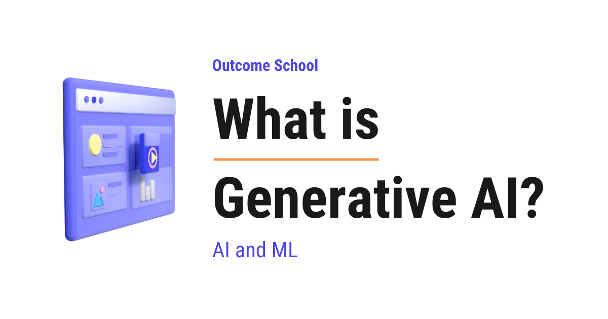

# What is Generative AI?

> Archived from <https://outcomeschool.com/blog/what-is-generative-ai> on 2026-11-25.

Generative AI is a type of AI that can create new things, like text, images, audio, video, and code, that did not exist before.

In this blog, we will learn about Generative AI. We will understand what the word &quot;generate&quot; actually means, how Generative AI is different from the older AI, how it learns from a huge amount of examples, how it creates something completely new, where we use it every day, and the limitations we must know.

We will cover the following:
<ul><li>What is Generative AI?</li><li>Generative AI = Generative + AI</li><li>What does &quot;generate&quot; mean here?</li><li>How is Generative AI different from the old AI?</li><li>How does Generative AI learn?</li><li>How does Generative AI actually create something new?</li><li>What can Generative AI create?</li><li>What is a model in Generative AI?</li><li>The complete flow of Generative AI</li><li>Where do we use Generative AI every day?</li><li>The limitations we must know</li><li>Summary</li></ul>
I am <strong>Amit Shekhar</strong>, Founder @ <a target="_blank" rel="noopener noreferrer" href="https://outcomeschool.com">Outcome School</a>, I have taught and mentored many developers, and their efforts landed them high-paying tech jobs, helped many tech companies in solving their unique problems, and created many open-source libraries being used by top companies. I am passionate about sharing knowledge through open-source, blogs, and videos.

I teach <a target="_blank" rel="noopener noreferrer" href="https://outcomeschool.com/program/ai-and-machine-learning">AI and Machine Learning</a> at Outcome School.

Let&#x27;s get started.
<h2 id="what-is-generative-ai">What is Generative AI?</h2>
<strong>Generative AI is a type of artificial intelligence that can create new things, like text, images, audio, video, and code.</strong>

Let&#x27;s say we ask a computer, &quot;Write me a short poem about the rain.&quot; A few years back, a normal computer could not do this. It could search for a poem that someone else had already written, but it could not write a fresh new poem on its own.

Now, things have changed. Today, we can ask, and the computer writes a brand new poem in seconds. Nobody wrote that exact poem before. The computer created it for us right now.

That power to create something new is what we call Generative AI.
<h2 id="generative-ai--generative--ai">Generative AI = Generative + AI</h2>
The best way to understand this term is to break it into two parts.

<strong>Generative:</strong> This word comes from &quot;generate&quot;, which means to create or to produce something new.

<strong>AI:</strong> This is short for Artificial Intelligence. It means making a computer do tasks that normally need human intelligence, like understanding language, seeing pictures, or making decisions.

So, when we join both parts:
<blockquote>
Generative AI = An artificial intelligence that can create new content on its own.
</blockquote>
In simple words, it can produce fresh text, images, sound, and more, just like a human creator would.
<h2 id="what-does-generate-mean-here">What does &quot;generate&quot; mean here?</h2>
This is the most important word, so let&#x27;s be very clear about it.

To generate means to create something that did not exist before.

Let&#x27;s say we have a calculator. We type <code>2 + 2</code>, and it gives <code>4</code>. This is not generating. The calculator just follows a fixed rule. The answer is always the same, and it is not new.

Now, let&#x27;s say we ask Generative AI to &quot;draw a cat riding a bicycle on the moon.&quot; No such picture existed before. The AI creates that picture, pixel by pixel, just for us. This is generating.

So, the key idea is this. Generative AI does not copy and paste an old answer. It creates a new one.

<strong>Planning your move into AI?</strong>

No matter which tech domain you work in today, with your effort, you can transition to these roles:
<ul><li>AI Engineer</li><li>Forward Deployed Engineer</li><li>AI Agent Engineer</li><li>Harness Engineer</li><li>Voice AI Engineer</li><li>AI Architect</li><li>LLM Engineer</li><li>LLM Inference Engineer</li><li>Gen AI Engineer</li><li>MLOps Engineer</li><li>ML Engineer</li><li>Deep Learning Engineer</li></ul>
Our <a target="_blank" rel="noopener noreferrer" href="https://outcomeschool.com/program/ai-and-machine-learning">AI and Machine Learning Program</a> at Outcome School takes you there.
<h2 id="how-is-generative-ai-different-from-the-old-ai">How is Generative AI different from the old AI?</h2>
Before Generative AI became popular, we already had AI. But that older AI mostly did one job. It looked at something and gave a label or a decision.

Let&#x27;s understand this with an example. The old AI was very good at answering questions like these:
<ul><li>Is this email spam or not spam?</li><li>Is there a cat in this photo or not?</li><li>Is this review positive or negative?</li></ul>
Here, we can notice one thing. The old AI only chooses from options that already exist. It does not create anything new. We can call this kind of AI &quot;the AI that decides.&quot;

Generative AI is different. It does not just decide. It creates. We can call it &quot;the AI that creates.&quot;

Let me tabulate the difference between the two for your better understanding so that the whole picture becomes clear.
<table><thead><tr><th>Old AI (the AI that decides)</th><th>Generative AI (the AI that creates)</th></tr></thead><tbody><tr><td>Looks at input and picks a label</td><td>Looks at input and produces new content</td></tr><tr><td>&quot;Is this a cat or a dog?&quot;</td><td>&quot;Draw me a new cat.&quot;</td></tr><tr><td>Chooses from fixed options</td><td>Creates something that did not exist before</td></tr><tr><td>Output is a decision</td><td>Output is fresh text, image, audio, or video</td></tr></tbody></table>
We can also picture this difference like below:

<pre><code class="code-highlight">   Old AI (decides)                    Generative AI (creates)

   Photo of an animal                  Text: &quot;a cat on the moon&quot;
        |                                     |
        v                                     v
   +-----------+                        +-----------+
   |    AI     |                        |    AI     |
   +-----------+                        +-----------+
        |                                     |
        v                                     v
   &quot;It is a cat&quot;                        A brand new picture
   (a label)                            of a cat on the moon
</code></pre>

Here, we can see the clear difference. On the left, the AI only puts a label. On the right, the AI creates a whole new picture.

Both kinds are built on Machine Learning, and we have a detailed blog on <a target="_blank" rel="noopener noreferrer" href="machine-learning.md">What is Machine Learning?</a> that explains how a machine learns from data in the first place.

Now that we know what Generative AI does, the next question is: how does it learn to do this? Let&#x27;s understand it.
<h2 id="how-does-generative-ai-learn">How does Generative AI learn?</h2>
Generative AI learns by looking at a huge amount of examples. This is the heart of everything, so let&#x27;s go slowly.

Let&#x27;s say we want to teach a child to write stories. We would let the child read thousands of storybooks. After reading so many stories, the child starts to understand how a story works. The child learns which words go together, how a sentence flows, and how a story begins and ends.

Generative AI learns in the same way. We show it a massive amount of examples. For a text AI, we show it a large part of the writing available on the internet, like books, articles, and websites. It reads all of this during a stage that we call training.

During training, the AI is not memorizing the text word for word. Instead, it is learning the patterns. It learns which words usually come after which words. It learns how ideas connect. It learns the style and the structure of language.

So, after training, the AI has learned the deep patterns of language. Now, it can use these patterns to create new sentences on its own.

<strong>Note:</strong> The same idea works for images. To create images, the AI is trained on a huge collection of pictures along with their descriptions. It learns what a &quot;cat&quot;, a &quot;bicycle&quot;, and the &quot;moon&quot; look like. Later, it can mix these learned patterns to draw a cat riding a bicycle on the moon, even though it never saw that exact picture before.

If we want to go deep into how this learning actually happens - Machine Learning fundamentals, Supervised and Unsupervised Learning, Neural Networks, and Backpropagation - check out our <a target="_blank" rel="noopener noreferrer" href="https://outcomeschool.com/program/ai-and-machine-learning">AI and Machine Learning Program</a> at Outcome School.
<h2 id="how-does-generative-ai-actually-create-something-new">How does Generative AI actually create something new?</h2>
Now, this is the most magical part. Let&#x27;s understand how a text Generative AI writes a sentence.

The secret is surprisingly simple. The AI predicts the next word, again and again. Inside the model, this writing job is done by the <a target="_blank" rel="noopener noreferrer" href="encoder-vs-decoder-in-transformers.md">Decoder</a>.

Let&#x27;s say we give it the starting words, &quot;The sky is&quot;. The AI now thinks, &quot;What word usually comes next?&quot; From all its training, it knows that &quot;blue&quot; is a very likely next word. So, it adds &quot;blue&quot;.

Now the sentence is &quot;The sky is blue&quot;. The AI again asks, &quot;What comes next?&quot; Now it adds &quot;and&quot;. Then it asks again, and adds &quot;clear&quot;. It keeps doing this, one word at a time, until the sentence is complete.

We can picture this step by step like below:

<pre><code class="code-highlight">   Step 1:  &quot;The sky is&quot;          -&gt;  predict next word  -&gt;  &quot;blue&quot;
   Step 2:  &quot;The sky is blue&quot;     -&gt;  predict next word  -&gt;  &quot;and&quot;
   Step 3:  &quot;The sky is blue and&quot; -&gt;  predict next word  -&gt;  &quot;clear&quot;
   Step 4:  &quot;The sky is blue and clear&quot;  -&gt;  and so on...
</code></pre>

Here, we can see the beautiful trick. The AI never writes a whole paragraph in one shot. It writes one word, then looks at everything so far, then writes the next word. It repeats this until the full answer is ready.

So, a long and smart answer is really just the AI predicting the next word, over and over, very fast. And whether it plays safe with &quot;blue&quot; or takes a chance on a surprising word is controlled by a knob called <a target="_blank" rel="noopener noreferrer" href="how-does-temperature-control-llm-output.md">Temperature</a>, along with two more settings called <a target="_blank" rel="noopener noreferrer" href="how-do-top-k-and-top-p-sampling-work.md">Top-k and Top-p</a>.

This way of creating, one word at a time, is called autoregressive generation, and we have a detailed blog on <a target="_blank" rel="noopener noreferrer" href="autoregressive-models.md">Autoregressive Models</a> that explains it step by step.

This is how Generative AI creates new text. It creates images, audio, and video in a similar spirit, by using the patterns it learned during training, just with different methods for each type of content.
<h2 id="what-can-generative-ai-create">What can Generative AI create?</h2>
Generative AI is not limited to text. It can create many kinds of content. Let&#x27;s see a few.
<ul><li><strong>Text:</strong> It can write emails, stories, articles, answers, and summaries.</li><li><strong>Images:</strong> It can create paintings, photos, logos, and art from a simple description.</li><li><strong>Audio:</strong> It can create music, and it can create a human-like voice that reads text aloud.</li><li><strong>Video:</strong> It can create short video clips from a text description.</li><li><strong>Code:</strong> It can write computer programs and help developers build software.</li></ul>
So, whatever kind of content a human can create, Generative AI is learning to create it too.

<strong>A quick note for you</strong>

No matter which tech domain you work in, get familiar with these topics:
<ul><li>LLM</li><li>RAG</li><li>MCP</li><li>Agent</li><li>Fine-tuning</li><li>Quantization</li></ul>
We put it all together in one video:

<a target="_blank" rel="noopener noreferrer" href="https://www.youtube.com/watch?v=lnfWvX66FUk">AI Engineering Explained: LLM, RAG, MCP, Agent, Fine-Tuning, and Quantization</a>

No need to stop reading - bookmark it and watch later when you get time. Future you will thank you.

Now, let&#x27;s get back to the topic.
<h2 id="what-is-a-model-in-generative-ai">What is a model in Generative AI?</h2>
We keep saying &quot;the AI&quot;, but let&#x27;s give it a proper name. The trained brain of Generative AI is called a model.

A model is the final result of all that training. Think of it as a brain that has already read a huge amount of data and has learned the patterns inside it. When we chat with a Generative AI tool, we are really talking to this trained model.

When a model works mainly with text and language, we call it a <a target="_blank" rel="noopener noreferrer" href="evolution-of-llm-architecture.md">Large Language Model</a>, or LLM for short. We have a detailed blog on <a target="_blank" rel="noopener noreferrer" href="large-language-model-llm.md">How an LLM Works</a> that explains this step by step.
<ul><li><strong>Large:</strong> It has learned from a very large amount of text, and it has a very large number of internal settings that store what it learned.</li><li><strong>Language:</strong> Its main job is to understand and create human language.</li><li><strong>Model:</strong> It is the trained brain that holds all this learned knowledge.</li></ul>
So, when we hear names like the models behind ChatGPT, Claude, or Gemini, these are all Large Language Models. They are the trained brains that power the Generative AI tools we use.

To master LLM Fundamentals, LLM Internals, and Transformer Architecture, and even build a Large Language Model (LLM) from scratch, check out our <a target="_blank" rel="noopener noreferrer" href="https://outcomeschool.com/program/ai-and-machine-learning">AI and Machine Learning Program</a> at Outcome School.
<h2 id="the-complete-flow-of-generative-ai">The complete flow of Generative AI</h2>
Now that we have learned about all the parts, let&#x27;s put the whole flow together in simple steps.
<ul><li><strong>First,</strong> we collect a huge amount of examples, like text or images. This is the data.</li><li><strong>Then,</strong> the AI reads all this data and learns the patterns inside it. This is training.</li><li><strong>After that,</strong> the trained brain is ready. We call this brain the model.</li><li><strong>Then,</strong> we give the model a request in plain words. This request is called a prompt.</li><li><strong>Finally,</strong> the model uses its learned patterns to create a brand new answer for us.</li></ul>
We can picture the whole flow like below:

<pre><code class="code-highlight">   Huge amount of data (text, images, code)
              |
              |  the AI reads and learns the patterns
              v
          Training
              |
              v
        Trained model  (the brain that has learned)
              |
              |  we give a prompt: &quot;Write a poem about rain&quot;
              v
        New content  (a fresh poem, created just now)
</code></pre>

Here, we can see the full journey. First, the model learns from data. Then, we give it a prompt. Finally, it creates something new for us.

<strong>Stay updated:</strong> Subscribe to our <a target="_blank" rel="noopener noreferrer" href="https://outcomeschool.substack.com/subscribe">newsletter</a> to get our latest AI and Machine Learning blogs straight to your inbox.
<h2 id="where-do-we-use-generative-ai-every-day">Where do we use Generative AI every day?</h2>
Let&#x27;s see a few common places.
<ul><li><strong>Chat assistants:</strong> We ask a question in plain English and get a helpful answer.</li><li><strong>Writing help:</strong> It helps us write emails, fix our grammar, and summarize long text.</li><li><strong>Image creation:</strong> We type a description, and it draws a picture for us.</li><li><strong>Coding help:</strong> It helps developers write and fix code faster.</li><li><strong>Customer support:</strong> Many company chatbots now use Generative AI to answer our questions.</li></ul>
It is helping millions of people every single day.
<h2 id="the-limitations-we-must-know">The limitations we must know</h2>
Generative AI is powerful, but it is not perfect. We must understand its limits so that we use it wisely.
<ul><li><strong>It can be wrong.</strong> The AI predicts what sounds right, but sometimes it makes up facts that are not true. This is called a <a target="_blank" rel="noopener noreferrer" href="why-do-llms-hallucinate-the-token-level-explanation.md">hallucination</a>. So, we must always check important information.</li><li><strong>It does not truly understand.</strong> It is very good at patterns, but it does not &quot;know&quot; things the way a human does. It has no real feelings or life experience.</li><li><strong>It learns from human data.</strong> Since it learns from what humans wrote, it can also pick up the mistakes and biases present in that data.</li><li><strong>It needs a good prompt.</strong> The quality of the answer depends a lot on how clearly we ask. A clear prompt gives a better result.</li></ul>
So, Generative AI is a very helpful tool, but we must use it as a smart helper, not as a source of final truth.
<h2 id="summary">Summary</h2>
Let&#x27;s quickly recap what we have learned.
<ul><li>Generative AI is a type of AI that creates new content, like text, images, audio, video, and code.</li><li>The word &quot;generate&quot; means to create something that did not exist before.</li><li>The old AI mostly decided or labeled things. Generative AI creates new things.</li><li>It learns by reading a huge amount of examples and understanding the patterns inside them.</li><li>A text Generative AI creates a sentence by predicting the next word, again and again.</li><li>The trained brain is called a model, and a text model is called a Large Language Model.</li><li>It is powerful, but it can be wrong, so we must always check important facts.</li></ul>
This is how Generative AI works. It reads a huge amount of data, learns the patterns, and then uses those patterns to create something fresh and new for us.

Now, we must have understood what Generative AI is.
<h2 id="frequently-asked-questions">Frequently Asked Questions</h2><h3 id="does-generative-ai-copy-answers-from-its-training-data">Does Generative AI copy answers from its training data?</h3>
No. Generative AI does not copy and paste an old answer, and during training, it is not memorizing text word for word. It learns the patterns, like which words usually come after which words and how ideas connect. Then, it uses these patterns to create new content that did not exist before.
<h3 id="is-an-llm-the-same-as-generative-ai">Is an LLM the same as Generative AI?</h3>
Not exactly. Generative AI is the broad type of AI that creates new text, images, audio, video, and code. A Large Language Model, or LLM, is a trained model that works mainly with text and language. LLMs are the trained brains that power many of the Generative AI tools we use.
<h3 id="is-chatgpt-an-example-of-generative-ai">Is ChatGPT an example of Generative AI?</h3>
Yes. The models behind ChatGPT, Claude, and Gemini are all Large Language Models, and they power Generative AI tools. When we ask such a tool a question in plain English, it creates a brand new answer by predicting the next word again and again, using the patterns it learned during training.
<h3 id="what-decides-whether-generative-ai-picks-a-safe-word-or-a-surprising-one">What decides whether Generative AI picks a safe word or a surprising one?</h3>
A setting called Temperature controls this, along with two more settings called Top-k and Top-p. When the AI predicts the next word, it can play safe with the most likely word or take a chance on a more surprising one. These settings decide which way it leans.
<h3 id="is-generative-ai-built-on-machine-learning">Is Generative AI built on Machine Learning?</h3>
Yes. Both the old AI that decides and Generative AI that creates are built on Machine Learning. Generative AI learns by looking at a huge amount of examples during a stage called training. The trained result is called a model, and it uses the learned patterns to create new content.

That&#x27;s it for now.

Thanks

<strong>Amit Shekhar</strong> Founder @ <a target="_blank" rel="noopener noreferrer" href="https://outcomeschool.com">Outcome School</a>

You can connect with me on:
<ul><li><a target="_blank" rel="noopener noreferrer" href="https://x.com/amitiitbhu">X</a></li><li><a target="_blank" rel="noopener noreferrer" href="https://www.linkedin.com/in/amit-shekhar-iitbhu">LinkedIn</a></li><li><a target="_blank" rel="noopener noreferrer" href="https://github.com/amitshekhariitbhu">GitHub</a></li></ul>
Follow Outcome School on:
<ul><li><a target="_blank" rel="noopener noreferrer" href="https://x.com/outcome_school">X</a></li><li><a target="_blank" rel="noopener noreferrer" href="https://youtube.com/@OutcomeSchool">YouTube</a></li><li><a target="_blank" rel="noopener noreferrer" href="https://www.linkedin.com/company/outcomeschool">LinkedIn</a></li><li><a target="_blank" rel="noopener noreferrer" href="https://github.com/OutcomeSchool">GitHub</a></li></ul>
<a target="_blank" rel="noopener noreferrer" href="https://outcomeschool.com/blog"><strong>Read all of our high-quality blogs here.</strong></a>

