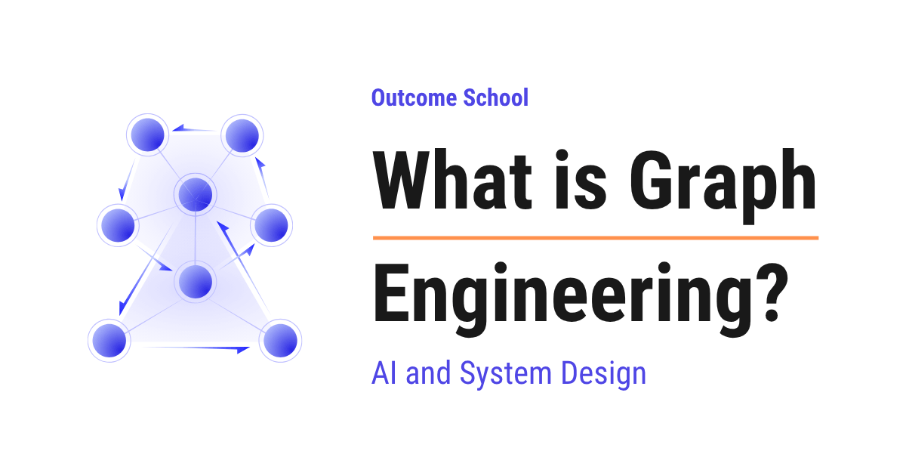

# What is Graph Engineering?

> Archived from <https://outcomeschool.com/blog/what-is-graph-engineering> on 2026-11-25.

Graph Engineering is the practice of designing an AI system as a graph, where every step of the work is a node, and every path from one step to another is an edge. We break the work into small steps and clearly decide which step runs after which.

In this blog, we will learn about Graph Engineering, the practice of building an AI system as a graph of small steps connected by clear paths instead of one giant prompt or one endless loop. We will also see why we need it, what nodes and edges actually mean, how the state travels through the graph, how conditional edges take decisions, how cycles let the system do the work again, how parallel branches save time, how checkpoints let us pause and resume, and where it works well and where it fails.

We will cover the following:
<ul><li>What is Graph Engineering?</li><li>Graph = Nodes + Edges</li><li>Why do we need Graph Engineering?</li><li>The three building blocks: Node, Edge, and State</li><li>Let&#x27;s build our first graph</li><li>Conditional edges: taking decisions inside the graph</li><li>Cycles: doing the work again when needed</li><li>One full run, step by step</li><li>Parallel branches: doing many things at the same time</li><li>Checkpoints: pause and resume the graph</li><li>Human in the loop</li><li>Handling errors inside a graph</li><li>Graph Engineering vs Loop Engineering</li><li>Where Graph Engineering works well</li><li>Where Graph Engineering fails</li><li>Best practices in Graph Engineering</li><li>Conclusion</li></ul>
I am <strong>Amit Shekhar</strong>, Founder @ <a target="_blank" rel="noopener noreferrer" href="https://outcomeschool.com">Outcome School</a>, I have taught and mentored many developers, and their efforts landed them high-paying tech jobs, helped many tech companies in solving their unique problems, and created many open-source libraries being used by top companies. I am passionate about sharing knowledge through open-source, blogs, and videos.

I teach <a target="_blank" rel="noopener noreferrer" href="https://outcomeschool.com/program/ai-and-machine-learning">AI and Machine Learning</a> at Outcome School.

Let&#x27;s get started.
<h2 id="what-is-graph-engineering">What is Graph Engineering?</h2>
<strong>Graph Engineering is the practice of designing an AI system as a graph, where every step of the work is a node and every path from one step to another step is an edge.</strong>

Graph Engineering = Graph + Engineering.

In simple words, instead of writing one huge instruction and hoping that the model does everything correctly in one go, we break the work into small steps, and then we clearly decide which step runs after which step.

Here, whenever we say the model, we mean the AI model that reads text and writes text, and whenever we say a <a target="_blank" rel="noopener noreferrer" href="how-does-function-calling-work-in-llms.md">tool</a>, we mean anything outside the model that our system can call, like a search, a database, or an email service.

We hear this word mostly around <a target="_blank" rel="noopener noreferrer" href="ai-agent.md">AI agents</a> today, and there is a good reason for that. Real work is never one step. Real work is many steps, with going back, waiting, checking, and approving in between. Graph Engineering is how we give that shape to our system.
<h2 id="graph--nodes--edges">Graph = Nodes + Edges</h2>
Before jumping into Graph Engineering, we must know what a graph is.

A graph is just two things.
<ul><li><strong>Nodes</strong>: the places where something happens.</li><li><strong>Edges</strong>: the paths that connect one place to another place.</li></ul>
The best way to learn this is by taking an example.

Let&#x27;s say we are looking at the metro map of a city. Every station on that map is a node. Every track between two stations is an edge. A train starts from one station, travels on a track, reaches the next station, and continues like this until it reaches the last station.

Now, replace the stations with the steps of our work, and replace the tracks with the order of our work. That is exactly the graph we build in Graph Engineering.
<table><thead><tr><th>Metro map</th><th>Our AI system</th></tr></thead><tbody><tr><td>Station</td><td>Node, which means one small step of work</td></tr><tr><td>Track between two stations</td><td>Edge, which means the path to the next step</td></tr><tr><td>Bag that the passenger carries</td><td>State, which means the information that travels along</td></tr><tr><td>First station</td><td>The step where our system starts</td></tr><tr><td>Last station</td><td>The step where our system stops</td></tr></tbody></table>
Here, we can see that an edge is simply the answer to one small question. After this step is over, which step runs next?

Now, we have understood the graph. Now, let&#x27;s understand why we need Graph Engineering at all.
<h2 id="why-do-we-need-graph-engineering">Why do we need Graph Engineering?</h2>
Let&#x27;s say we are building a system that answers questions about a company&#x27;s internal documents. A user asks a question, and our system must give a correct answer with proper sources.

We will build this system step by step. At every step we will see the problem, and then we will move to a better approach.
<h3 id="approach-1-one-big-prompt">Approach 1: One big prompt</h3>
We write one long instruction and send it to the model.

<pre><code class="code-highlight language-text">You are a helpful assistant. Read the user question. Search the company
documents. Read the results. Write an answer. Check that the answer is
correct. Add the sources. If something is missing, search again.
</code></pre>

The model reads all of this and tries to do everything at once.

<strong>Problem:</strong> The model does some parts and quietly forgets the other parts. Sometimes it writes the answer without searching. Sometimes it searches but never checks the answer. And when the output is wrong, we have no idea which part went wrong, because everything happened inside one single call. We cannot fix what we cannot see.

The issue with this approach is that there is no structure at all. Let&#x27;s see how the next approach solve this issue.
<h3 id="approach-2-a-chain-of-steps">Approach 2: A chain of steps</h3>
Now, we break the work into separate calls, and we run them one after another.

<pre><code class="code-highlight language-text">Step 1: understand the question
Step 2: search the documents
Step 3: write the answer
Step 4: send the answer
</code></pre>

This is <a target="_blank" rel="noopener noreferrer" href="how-does-prompt-chaining-work.md">prompt chaining</a>, and it is much better. Every step has only one job. When something goes wrong, we know exactly which step failed.

<strong>Problem:</strong> A chain always moves forward in a straight line. It never comes back. But real work needs coming back. What if the search returns nothing useful? What if the answer is wrong and needs to be written again? A straight chain cannot do this. It simply walks forward and delivers a bad answer.

The issue with this approach is that it cannot go back. Let&#x27;s see how the next approach solve this issue.
<h3 id="approach-3-one-loop">Approach 3: One loop</h3>
Now, we put the whole thing inside an <a target="_blank" rel="noopener noreferrer" href="ai-agent-loop.md">agent loop</a>. The model thinks, calls a tool, looks at the result, and thinks again, again and again, until it decides that the work is done.

This solves the coming back problem. The model can search again, write again, and correct itself.

<strong>Problem:</strong> Now we have gone to the other extreme. Every decision is taken by the model inside one loop, so we have very less control. The model repeats the same failing search ten times. It skips the checking step because it feels confident. It calls a dangerous tool that we never wanted it to call at that moment. The path is different on every run, so testing becomes very hard.

The issue with this approach is that the flow is completely in the model&#x27;s hands. Let&#x27;s see how the next approach solve this issue.
<h3 id="approach-4-a-graph">Approach 4: A graph</h3>
So, here comes Graph Engineering to the rescue.

We keep the small steps of Approach 2, we keep the coming back ability of Approach 3, and we write down the paths ourselves.

<pre><code class="code-highlight language-text">understand  -&gt;  search  -&gt;  write  -&gt;  check
check       -&gt;  send        (when the answer is good)
check       -&gt;  search      (when the sources are missing)
check       -&gt;  write       (when the answer is weak)
</code></pre>

Here, we can see that every step is small and visible, the system can go back when it needs to, and the model takes decisions only at the places where we allow it to take decisions.

The problem is solved. This is Graph Engineering.

The example we took here, where the system searches, writes, checks, and searches again, is what we call <a target="_blank" rel="noopener noreferrer" href="agentic-rag.md">Agentic RAG</a>, and we have a detailed blog on it that explains this in depth.
<h2 id="the-three-building-blocks-node-edge-and-state">The three building blocks: Node, Edge, and State</h2>
Every graph we build has only three parts.

<strong>Node:</strong> A node is one step of the work. It is just a function. It takes the current information, does one small job, and gives the updated information back. A node can call a model, call a tool, hit a database, or run plain code with no model at all.

<strong>Edge:</strong> An edge is a path from one node to another node. It answers only one question. Which node runs next?

<strong>State:</strong> The state is the shared notebook of the graph. Every node reads from this notebook and writes into this notebook. This is how the second node knows what the first node did.

Let&#x27;s see the state for our document question system as below:

<pre><code class="language-python code-highlight">state = {
    &quot;question&quot;: &quot;What is our refund policy?&quot;,
    &quot;intent&quot;: None,
    &quot;documents&quot;: [],
    &quot;answer&quot;: None,
    &quot;score&quot;: None,
    &quot;attempts&quot;: 0,
}
</code></pre>

Here, we have created a simple notebook with empty values. As the graph runs, the nodes will keep filling these values. The <code>understand</code> node fills <code>intent</code>. The <code>search</code> node fills <code>documents</code>. The <code>write</code> node fills <code>answer</code>. The <code>check</code> node fills <code>score</code> and <code>attempts</code>.

This state is the most important design decision in Graph Engineering. If the state is clean, the graph stays simple. If the state becomes a dumping ground of random keys, the graph becomes impossible to understand. Whatever a node puts in front of the model also comes out of this state, so keeping it clean is good <a target="_blank" rel="noopener noreferrer" href="context-engineering.md">Context Engineering</a> as well.

Now that we have learned about the building blocks, it is time to build a real graph.
<h2 id="lets-build-our-first-graph">Let&#x27;s build our first graph</h2>
First, we will write the nodes. Every node is a plain function.

<pre><code class="language-python code-highlight">def understand(state):
    state[&quot;intent&quot;] = model.find_intent(state[&quot;question&quot;])
    return state

def search(state):
    state[&quot;documents&quot;] = db.search(state[&quot;intent&quot;])
    return state

def write(state):
    state[&quot;answer&quot;] = model.write_answer(state[&quot;question&quot;], state[&quot;documents&quot;])
    return state
</code></pre>

Here, we can notice that each function does exactly one job and returns the updated state. There is no big instruction anywhere. The <code>understand</code> node only finds the intent. The <code>search</code> node only searches. The <code>write</code> node only writes the answer from the documents that the <code>search</code> node found.

Then, we will connect these nodes with edges.

<pre><code class="language-python code-highlight">graph = Graph(state)

graph.add_node(&quot;understand&quot;, understand)
graph.add_node(&quot;search&quot;, search)
graph.add_node(&quot;write&quot;, write)

graph.add_edge(&quot;understand&quot;, &quot;search&quot;)
graph.add_edge(&quot;search&quot;, &quot;write&quot;)

graph.set_entry(&quot;understand&quot;)
graph.set_finish(&quot;write&quot;)
</code></pre>

Here, we have first added the three nodes to the graph. Then, we have added two edges. The first edge says that after <code>understand</code>, the <code>search</code> node runs. The second edge says that after <code>search</code>, the <code>write</code> node runs. Finally, we have told the graph where to start and where to stop.

After this, we can run the graph.

<pre><code class="language-python code-highlight">final_state = graph.run(state)
print(final_state[&quot;answer&quot;])
</code></pre>

Here, we are giving the starting notebook to the graph. The graph walks from node to node, each node updates the notebook, and at the end we read the answer from the same notebook.

It works perfectly. But this graph is still a straight line, exactly like Approach 2. Now, let&#x27;s give it the power to take decisions.

<strong>Note:</strong> The code in this blog is kept simple just for the sake of understanding. The real libraries built for this work give us the same three ideas of node, edge, and state, only with slightly different names. <a target="_blank" rel="noopener noreferrer" href="how-does-langgraph-work.md">LangGraph</a> is the most popular one of them, and we have a detailed blog on it that explains how it works step by step.

<strong>Planning your move into AI?</strong>

No matter which tech domain you work in today, with your effort, you can transition to these roles:
<ul><li>AI Engineer</li><li>Forward Deployed Engineer</li><li>AI Agent Engineer</li><li>Harness Engineer</li><li>Voice AI Engineer</li><li>AI Architect</li><li>LLM Engineer</li><li>LLM Inference Engineer</li><li>Gen AI Engineer</li><li>MLOps Engineer</li><li>ML Engineer</li><li>Deep Learning Engineer</li></ul>
Our <a target="_blank" rel="noopener noreferrer" href="https://outcomeschool.com/program/ai-and-machine-learning">AI and Machine Learning Program</a> at Outcome School takes you there.
<h2 id="conditional-edges-taking-decisions-inside-the-graph">Conditional edges: taking decisions inside the graph</h2>
A normal edge always goes to the same next node. A <strong>conditional edge</strong> looks at the state first and then decides which node runs next.

Let&#x27;s add a <code>check</code> node that gives a score to our answer.

<pre><code class="language-python code-highlight">def check(state):
    state[&quot;score&quot;] = model.rate_answer(state[&quot;answer&quot;], state[&quot;documents&quot;])
    state[&quot;attempts&quot;] = state[&quot;attempts&quot;] + 1
    return state
</code></pre>

Here, we have used the model as a reviewer, which is the <a target="_blank" rel="noopener noreferrer" href="llm-as-a-judge.md">LLM as a Judge</a> pattern. It reads the answer along with the documents, and it gives a score out of ten. We are also counting the attempts, and we will see very soon why this count matters so much.

Now, we will write the routing function.

<pre><code class="language-python code-highlight">def route_after_check(state):
    if state[&quot;score&quot;] &gt;= 8:
        return &quot;send&quot;
    if not state[&quot;documents&quot;]:
        return &quot;search&quot;
    return &quot;write&quot;
</code></pre>

Here, we can see that the decision is plain code, and it is fully in our hands. If the score is good, we go to <code>send</code>. If there were no documents at all, we go back to <code>search</code>. In every other case, we go back to <code>write</code> and try again.

Then, we attach this function as a conditional edge.

<pre><code class="language-python code-highlight">graph.add_node(&quot;check&quot;, check)
graph.add_node(&quot;send&quot;, send)

graph.add_edge(&quot;write&quot;, &quot;check&quot;)
graph.add_conditional_edge(&quot;check&quot;, route_after_check)

graph.set_finish(&quot;send&quot;)
</code></pre>

We have followed the following steps:
<ul><li>We have added the <code>check</code> node and the <code>send</code> node. The <code>send</code> node is a small node that simply delivers the final answer to the user.</li><li>We have added a normal edge from <code>write</code> to <code>check</code>, so every answer goes for review.</li><li>We have added a conditional edge from <code>check</code>. This edge has three possible destinations, and our routing function picks one of them by reading the state.</li><li>We have moved the finish point from <code>write</code> to <code>send</code>, because <code>send</code> is the last station of our graph now.</li></ul>
<strong>Note:</strong> The model gave the score, but the model did not choose the path. The path was chosen by our own code. This is the heart of Graph Engineering. We let the model do the thinking, and we keep the control of the flow with ourselves.

To learn Graph Engineering, Orchestration and Routing, and LLM as a Judge, we cover all of them in depth in our <a target="_blank" rel="noopener noreferrer" href="https://outcomeschool.com/program/ai-and-machine-learning">AI and Machine Learning Program</a> at Outcome School.
<h2 id="cycles-doing-the-work-again-when-needed">Cycles: doing the work again when needed</h2>
In the graph above, <code>check</code> can send us back to <code>write</code>, and <code>write</code> sends us to <code>check</code> again. This going back and forth between two nodes is called a <strong>cycle</strong>.

A cycle is a very powerful thing, because this is how a system corrects itself. Write, review, write better, review again. This is exactly how a human works, and this is also the idea behind a <a target="_blank" rel="noopener noreferrer" href="reflection-agent.md">Reflection Agent</a>.

But, here is the catch. A cycle can run forever. If the reviewer never gives a score of eight, our graph will keep writing and checking until our money is over.

So, every cycle must have a stop condition. This is why we were counting the attempts inside the <code>check</code> node.

<pre><code class="language-python code-highlight">def route_after_check(state):
    if state[&quot;score&quot;] &gt;= 8:
        return &quot;send&quot;
    if state[&quot;attempts&quot;] &gt;= 3:
        return &quot;ask_human&quot;
    if not state[&quot;documents&quot;]:
        return &quot;search&quot;
    return &quot;write&quot;
</code></pre>

Here, we have added two highlighted lines. After three attempts, the graph stops trying on its own and hands the work over to a human through a new <code>ask_human</code> node. We must also add this node to the graph, otherwise the graph will not know where this path goes.

<pre><code class="language-python code-highlight">graph.add_node(&quot;ask_human&quot;, ask_human)
graph.add_edge(&quot;ask_human&quot;, &quot;send&quot;)
</code></pre>

Here, we have added the <code>ask_human</code> node and joined it to <code>send</code>, so even this sad path reaches the last station properly.

Our full graph looks like below now:

<pre><code class="code-highlight language-text">understand  -&gt;  search  -&gt;  write  -&gt;  check
check       -&gt;  send        (the score is good)
check       -&gt;  ask_human   (three attempts are over)
check       -&gt;  search      (there are no documents)
check       -&gt;  write       (the answer is weak)
ask_human   -&gt;  send
</code></pre>

Here, we can see the complete shape of our system on one screen. Every step is a node, every line is an edge, and there is no hidden behaviour anywhere.

Our system now fails in a safe and predictable way instead of running forever.

<strong>Very important:</strong> Every cycle in our graph must have a hard limit.

<strong>A quick note for you</strong>

No matter which tech domain you work in, get familiar with these topics:
<ul><li>LLM</li><li>RAG</li><li>MCP</li><li>Agent</li><li>Fine-tuning</li><li>Quantization</li></ul>
We put it all together in one video:

<a target="_blank" rel="noopener noreferrer" href="https://www.youtube.com/watch?v=lnfWvX66FUk">AI Engineering Explained: LLM, RAG, MCP, Agent, Fine-Tuning, and Quantization</a>

No need to stop reading - bookmark it and watch later when you get time. Future you will thank you.

Now, let&#x27;s get back to the topic.
<h2 id="one-full-run-step-by-step">One full run, step by step</h2>
Now, let&#x27;s walk through one complete run and see what the notebook looks like after every node. This is the best way to feel how a graph really works.

<strong>Step 1:</strong> The user asks a question, so the starting state is:

<pre><code class="code-highlight language-text">question: &quot;What is our refund policy?&quot;
intent: None, documents: [], answer: None, score: None, attempts: 0
</code></pre>

<strong>Step 2:</strong> The <code>understand</code> node runs and fills the intent:

<pre><code class="code-highlight language-text">intent: &quot;refund policy duration and conditions&quot;
</code></pre>

<strong>Step 3:</strong> The <code>search</code> node runs and fills the documents:

<pre><code class="code-highlight language-text">documents: [&quot;policy-v3.pdf&quot;, &quot;faq-refunds.md&quot;]
</code></pre>

<strong>Step 4:</strong> The <code>write</code> node runs and fills the answer:

<pre><code class="code-highlight language-text">answer: &quot;Refunds are allowed within 30 days.&quot;
</code></pre>

<strong>Step 5:</strong> The <code>check</code> node runs. The answer has no sources in it, so the reviewer gives a low score:

<pre><code class="code-highlight language-text">score: 5, attempts: 1
</code></pre>

<strong>Step 6:</strong> The conditional edge reads the state. The score is below eight, the documents are present, and the attempts are below three, so the path goes back to <code>write</code>.

<strong>Step 7:</strong> The <code>write</code> node runs again, and this time it writes a better answer with sources:

<pre><code class="code-highlight language-text">answer: &quot;Refunds are allowed within 30 days of purchase, as per policy-v3.pdf.&quot;
</code></pre>

<strong>Step 8:</strong> The <code>check</code> node runs again:

<pre><code class="code-highlight language-text">score: 9, attempts: 2
</code></pre>

<strong>Step 9:</strong> The conditional edge reads the state again. The score is eight or more, so the path goes to <code>send</code>, and the graph stops there.

Here, we can notice one beautiful thing. The system found its own mistake and corrected it, and still it never went out of our control, because we had written every path ourselves.

This was all about one single run of our graph. Now, let&#x27;s see how we can make our graph faster.
<h2 id="parallel-branches-doing-many-things-at-the-same-time">Parallel branches: doing many things at the same time</h2>
Sometimes two steps have nothing to do with each other. Searching our internal documents and searching the public web are completely independent. Running them one after another only wastes time.

In a graph, we can send one node to two nodes at the same time.

<pre><code class="language-python code-highlight">graph.add_edge(&quot;understand&quot;, &quot;search_docs&quot;)
graph.add_edge(&quot;understand&quot;, &quot;search_web&quot;)

graph.add_edge(&quot;search_docs&quot;, &quot;merge&quot;)
graph.add_edge(&quot;search_web&quot;, &quot;merge&quot;)
</code></pre>

Here, we can see two things. First, <code>understand</code> has two outgoing edges, so both the searches start together. This is called fan-out. Second, both the searches point to the same <code>merge</code> node, so the graph waits for both of them to finish and then continues. This is called fan-in.

The <code>merge</code> node joins the two results.

<pre><code class="language-python code-highlight">def merge(state):
    state[&quot;documents&quot;] = state[&quot;doc_results&quot;] + state[&quot;web_results&quot;]
    return state
</code></pre>

Here, we have simply joined both the lists into the <code>documents</code> key, and the rest of our graph does not even need to know that two searches happened.

Fan-out and fan-in are two of the common patterns that we use to coordinate many steps together. We have a detailed blog on <a target="_blank" rel="noopener noreferrer" href="ai-orchestration.md">AI Orchestration</a> that covers these patterns end to end.

<strong>Note:</strong> When two nodes run at the same time, they must write into different keys of the state. If both write into the same key, one will silently overwrite the other, and we will spend hours finding that bug.
<h2 id="checkpoints-pause-and-resume-the-graph">Checkpoints: pause and resume the graph</h2>
A long graph takes time. It calls models, it calls tools, and it waits for slow services. Now, what happens if our server restarts in the middle of a run? In a simple loop, everything is lost, and the user has to start again from zero.

Here comes <strong>checkpointing</strong> into the picture.

After every node finishes, the graph saves the state. This saved state is called a checkpoint. If something breaks, we load the last checkpoint and continue from that exact node.

<pre><code class="language-python code-highlight">graph = Graph(state, checkpointer=Database())

final_state = graph.run(state, thread_id=&quot;user-123&quot;)
</code></pre>

Here, we have given a storage to the graph, and we have given an id to this particular run. After every node, the state is saved against this id. If this run breaks after the <code>search</code> node, we call <code>run</code> again with the same <code>thread_id</code>, and the graph starts from <code>write</code> instead of starting from <code>understand</code>.

This is possible only because the whole progress of our system lives inside one plain state object. This is one more reason why keeping a clean state is so valuable.

<strong>Stay updated:</strong> Subscribe to our <a target="_blank" rel="noopener noreferrer" href="https://outcomeschool.substack.com/subscribe">newsletter</a> to get our latest AI and Machine Learning blogs straight to your inbox.

Till now, we have learned how a graph runs on its own. Now, it&#x27;s time to learn about the place where a human joins the graph.
<h2 id="human-in-the-loop">Human in the loop</h2>
Some steps must never happen without a human saying yes. Sending an email to a customer. Issuing a refund. Deleting a record. Pushing code to the live app.

Because our work is divided into nodes, we can simply stop the graph before such a node.

<pre><code class="language-python code-highlight">graph.add_node(&quot;send_email&quot;, send_email, interrupt_before=True)
</code></pre>

Here, we have marked one node as a stopping point. When the graph reaches <code>send_email</code>, it saves the state and pauses. Nothing is sent yet.

Now, a human opens the pending work, reads the draft, and takes a call.

<pre><code class="language-python code-highlight">if human_says_yes:
    graph.resume(thread_id=&quot;user-123&quot;)
else:
    graph.update_state(thread_id=&quot;user-123&quot;, changes={&quot;answer&quot;: edited_answer})
    graph.resume(thread_id=&quot;user-123&quot;)
</code></pre>

Here, we can see that the human can either allow the graph to continue, or first correct the answer inside the state and then allow it to continue. The graph does not even know that a human touched it. It just reads the state and moves ahead.

This is how we get the speed of automation with the safety of <a target="_blank" rel="noopener noreferrer" href="human-in-the-loop-agents.md">human review</a>.

If we want to go deep into Agent Architecture, Memory in Agents, and Tool use in Agents, we cover all of them from the ground up in our <a target="_blank" rel="noopener noreferrer" href="https://outcomeschool.com/program/ai-and-machine-learning">AI and Machine Learning Program</a> at Outcome School.
<h2 id="handling-errors-inside-a-graph">Handling errors inside a graph</h2>
Tools fail. Networks fail. Models return broken output. In one big prompt, a failure kills everything. In a graph, a failure is just one node behaving badly, and we can keep it inside the state like any other information.

<pre><code class="language-python code-highlight">def search(state):
    try:
        state[&quot;documents&quot;] = db.search(state[&quot;intent&quot;])
        state[&quot;error&quot;] = None
    except Exception:
        state[&quot;error&quot;] = &quot;search service is down&quot;
    return state
</code></pre>

Here, we have caught the failure and written it into the state instead of letting the whole graph crash.

Then, we write a routing function that reads that error and decides what to do.

<pre><code class="language-python code-highlight">def route_after_search(state):
    if state[&quot;error&quot;]:
        return &quot;search_web&quot;
    if not state[&quot;documents&quot;]:
        return &quot;ask_human&quot;
    return &quot;write&quot;
</code></pre>

Then, we replace the normal edge coming out of <code>search</code> with a conditional edge as below:

<pre><code class="language-python code-highlight">graph.add_conditional_edge(&quot;search&quot;, route_after_search)
</code></pre>

Here, we can notice that a failure is now just a normal path in our graph. When our own search is down, we fall back to the web search. When there is nothing at all to answer from, we ask a human. Nothing crashes, and the user always gets some response.

This is how we build a system that keeps working even on a bad day.

Now that we have learned about the complete graph, it&#x27;s time to compare it with the other popular way of building AI systems.
<h2 id="graph-engineering-vs-loop-engineering">Graph Engineering vs Loop Engineering</h2>
<a target="_blank" rel="noopener noreferrer" href="what-is-loop-engineering.md">Loop Engineering</a> is about one agent thinking in a loop, deciding its own next action, and stopping when it feels that the work is done. Graph Engineering is about many small steps, with the paths between them written down by us.

Let me tabulate the differences between Loop Engineering and Graph Engineering for your better understanding.
<table><thead><tr><th>Point</th><th>Loop Engineering</th><th>Graph Engineering</th></tr></thead><tbody><tr><td>Who decides the next step</td><td>The model decides</td><td>Our code decides, using the model&#x27;s output</td></tr><tr><td>Structure</td><td>One loop of think and act</td><td>Many nodes joined by edges</td></tr><tr><td>Path on every run</td><td>Different every time</td><td>Same path for the same situation</td></tr><tr><td>Testing</td><td>Hard, because the path keeps changing</td><td>Easy, we can test one node at a time</td></tr><tr><td>Finding a bug</td><td>We read one long history of everything the model did</td><td>We look at the one node that failed</td></tr><tr><td>Freedom for the model</td><td>Very high</td><td>Only where we allow it</td></tr><tr><td>Best for</td><td>Open ended and unknown tasks</td><td>Known work with clear stages</td></tr></tbody></table>
To master Loop Engineering, Graph Engineering, and Multi-Agent Systems, we build an AI Coding Agent from scratch in our <a target="_blank" rel="noopener noreferrer" href="https://outcomeschool.com/program/ai-and-machine-learning">AI and Machine Learning Program</a> at Outcome School.
<h2 id="where-graph-engineering-works-well">Where Graph Engineering works well</h2><ul><li><strong>Work with clear stages.</strong> Support tickets, refund handling, document review, and report writing all have a natural shape of stages.</li><li><strong>Work that needs approval.</strong> Because we can pause at any node, human review fits in very naturally.</li><li><strong>Work that must be repeatable.</strong> The same input takes the same path, so we can test it and trust it.</li><li><strong>Long running work.</strong> Checkpoints let a graph survive restarts and continue for hours or even days.</li><li><strong>Work with independent parts.</strong> Parallel branches finish many searches or many checks together.</li><li><strong>Work that must be explained.</strong> We can show the exact path that was taken, node by node. In banking, healthcare, and legal work, this matters a lot.</li></ul><h2 id="where-graph-engineering-fails">Where Graph Engineering fails</h2><ul><li><strong>Truly open ended work.</strong> If we cannot even name the stages, then drawing a graph is only guesswork. A loop is a better fit there.</li><li><strong>Very simple work.</strong> If one model call answers the question, a graph only adds work with no benefit.</li><li><strong>Graphs that grow without care.</strong> A graph with sixty nodes and edges going everywhere is worse than a big prompt, because now the mess is spread across many files.</li><li><strong>A messy state.</strong> When every node adds a few keys and nobody removes anything, the state becomes a junkyard, and no node can be understood on its own.</li><li><strong>Hidden dependencies.</strong> If a node silently needs a key that only some earlier node writes, then moving the nodes around will break the graph in a way that is very hard to find.</li><li><strong>Cycles without limits.</strong> One missing stop condition, and our graph keeps running in circles all night, and we pay for every round.</li></ul><h2 id="best-practices-in-graph-engineering">Best practices in Graph Engineering</h2>
<strong>Keep every node small.</strong> One node, one job. If we cannot describe a node in one short sentence, then it must be split into two nodes.

<strong>Design the state first.</strong> Write down every key, what it holds, and which node fills it. Do this before writing a single node.

<strong>Keep the decisions in code, not in prose.</strong> Let the model give the score, the label, or the choice. Let our own code read that value and pick the path. This one habit gives us most of the control.

<strong>Put a limit on every cycle.</strong> Count the attempts inside the state, and always have an exit path for the case when the count is over.

<strong>Always have an exit.</strong> Every path in the graph must reach an end, even the sad paths. A path that goes nowhere is a hung system.

<strong>Turn failures into paths.</strong> Write the error into the state, and route on it. Do not let one bad tool call kill the whole run.

<strong>Draw the graph on paper.</strong> If we cannot draw it, then our teammates and our users will never understand it. A graph that cannot be drawn is too complex.

<strong>Log every node.</strong> Save which node ran, what came in, and what went out. When something goes wrong, this log takes us straight to the guilty node. This is what gives us real <a target="_blank" rel="noopener noreferrer" href="ai-agent-observability.md">observability</a> into our system.

<strong>Test node by node.</strong> Every node is just a function from state to state, so we can test it alone with a fixed state and no model at all. This is a huge advantage over one big prompt.

<strong>Start with a straight line.</strong> Build the simplest working path first. Add branches, cycles, and parallel work only when a real problem asks for them.
<h2 id="conclusion">Conclusion</h2>
Graph Engineering is a simple idea. Break the work into small steps, write down the paths between those steps, and keep all the progress inside one shared state.

When we do this, our AI system stops being a black box that sometimes works. It becomes a system that we can see, test, pause, resume, correct, and explain to anyone.

The model still does the thinking. The graph decides where that thinking goes.

Now we must have understood Graph Engineering, and we can start drawing our own graph for the work that we are building.
<h2 id="frequently-asked-questions">Frequently Asked Questions</h2><h3 id="is-graph-engineering-the-same-as-prompt-chaining">Is Graph Engineering the same as prompt chaining?</h3>
No. Prompt chaining breaks the work into separate calls that run one after another, but a chain always moves forward in a straight line and never comes back. Graph Engineering keeps those small steps and adds the ability to go back, branch, and take decisions, with the paths between steps written down by us.
<h3 id="does-the-model-choose-the-next-step-in-graph-engineering">Does the model choose the next step in Graph Engineering?</h3>
No. The model can give a score, a label, or a choice, but our own code reads that value from the state and picks the path. We let the model do the thinking, and we keep the control of the flow with ourselves. This is the heart of Graph Engineering.
<h3 id="does-every-node-in-a-graph-need-to-call-an-ai-model">Does every node in a graph need to call an AI model?</h3>
No. A node is just a function that takes the current state, does one small job, and returns the updated state. A node can call a model, call a tool, hit a database, or run plain code with no model at all. This is also why we can test each node alone.
<h3 id="is-langgraph-the-same-thing-as-graph-engineering">Is LangGraph the same thing as Graph Engineering?</h3>
No. Graph Engineering is the practice of designing an AI system as nodes, edges, and state. LangGraph is the most popular library built for this work. Such libraries give us the same three ideas of node, edge, and state, only with slightly different names.
<h3 id="what-happens-if-two-parallel-nodes-write-to-the-same-state-key">What happens if two parallel nodes write to the same state key?</h3>
One will silently overwrite the other. When two nodes run at the same time in parallel branches, they must write into different keys of the state. A merge node can then join the results, so the rest of the graph does not need to know that two branches ran together.

That&#x27;s it for now.

Thanks

<strong>Amit Shekhar</strong> Founder @ <a target="_blank" rel="noopener noreferrer" href="https://outcomeschool.com">Outcome School</a>

You can connect with me on:
<ul><li><a target="_blank" rel="noopener noreferrer" href="https://x.com/amitiitbhu">X</a></li><li><a target="_blank" rel="noopener noreferrer" href="https://www.linkedin.com/in/amit-shekhar-iitbhu">LinkedIn</a></li><li><a target="_blank" rel="noopener noreferrer" href="https://github.com/amitshekhariitbhu">GitHub</a></li></ul>
Follow Outcome School on:
<ul><li><a target="_blank" rel="noopener noreferrer" href="https://x.com/outcome_school">X</a></li><li><a target="_blank" rel="noopener noreferrer" href="https://youtube.com/@OutcomeSchool">YouTube</a></li><li><a target="_blank" rel="noopener noreferrer" href="https://www.linkedin.com/company/outcomeschool">LinkedIn</a></li><li><a target="_blank" rel="noopener noreferrer" href="http://github.com/OutcomeSchool">GitHub</a></li></ul>
<a target="_blank" rel="noopener noreferrer" href="https://outcomeschool.com/blog"><strong>Read all of our high-quality blogs here.</strong></a>

