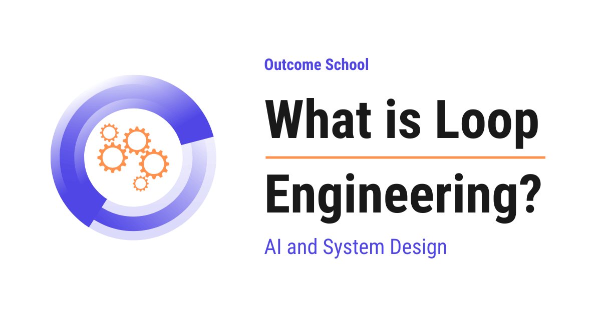

# What is Loop Engineering?

> Archived from <https://outcomeschool.com/blog/what-is-loop-engineering> on 2026-11-25.

Loop Engineering is the practice of designing the repeating cycle that an AI agent runs, so that the agent keeps making real progress on a task and stops at the right moment with the right result.

In this blog, we will learn about Loop Engineering, the practice of designing the repeating cycle that an AI agent runs again and again until a task is actually finished. We will also see why we need it, what one turn of the loop looks like, the parts of the loop that we must control, how it is different from prompt engineering and context engineering, the common ways a loop breaks, the techniques that fix those breaks, and where it works well and where it fails.

We will cover the following:
<ul><li>What is Loop Engineering?</li><li>Loop Engineering = Loop + Engineering</li><li>Why do we need Loop Engineering?</li><li>What is a loop in an AI agent?</li><li>The simplest loop and its problems</li><li>The parts of the loop that we must engineer</li><li>Prompt Engineering vs Context Engineering vs Loop Engineering</li><li>Common ways a loop breaks</li><li>Techniques of Loop Engineering</li><li>A complete example</li><li>Where it works well and where it fails</li></ul>
I am <strong>Amit Shekhar</strong>, Founder @ <a target="_blank" rel="noopener noreferrer" href="https://outcomeschool.com">Outcome School</a>, I have taught and mentored many developers, and their efforts landed them high-paying tech jobs, helped many tech companies in solving their unique problems, and created many open-source libraries being used by top companies. I am passionate about sharing knowledge through open-source, blogs, and videos.

I teach <a target="_blank" rel="noopener noreferrer" href="https://outcomeschool.com/program/ai-and-machine-learning">AI and Machine Learning</a> at Outcome School.

Let&#x27;s get started.
<h3 id="what-is-loop-engineering">What is Loop Engineering?</h3>
<strong>Loop Engineering is the practice of designing the repeating cycle that an AI agent runs, so that the agent keeps making real progress on a task and stops at the right moment with the right result.</strong>

In simple words, a modern <a target="_blank" rel="noopener noreferrer" href="ai-agent.md">AI agent</a> does not answer in one shot. It thinks, it does something, it looks at what happened, and then it thinks again. That circle repeats many times. Loop Engineering is the work of shaping that circle.

The model is only one part of an agent. The loop around the model decides how many times the model gets to try, what the model sees on each try, what it is allowed to do, and when the whole thing must stop. A strong model inside a badly designed loop will still fail. A modest model inside a well designed loop will often finish the job.
<h3 id="loop-engineering--loop--engineering">Loop Engineering = Loop + Engineering</h3>
Let&#x27;s break the term into two parts.

<strong>Loop</strong> means something that repeats. The agent does a step, and then it does another step, and then another one, until some condition tells it to stop.

<strong>Engineering</strong> means designing that repetition on purpose, with rules, limits, and checks, instead of letting it run wild.

So, Loop Engineering is the deliberate design of the repeat.

The best way to learn this is by taking an example.

Let&#x27;s say we are cooking a soup. We taste it. It needs salt. We add a pinch of salt. We taste it again. It is still not enough. We add another pinch. We taste again. Now it is good, so we stop and serve it.

Here, we can see a loop. Taste, decide, act, taste again.

Now think about what can go wrong. A cook who never tastes will never know when to stop. A cook who forgets that salt was already added will keep adding salt forever. A cook who tastes a hundred times will serve the soup cold. A cook who never decides that the soup is good enough will never serve it at all.

Loop Engineering is everything we do to prevent these problems. How many tastes are allowed, what the cook must remember, what &quot;good enough&quot; means, and what to do when the soup is already ruined.

An AI agent has exactly the same problems. Let me map the kitchen to the agent for your better understanding.
<table><thead><tr><th>In the kitchen</th><th>In the agent</th></tr></thead><tbody><tr><td>The cook</td><td>The AI model that decides what to do next</td></tr><tr><td>Adding a pinch of salt</td><td>An action, such as running a command or reading a file</td></tr><tr><td>Tasting the soup</td><td>Looking at the result of that action</td></tr><tr><td>Remembering the salt already added</td><td>The memory that carries from one turn to the next</td></tr><tr><td>&quot;The soup is good enough&quot;</td><td>The definition of done</td></tr><tr><td>&quot;Serve it before it goes cold&quot;</td><td>The limit on how many turns are allowed</td></tr></tbody></table><h3 id="why-do-we-need-loop-engineering">Why do we need Loop Engineering?</h3>
Earlier, we used a language model like a vending machine. We put in a question, we got out an answer, and the story ended there. One request, one response.

But real tasks are not like that. Consider a task like &quot;find the bug in this file and fix it&quot;. The model cannot do this in one shot, because it does not know what is inside the file yet. It must read the file first. After reading, it must run the test. After running the test, it must see the error. After seeing the error, it must edit the code. After editing, it must run the test again to confirm.

So, the work naturally becomes a sequence of steps, and each step depends on the result of the previous one. That is a loop.

Once we put a model inside a loop, a new class of problems arrives that never existed in the single-question world. The agent can repeat itself. It can forget what it already did. It can drift away from the original goal. It can run forever and burn a lot of money. It can declare success when nothing actually worked.

None of these are problems of the prompt. They are problems of the loop.

Now, let&#x27;s take a real use-case. A coding agent that fixes a failing test, a research agent that reads twenty pages before writing a summary, and a support agent that checks an order, then checks the refund policy, then raises a ticket. Every one of them is a loop running behind the scenes. The company that builds the better loop ships the better agent, even when everyone is calling the very same model.

So, here comes Loop Engineering to the rescue.

To learn AI Agent, Agentic AI, and Tool use in Agents in depth, check out our <a target="_blank" rel="noopener noreferrer" href="https://outcomeschool.com/program/ai-and-machine-learning">AI and Machine Learning Program</a> at Outcome School.
<h3 id="what-is-a-loop-in-an-ai-agent">What is a loop in an AI agent?</h3>
Before jumping into the loop, we must know one word that we will use again and again from here onwards.

<strong>The context is everything the model can see at this moment.</strong> It is the working notepad of the agent. The goal sits in it, the earlier steps sit in it, and every result sits in it. The model has no other memory. If a fact is not in the context, then for the model that fact does not exist.

Now, one turn of an <a target="_blank" rel="noopener noreferrer" href="ai-agent-loop.md">agent loop</a> has three parts.

<strong>Think:</strong> the model reads the context and decides what to do next.

<strong>Act:</strong> the system runs the thing the model asked for. The model cannot touch the outside world by itself, so it asks for a <strong><a target="_blank" rel="noopener noreferrer" href="how-does-function-calling-work-in-llms.md">tool</a></strong>. A tool is simply a small program that we hand to the model, such as one that reads a file, searches the web, runs a command, or fetches data from another service.

<strong>Observe:</strong> the result of that action comes back and gets added to the context.

Then the turn ends, and the next turn begins with that updated context. Think, act, observe. Again and again.

This think, act, observe cycle is exactly the pattern behind a <a target="_blank" rel="noopener noreferrer" href="react-agent.md">ReAct Agent</a>, and we have a detailed blog on it that explains this in depth.

The important thing to notice is that the model itself does not loop. The model just produces one output when we call it. <strong>The loop is code that we write around the model.</strong> That is why we can engineer it.
<blockquote>
The model decides what to do next. The loop decides what actually happens.
</blockquote>
<strong>Planning your move into AI?</strong>

No matter which tech domain you work in today, with your effort, you can transition to these roles:
<ul><li>AI Engineer</li><li>Forward Deployed Engineer</li><li>AI Agent Engineer</li><li>Harness Engineer</li><li>Voice AI Engineer</li><li>AI Architect</li><li>LLM Engineer</li><li>LLM Inference Engineer</li><li>Gen AI Engineer</li><li>MLOps Engineer</li><li>ML Engineer</li><li>Deep Learning Engineer</li></ul>
Our <a target="_blank" rel="noopener noreferrer" href="https://outcomeschool.com/program/ai-and-machine-learning">AI and Machine Learning Program</a> at Outcome School takes you there.
<h3 id="the-simplest-loop-and-its-problems">The simplest loop and its problems</h3>
Let&#x27;s see the most basic version of an agent loop as below:

<pre><code class="language-python code-highlight">while True:
    decision = model(context)
    result = run_tool(decision.tool, decision.input)
    context = context + result
</code></pre>

Here, we can see that the model looks at the context, picks a tool, we run that tool, and we paste the result back into the context. Then it goes around again.

This works for a small demo, and it fails badly in the real world.

<strong>Problem 1:</strong> There is no stop. <code>while True</code> means the agent can go around a thousand times if the model never says it is finished.

<strong>Problem 2:</strong> The context only grows. Every raw tool result gets pasted in. After twenty steps, the context is huge, expensive, and full of noise.

<strong>Problem 3:</strong> There is no error handling. If the tool crashes, the whole loop crashes with it.

<strong>Problem 4:</strong> There is no <a target="_blank" rel="noopener noreferrer" href="ai-is-only-as-good-as-our-definition-of-done.md">definition of done</a>. Nothing in this code knows what success looks like.

The issue with this approach is that it trusts the model to manage itself. Let&#x27;s see how the next approach solve this issue.
<h3 id="the-parts-of-the-loop-that-we-must-engineer">The parts of the loop that we must engineer</h3>
There are seven parts in a loop, and each one is a decision that we, the engineers, must make.

<strong>The goal.</strong> The loop must carry a clear statement of what finished means. &quot;Fix the bug&quot; is weak. &quot;The test named <code>test_login</code> passes&quot; is strong, because a machine can check it.

<strong>The step budget.</strong> The loop must have a maximum number of turns. When the budget runs out, the agent stops and reports honestly that it did not finish.

<strong>The tools.</strong> The list of actions the agent is allowed to take. A short, sharp list of tools produces a much better loop than a long list of overlapping ones, because the model has fewer wrong turns available to it.

<strong>The observation.</strong> What we paste back after a tool runs. A tool that returns ten thousand lines of output will drown the loop. We must trim it, or summarize it, or return it in small pages, before it enters the context.

<strong>The <a target="_blank" rel="noopener noreferrer" href="ai-agent-memory.md">memory</a>.</strong> What carries forward from turn to turn. Full history is honest but expensive. A running summary is cheap but can lose details. This choice shapes everything.

<strong>The feedback on failure.</strong> When a tool returns an error, the message we paste back is a teaching signal. &quot;Error&quot; teaches nothing. &quot;File not found at path <code>src/mian.py</code>, did you mean <code>src/main.py</code>&quot; lets the agent recover on the very next turn.

<strong>The exit.</strong> The set of conditions under which the loop stops. Success, budget exhausted, repeated failure, or a request for a human. Every one of these must be handled.

Now, we have understood the parts. Let&#x27;s see them inside real code.

Our updated loop:

<pre><code class="language-python code-highlight">MAX_STEPS = 12

def run_agent(goal, context):
    for step in range(MAX_STEPS):
        # the goal goes in on every single turn, so the agent cannot drift
        decision = model(goal, context)

        if decision.is_done:
            if verify(goal):          # check the claim, do not believe it
                return decision.answer
            context = add(context, &quot;Verification failed. Keep working.&quot;)
            continue

        try:
            result = run_tool(decision.tool, decision.input)
        except ToolError as e:
            # a crash becomes a lesson instead of the end of the run
            result = f&quot;Tool failed: {e}. Try a different approach.&quot;

        context = add(context, trim(result))

    return &quot;Could not finish within the step budget.&quot;
</code></pre>

Here, we have made six changes.
<ul><li><code>MAX_STEPS</code> gives the loop a hard ceiling, so it can never run forever.</li><li>The <code>goal</code> is passed in on every turn, so the agent always knows where it is headed.</li><li><code>decision.is_done</code> gives the model a proper way to say that it has finished.</li><li><code>verify(goal)</code> checks that claim with real code instead of believing it. If the check fails, we tell the agent and let it continue.</li><li>The <code>try</code> block turns a crash into a message, so a broken tool becomes a lesson instead of the end of the run.</li><li><code>trim(result)</code> keeps the observation small, so the context stays clean.</li></ul>
<strong>Note:</strong> the <code>verify</code> step is the single most valuable line here. Without it, an agent will happily tell us that the bug is fixed while the test is still failing.

This is how a loop stops being a demo and starts being a system.

<strong>A quick note for you</strong>

No matter which tech domain you work in, get familiar with these topics:
<ul><li>LLM</li><li>RAG</li><li>MCP</li><li>Agent</li><li>Fine-tuning</li><li>Quantization</li></ul>
We put it all together in one video:

<a target="_blank" rel="noopener noreferrer" href="https://www.youtube.com/watch?v=lnfWvX66FUk">AI Engineering Explained: LLM, RAG, MCP, Agent, Fine-Tuning, and Quantization</a>

No need to stop reading - bookmark it and watch later when you get time. Future you will thank you.

Now, let&#x27;s get back to the topic.
<h3 id="prompt-engineering-vs-context-engineering-vs-loop-engineering">Prompt Engineering vs Context Engineering vs Loop Engineering</h3>
These three names sound similar, so let&#x27;s separate them clearly.

<strong><a target="_blank" rel="noopener noreferrer" href="prompt-engineering.md">Prompt Engineering</a></strong> is about the wording of one instruction. What do we say to the model, and how do we say it.

<strong><a target="_blank" rel="noopener noreferrer" href="context-engineering.md">Context Engineering</a></strong> is about the content of that notepad. What information sits in front of the model at this moment, where it came from, and what we left out.

<strong>Loop Engineering</strong> is about the shape of the repetition. How many turns, what changes between turns, what carries forward, and when it ends.

Let me tabulate the differences between the three for your better understanding.
<table><thead><tr><th>Point</th><th>Prompt Engineering</th><th>Context Engineering</th><th>Loop Engineering</th></tr></thead><tbody><tr><td>Unit of work</td><td>One instruction</td><td>One context</td><td>One full run</td></tr><tr><td>Main question</td><td>What do we say?</td><td>What does the model see?</td><td>What happens next, and when do we stop?</td></tr><tr><td>Typical fix</td><td>Rewrite the wording</td><td>Add, trim, or reorder information</td><td>Add a budget, a check, or a better exit</td></tr><tr><td>Failure it prevents</td><td>A vague or misread answer</td><td>A confused or overloaded model</td><td>An endless, drifting, or falsely successful run</td></tr><tr><td>Who controls it</td><td>The person writing the prompt</td><td>The code that gathers the information</td><td>The code that runs the model again and again</td></tr></tbody></table>
Prompt Engineering fixes what the model hears, Context Engineering fixes what the model knows, and Loop Engineering fixes what the model is allowed to do over time.

This was all about the comparison. Now, let&#x27;s learn about the ways a loop breaks in practice.
<h3 id="common-ways-a-loop-breaks">Common ways a loop breaks</h3>
Most of the time, we do mistakes while designing the loop, and the same failures show up again and again.

<strong>The endless loop.</strong> The agent keeps taking turns and never decides that the work is complete. It usually happens when the goal has no definition of done that a machine can check.

<strong>The repeating loop.</strong> The agent runs the same failing command four times in a row and expects a different result. It happens when the failure message carries no new information, so the model has no reason to change its plan.

<strong>The forgetting loop.</strong> The agent solves a sub-problem on turn three, and by turn fifteen that solution has been squeezed out of the context. The agent then solves the same sub-problem again. This is a memory design failure.

<strong>The drifting loop.</strong> The agent starts by fixing a login bug and ends up rewriting the whole database layer. Each single step looked reasonable, and the destination is completely wrong. It happens when the original goal is not repeated in the context on every turn.

<strong>The lying loop.</strong> The agent announces that the task is complete, and nothing was actually verified. This is the most dangerous one, because the run looks successful in the logs.

<strong>The expensive loop.</strong> The agent finishes correctly, and it took ninety turns and a very large bill, because every raw tool output was pasted in and re-sent on every single turn.

<strong>Stay updated:</strong> Subscribe to our <a target="_blank" rel="noopener noreferrer" href="https://outcomeschool.substack.com/subscribe">newsletter</a> to get our latest AI and Machine Learning blogs straight to your inbox.

Now that we have seen the failures, it is time to learn the techniques that prevent them.
<h3 id="techniques-of-loop-engineering">Techniques of Loop Engineering</h3>
<strong>Give a step budget.</strong> Set a maximum number of turns and stop cleanly when it is reached. A run that reports &quot;I could not finish in twelve steps, here is how far I got&quot; is far more useful than a run that never returns.

<strong>Make done checkable by a machine.</strong> Do not ask the loop to decide that the code &quot;looks correct&quot;. Ask it to run the test and read the pass or fail result that the computer itself reports. If a machine cannot check the goal, the loop cannot reliably end.

<strong>Verify before we trust.</strong> When the model says it is finished, run the check ourselves. If the check fails, put that fact into the context and continue the loop.

<strong>Repeat the goal every turn.</strong> Keep the original task at the top of the context on every single turn. This costs a few extra words on every turn, and it is the cheapest cure for drift.

<strong>Make failures informative.</strong> Turn an error into a hint. Instead of pasting the full crash report, paste the one line that matters plus a short note about what to try next.

<strong>Break the repeat.</strong> Detect when the same action is being attempted again with the same input. When that happens, block it and add a message such as &quot;This exact command already failed twice. Try a different approach.&quot;

<strong>Trim every observation.</strong> Before a tool result enters the context, cut it down. The first few and the last few lines of a long output, the first twenty search results instead of all of them, the relevant function instead of the whole file.

<strong>Compact the history.</strong> When the context crosses a threshold, replace the old turns with a short summary that keeps the decisions and the facts learned, and drops the raw noise. The agent then continues with a light, clean context. We have a detailed blog on <a target="_blank" rel="noopener noreferrer" href="how-does-context-compaction-work.md">context compaction</a> that explains this step by step.

<strong>Plan first, then loop.</strong> Ask for a short plan on the first turn, and keep that plan visible in the context. Each later turn then works against a written list instead of a vague memory, and the drift problem shrinks a lot. This is the idea behind the <a target="_blank" rel="noopener noreferrer" href="plan-and-execute-agent.md">Plan-and-Execute Agent</a>, and we have a detailed blog on it that covers the pattern end to end.

<strong>Use sub-loops.</strong> When a step is big, hand it to a separate agent with its own small loop, its own budget, and its own tools. The <a target="_blank" rel="noopener noreferrer" href="ai-subagents.md">sub-agent</a> returns only its final result. The parent loop stays short and clean, because all the noisy intermediate steps stayed inside the child.

<strong>Keep a <a target="_blank" rel="noopener noreferrer" href="human-in-the-loop-agents.md">human in the loop</a> for irreversible steps.</strong> Deleting data, sending an email, moving money, deploying to production. The loop must pause and ask before crossing these lines.

Let me tabulate the failures against their fixes for your better understanding so that you know exactly which technique to reach for.
<table><thead><tr><th>The failure</th><th>The fix</th></tr></thead><tbody><tr><td>The endless loop</td><td>A step budget and a finish line a machine can check</td></tr><tr><td>The repeating loop</td><td>Better failure messages, and blocking a repeated action</td></tr><tr><td>The forgetting loop</td><td>Compact the history instead of dropping the old turns</td></tr><tr><td>The drifting loop</td><td>Repeat the goal every turn, and plan first</td></tr><tr><td>The lying loop</td><td>Verify the claim with code before exiting</td></tr><tr><td>The expensive loop</td><td>Trim every observation, and use sub-loops</td></tr></tbody></table>
If we want to go deep into Loop Engineering, Memory in Agents, Context Engineering, and Subagent, we cover all of them from the ground up in our <a target="_blank" rel="noopener noreferrer" href="https://outcomeschool.com/program/ai-and-machine-learning">AI and Machine Learning Program</a> at Outcome School.
<h3 id="a-complete-example">A complete example</h3>
Let&#x27;s take a real task. The goal is: &quot;The test <code>test_login</code> must pass.&quot;

<strong>Turn 1.</strong> The agent reads the goal. It calls the tool that runs the test. The result comes back as a failure, and it points at line 42. We trim the output to the goal, the failing test name, and that one error line.

<strong>Turn 2.</strong> The agent reads line 42 and the function around it. It sees that a token is compared before it is created.

<strong>Turn 3.</strong> The agent edits the file to move the token creation above the comparison.

<strong>Turn 4.</strong> The agent runs the test again. It fails with a different error now, which tells us that the loop is making progress and not spinning.

<strong>Turn 5.</strong> The agent reads the new error, sees a missing import, and adds it.

<strong>Turn 6.</strong> The agent runs the test. It passes. The agent says it is done.

<strong>The verify step.</strong> The loop does not simply believe this. It runs the whole test suite one final time itself. Every test passes, so the loop exits and returns the answer.

Here, we can notice a few things. The loop had a budget of twelve turns and used six. The goal was checkable by a machine, so the ending was never in doubt. Each error message pointed at exactly one line, so every turn changed the plan. And the final claim was verified by code, not accepted on trust.

That is a well engineered loop.

To master Agent Architecture and Evaluation of LLMs and Agents, we build an AI Coding Agent from scratch in our <a target="_blank" rel="noopener noreferrer" href="https://outcomeschool.com/program/ai-and-machine-learning">AI and Machine Learning Program</a> at Outcome School.
<h3 id="where-it-works-well-and-where-it-fails">Where it works well and where it fails</h3>
<strong>Where it works well:</strong>
<ul><li>Tasks that have a clear finish line that a machine can check, such as tests passing, a build succeeding, or a file matching a required format.</li><li>Tasks where the environment gives honest feedback after every action, such as a compiler, a test runner, or a service that returns a real error message.</li><li>Tasks that can be broken into small steps, where a wrong step is cheap to undo.</li><li>Long tasks where the agent must gather information before it can even plan.</li></ul>
<strong>Where it fails:</strong>
<ul><li>Tasks with no objective finish line, such as &quot;make this essay better&quot;. The loop has nothing to check, so it either stops too early or never stops.</li><li>Environments that give slow or silent feedback. If a mistake shows up only thirty minutes later, the loop cannot learn from it in time.</li><li>Actions that cannot be undone. A loop that experiments freely is a very bad fit for production systems and real money.</li><li>Very long tasks where the context must hold hundreds of facts. The summarizing starts dropping things, and the forgetting loop appears.</li></ul>
Now we must have understood what Loop Engineering is. Prompt Engineering shapes one sentence, Context Engineering shapes what the model sees, <a target="_blank" rel="noopener noreferrer" href="what-is-graph-engineering.md">Graph Engineering</a> shapes the path from one step to the next, and Loop Engineering shapes the whole run from the first turn to the last. As agents take on longer and longer work, the quality of the loop, and not the cleverness of the prompt, decides whether the work actually gets finished.
<h2 id="frequently-asked-questions">Frequently Asked Questions</h2><h3 id="can-a-stronger-model-make-up-for-a-badly-designed-loop">Can a stronger model make up for a badly designed loop?</h3>
No. A strong model inside a badly designed loop will still fail, while a modest model inside a well designed loop will often finish the job. The loop decides how many times the model tries, what it sees on each try, what it is allowed to do, and when it must stop.
<h3 id="should-we-trust-an-agent-when-it-says-the-task-is-done">Should we trust an agent when it says the task is done?</h3>
No. We must verify the claim with real code before the loop exits, such as running the tests ourselves. If the check fails, we put that fact into the context and let the agent continue. Without this step, an agent can report that a bug is fixed while the test is still failing.
<h3 id="what-should-an-agent-do-when-it-runs-out-of-its-step-budget">What should an agent do when it runs out of its step budget?</h3>
It should stop cleanly and report honestly that it did not finish. A run that says it could not finish within the budget and shows how far it got is far more useful than a run that never returns. The step budget is what keeps the loop from running forever.
<h3 id="is-it-good-to-paste-the-full-tool-output-back-into-the-context">Is it good to paste the full tool output back into the context?</h3>
No. If every raw tool result is pasted in, the context keeps growing and becomes huge, expensive, and full of noise. We must trim each observation first, such as keeping only the relevant lines, the first few search results, or the one function we need instead of the whole file.
<h3 id="what-is-the-difference-between-loop-engineering-and-graph-engineering">What is the difference between Loop Engineering and Graph Engineering?</h3>
Graph Engineering shapes the path from one step to the next, while Loop Engineering shapes the whole run from the first turn to the last. Loop Engineering focuses on the repeating think, act, observe cycle of an agent, including its step budget, memory, feedback on failure, and exit conditions.

That&#x27;s it for now.

Thanks

<strong>Amit Shekhar</strong> Founder @ <a target="_blank" rel="noopener noreferrer" href="https://outcomeschool.com">Outcome School</a>

You can connect with me on:
<ul><li><a target="_blank" rel="noopener noreferrer" href="https://x.com/amitiitbhu">X</a></li><li><a target="_blank" rel="noopener noreferrer" href="https://www.linkedin.com/in/amit-shekhar-iitbhu">LinkedIn</a></li><li><a target="_blank" rel="noopener noreferrer" href="https://github.com/amitshekhariitbhu">GitHub</a></li></ul>
Follow Outcome School on:
<ul><li><a target="_blank" rel="noopener noreferrer" href="https://x.com/outcome_school">X</a></li><li><a target="_blank" rel="noopener noreferrer" href="https://youtube.com/@OutcomeSchool">YouTube</a></li><li><a target="_blank" rel="noopener noreferrer" href="https://www.linkedin.com/company/outcomeschool">LinkedIn</a></li><li><a target="_blank" rel="noopener noreferrer" href="http://github.com/OutcomeSchool">GitHub</a></li></ul>
<a target="_blank" rel="noopener noreferrer" href="https://outcomeschool.com/blog"><strong>Read all of our high-quality blogs here.</strong></a>

