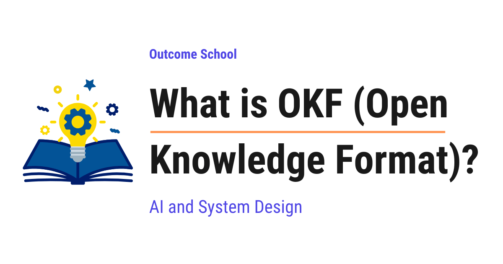

# What is OKF (Open Knowledge Format)?

> Archived from <https://outcomeschool.com/blog/what-is-okf-open-knowledge-format> on 2026-11-25.

OKF (Open Knowledge Format) is an open standard for writing down what an organization knows about its data and systems, as a folder of plain markdown files, so that any AI agent or any tool can read that knowledge.

In this blog, we will learn about OKF (Open Knowledge Format). We will also see why the knowledge about our data stays scattered across many places, how OKF writes that knowledge down as a folder of plain markdown files which any AI agent or any tool can read, and where it fits along with <a target="_blank" rel="noopener noreferrer" href="what-is-mcp-model-context-protocol.md">MCP</a> and <a target="_blank" rel="noopener noreferrer" href="what-are-agent-skills.md">Agent Skills</a> in the real world.

We will cover the following:
<ul><li>The problem: our knowledge is scattered</li><li>What is OKF?</li><li>OKF = Open + Knowledge + Format</li><li>What is inside an OKF bundle?</li><li>The frontmatter and the one required field</li><li>Cross-links turn files into a graph</li><li>Why plain markdown files?</li><li>How an agent actually uses it</li><li>OKF, MCP, and Agent Skills</li><li>What ships with OKF today</li><li>Summary</li></ul>
I am <strong>Amit Shekhar</strong>, Founder @ <a target="_blank" rel="noopener noreferrer" href="https://outcomeschool.com">Outcome School</a>, I have taught and mentored many developers, and their efforts landed them high-paying tech jobs, helped many tech companies in solving their unique problems, and created many open-source libraries being used by top companies. I am passionate about sharing knowledge through open-source, blogs, and videos.

I teach <a target="_blank" rel="noopener noreferrer" href="https://outcomeschool.com/program/ai-and-machine-learning">AI and Machine Learning</a> at Outcome School.

Let&#x27;s get started.
<h2 id="the-problem-our-knowledge-is-scattered">The problem: our knowledge is scattered</h2>
Before jumping into OKF, we must understand the problem it solves.

Let&#x27;s say we work at a company that sells things online. All of our business data sits in tables, and one of those tables is called <code>orders</code>.

Now, a new person joins our team. They are a good engineer and they know how to query a table. After a couple of weeks, they are given a simple job.

&quot;Tell me how many sales we made last week.&quot;

It sounds easy. The table is right there, and it is not hidden from anybody. It has a <code>status</code> column, an <code>amount</code> column, and a <code>country</code> column, and the tool that lists our tables shows us those names and stops there.

But before that number is correct, there are five separate rules that have to be known, and each one of them was written down in a different place.

<pre><code class="code-highlight">   only completed orders count        -&gt;  one senior engineer knows this
   test orders must be removed        -&gt;  a wiki page from two years ago
   a refund is a row with a minus     -&gt;  a comment inside the code
   one country is counted twice       -&gt;  a spreadsheet made last year
   data before March is not usable    -&gt;  the same senior engineer
</code></pre>

Here, we can see the problem. Every one of these rules is real, every one of them changes the final number, and no single place holds all five. The knowledge exists, but it is scattered, and nobody wrote it down in one place because each rule was learned on a different day by a different person. So the new person walks around asking people, and even then they only learn the rules somebody remembers to mention.

Now, this was always annoying. But something has changed that makes it much worse.

Today we have AI agents. An <a target="_blank" rel="noopener noreferrer" href="ai-agent.md">AI agent</a> is an AI that takes actions step by step to finish a job for us. We ask an agent to build a sales report, and it goes looking at the <code>orders</code> table.

The agent faces the exact same problem as the new person, and it is in a worse position, because it cannot walk over to the senior engineer&#x27;s desk and ask. It sees column names and nothing more. So it guesses. And a confident guess about what our data means is exactly how we end up with a report full of wrong numbers. We have a detailed blog on <a target="_blank" rel="noopener noreferrer" href="context-engineering.md">Context Engineering</a> that explains how we give an agent the right context to work with.

Now, we can think the answer is simple. Let&#x27;s just write all of it down properly in one tool.

But, here is the catch. Every tool stores this knowledge in its own private shape, behind its own way of asking for it. So if we write everything into tool A, then tool B cannot read it, and our agent has to be taught tool A&#x27;s private language first. Move to a different tool next year, and the whole thing has to be redone.

So, we need one common shape for writing down what we know, which every tool and every agent can read without special treatment.

We needed a solution for that. So, here comes OKF to the rescue.
<h2 id="what-is-okf">What is OKF?</h2>
<strong>OKF, which stands for Open Knowledge Format, is an open standard for writing down what an organization knows about its data and systems, as a folder of plain markdown files, so that any AI agent or any tool can read that knowledge without custom work.</strong>

It was published by the Google Cloud Data Cloud team on 13 June 2026, as version 0.1.

In simple words, OKF is an agreed way of writing our company&#x27;s knowledge into ordinary text files, so that both people and machines can read the same file.

Now, this idea did not appear out of nowhere. For a while, teams had already been keeping a folder of notes written specially for their AI to read, and people started calling this an &quot;LLM wiki&quot;. The habit worked well, but every team invented its own arrangement, so one team&#x27;s notes could not be shared with anybody else. OKF takes that habit and writes down the rules for it, so that the notes one team keeps can be read by another team&#x27;s agent.

Let&#x27;s be clear about the most important design choice, because it explains everything else.
<blockquote>
OKF is just markdown. Just files. Just YAML frontmatter.
</blockquote>
There is no software to install. There is no server to run. There is no special program needed to read it. We will understand what each of those words means as we go.

Let&#x27;s see the change it brings.

<pre><code class="code-highlight">   Without a common format:

     Catalog tool   -&gt;  shape A  -&gt;  needs a reader built only for shape A
     Company wiki   -&gt;  shape B  -&gt;  needs a reader built only for shape B
     Code comment   -&gt;  shape C  -&gt;  needs a reader built only for shape C

     3 sources, 3 different shapes, 3 readers to build and maintain

   With OKF:

     Catalog tool   --+
     Company wiki   --+--&gt;  the same OKF files  -&gt;  one reader for all of them
     Code comment   --+

     3 sources, 1 shape, 0 readers to build
</code></pre>

In this diagram, &quot;shape&quot; means the arrangement each tool uses to store the knowledge, and a &quot;reader&quot; is the extra code our agent needs so it can understand that one arrangement.

Here, we can see the whole point of a standard. In the first case, adding one more source means building one more reader, so the work keeps growing forever. In the second case, everybody writes the same shape once, and a single reader understands all of them, including the sources we add next year. The people writing the knowledge and the tools reading it no longer need to know about each other at all.

To learn AI Agent, Tool use in Agents, and Context Engineering in depth, and to build an AI Coding Agent from scratch, check out our <a target="_blank" rel="noopener noreferrer" href="https://outcomeschool.com/program/ai-and-machine-learning">AI and Machine Learning Program</a> at Outcome School.
<h2 id="okf--open--knowledge--format">OKF = Open + Knowledge + Format</h2>
The name is doing exactly what it says, so let&#x27;s break it down.
<blockquote>
OKF = Open + Knowledge + Format
</blockquote><ul><li><strong>Open</strong> means the rules are published for everybody. Anyone can write these files, and anyone can read them.</li><li><strong>Knowledge</strong> means the part that is not the data itself. Not the rows in the table, but what the table means, why it exists, what its columns are for, and what to watch out for.</li><li><strong>Format</strong> means an agreed shape for writing it down, so that everybody writes it the same way.</li></ul>
Means, OKF is an agreed and openly published shape for writing down what we know.

Now, let&#x27;s be very clear about that middle word, because it is the part people misread. OKF does not store our data. It stores the understanding that sits around our data.

Let&#x27;s see the difference side by side.

<pre><code class="code-highlight">   THE DATA lives in the table:

     order_id | amount | status    | country
     ---------+--------+-----------+--------
     1001     | 250    | complete  | IN
     1002     | 90     | cancelled | IN
     1003     | 410    | complete  | US
     ...      | ...    | ...       | ...       (a million more rows)

   THE KNOWLEDGE lives in the OKF file:

     &quot;One row per order. Only completed ones count as a sale.&quot;
</code></pre>

Here, we can see it clearly. The table holds a million rows and never explains itself. The OKF file holds one short sentence, and that sentence is what tells us the cancelled row must not be counted. The data is the what. The knowledge is the meaning.

<strong>Planning your move into AI?</strong>

No matter which tech domain you work in today, with your effort, you can transition to these roles:
<ul><li>AI Engineer</li><li>Forward Deployed Engineer</li><li>AI Agent Engineer</li><li>Harness Engineer</li><li>Voice AI Engineer</li><li>AI Architect</li><li>LLM Engineer</li><li>LLM Inference Engineer</li><li>Gen AI Engineer</li><li>MLOps Engineer</li><li>ML Engineer</li><li>Deep Learning Engineer</li></ul>
Our <a target="_blank" rel="noopener noreferrer" href="https://outcomeschool.com/program/ai-and-machine-learning">AI and Machine Learning Program</a> at Outcome School takes you there.
<h2 id="what-is-inside-an-okf-bundle">What is inside an OKF bundle?</h2>
Now, let&#x27;s open one up. A collection of OKF files is called a <strong>bundle</strong>, and a bundle is simply a folder on a computer.

Let&#x27;s look at a real one.

<pre><code class="code-highlight">   sales/
   ├── index.md
   ├── datasets/
   │   ├── index.md
   │   └── orders_db.md
   ├── tables/
   │   ├── index.md
   │   ├── orders.md
   │   └── customers.md
   └── metrics/
       ├── index.md
       └── weekly_active_users.md
</code></pre>

Here, we can see the whole idea at a glance. It is folders and files, exactly like the folders on our own laptop. Nothing more.

The rule is simple. <strong>One file per concept.</strong> The <code>orders</code> table gets one file. The <code>customers</code> table gets its own file. The &quot;weekly active users&quot; measurement gets its own file too.

Every file ends in <code>.md</code>, which means it is a <strong>markdown</strong> file. Markdown is simply plain text with very light formatting, the kind we already use for a README file. We can open it in any text editor.

There is one more clever detail here. The location of the file is the name of the concept. The <code>orders</code> table is at <code>tables/orders.md</code>, so its identity is that path. Nobody needs to invent a separate identification system, because the folder structure already provides one.

<strong>Note:</strong> Those <code>index.md</code> files are optional. They act like the front page of each folder, giving a short overview so that a reader can understand the folder without opening every file in it. There is also an optional <code>log.md</code>, which keeps a dated history of what changed.
<h2 id="the-frontmatter-and-the-one-required-field">The frontmatter and the one required field</h2>
Now, let&#x27;s look inside a single file. Each file has two parts.

The top part sits between two lines of dashes, and it is called the <strong>frontmatter</strong>. It holds the labeled facts about this concept. It is written in a style called YAML, which is simply &quot;label: value&quot; on each line.

The bottom part is the body, which is ordinary markdown, where we explain things in normal sentences.

Let&#x27;s see a whole file at once, so the two parts are clear.

<pre><code class="code-highlight">   tables/orders.md
   +----------------------------------------------------+
   |  ---                                               |
   |  type: BigQuery Table                              |   &lt;- frontmatter
   |  title: Orders                                     |      (labeled facts,
   |  description: One row per order ...                |       read by machines)
   |  ---                                               |
   |                                                    |
   |  # Orders                                          |   &lt;- body
   |                                                    |      (plain sentences,
   |  This table is loaded every night at 2 AM.         |       read by people)
   |  Cancelled orders are never counted as sales.      |
   +----------------------------------------------------+
</code></pre>

Here, we can see both halves in one place. The top half holds short labeled facts, which a machine can sort and filter on. The bottom half holds everything a person would say out loud, the kind of detail that never fits into a label. Both live in the same file, so they can never drift apart.

Now, let&#x27;s look closely at the top of a real file.

<pre><code class="code-highlight language-yaml">---
type: BigQuery Table
title: Orders
description: One row per order. Only completed ones count as a sale.
resource: https://console.cloud.google.com/bigquery?p=acme&amp;d=sales&amp;t=orders
tags: [sales, revenue]
timestamp: 2026-05-28T14:30:00Z
---
</code></pre>

Here, we can read every line without knowing anything technical.
<ul><li><code>type</code> says what kind of thing this is. Here it is a table inside BigQuery, which is Google&#x27;s service for storing very large amounts of data.</li><li><code>title</code> is the human name.</li><li><code>description</code> is the one-line explanation. Notice how much this single line solves. The first rule our new person had to hunt for, that only completed orders count as sales, is answered right here.</li><li><code>resource</code> is a link to the actual thing, so we can go and look at it.</li><li><code>tags</code> are labels for grouping, written as a list.</li><li><code>timestamp</code> records when this was last true, written in a standard date style.</li></ul>
Now, here is the part that surprises people. <strong>Out of all of these, only <code>type</code> is required.</strong> Everything else is optional.

Why would a standard ask for so little? Because a standard that demands twenty fields is a standard nobody fills in. By asking for almost nothing, OKF makes it easy to start with a single line and add more later. The other fields are simply the agreed names to use when we do want them, so that everybody uses the same word instead of one team writing <code>description</code> and another writing <code>desc</code>.

And the types themselves are deliberately loose. <code>BigQuery Table</code> is just an example. A <code>Dataset</code>, a <code>Metric</code>, an <code>API</code>, a <code>Runbook</code>, a <code>Playbook</code>, all of these are fine. OKF does not hand us a fixed list to pick from.

<strong>A quick note for you</strong>

No matter which tech domain you work in, get familiar with these topics:
<ul><li>LLM</li><li>RAG</li><li>MCP</li><li>Agent</li><li>Fine-tuning</li><li>Quantization</li></ul>
We put it all together in one video:

<a target="_blank" rel="noopener noreferrer" href="https://www.youtube.com/watch?v=lnfWvX66FUk">AI Engineering Explained: LLM, RAG, MCP, Agent, Fine-Tuning, and Quantization</a>

No need to stop reading - bookmark it and watch later when you get time. Future you will thank you.

Now, let&#x27;s get back to the topic.
<h2 id="cross-links-turn-files-into-a-graph">Cross-links turn files into a graph</h2>
Now, let&#x27;s learn the part that makes a bundle more than a pile of files.

Concepts in the real world point at each other. The <code>orders</code> table has a column that refers to a customer, and customers live in a different table. So how do we record that connection?

We use an ordinary markdown link, exactly the kind we would write in any document.

<pre><code class="code-highlight language-markdown">| `customer_id` | STRING | FK to [customers](/tables/customers.md). |
</code></pre>

Here, we can see a row from a table description inside the <code>orders.md</code> file. It says there is a column called <code>customer_id</code>, and it holds text. Then <code>FK</code> is short for foreign key, which simply means the value in this column identifies a row sitting in a different table. And notice how that connection is recorded. It is a plain clickable link to the other file.

Now, why does this matter so much? Because once every file can link to other files, the whole bundle stops being a flat list and becomes a <strong>graph</strong>, which simply means a set of things joined by connections.

<pre><code class="code-highlight">   orders.md  ---- points to ----&gt;  customers.md
       |
       +---------- points to ----&gt;  orders_db.md
</code></pre>

Here, we can see what that gives an agent. It starts at the <code>orders</code> file, discovers that customers matter, and follows the link to go and read about them. It can walk through our knowledge the same way we walk through linked pages, one step at a time, learning only what it needs.
<h2 id="why-plain-markdown-files">Why plain markdown files?</h2>
Now, the following question arises. Why did they choose something as plain as text files, when far more powerful options exist?

The plainness is the whole point. Let&#x27;s see what we get for free because of it.
<ul><li><strong>Humans can read it.</strong> The same file that the agent reads is the file we read. There is no separate version for people, so the two can never drift apart.</li><li><strong>It renders anywhere.</strong> Put the bundle in a code repository, and it displays as neat formatted pages. Search tools can index it.</li><li><strong>It travels easily.</strong> It is a folder, so we can zip it up, share it, or copy it onto a machine.</li><li><strong>It versions with our code.</strong> Because these are files, we can keep them beside our code and track every change over time, exactly as we do with code.</li><li><strong>Nothing needs installing.</strong> No program to buy, no service to keep running, no library to add to our project.</li></ul><h2 id="how-an-agent-actually-uses-it">How an agent actually uses it</h2>
Now, let&#x27;s follow one real request from start to finish, so the whole thing becomes concrete.

Suppose we ask our AI agent the same job we gave the new person at the start, &quot;how many sales did we make last week?&quot;

<strong>Step 1:</strong> Before touching any data, the agent looks in the OKF bundle. It reads <code>index.md</code> to see what exists.

<strong>Step 2:</strong> It sees a <code>tables</code> folder and opens <code>tables/orders.md</code>.

<strong>Step 3:</strong> It reads the frontmatter and learns the important sentence straight away. One row is one order, and only the <strong>completed</strong> ones count as a sale. So it now knows it must not count orders that were cancelled or still in progress.

<strong>Step 4:</strong> It reads the body, sees the <code>customer_id</code> column, and follows the link to <code>customers.md</code> if it needs to.

<strong>Step 5:</strong> It uses the <code>resource</code> link to find where the real table actually lives.

<strong>Step 6:</strong> Only now does it go and do the actual work, and it produces the right number.

We can picture the whole flow as below:

<pre><code class="code-highlight">   our question
        |
        v
   read the OKF bundle FIRST        &lt;-  this is the new step
        |
        v
   learn the rule: &quot;completed orders only&quot;
        |
        v
   now go to the real table
        |
        v
   the right answer
</code></pre>

Here, we can see that only one step was added, and it was added at the front. Everything after it stays the same. That one step is the difference between an answer and a guess.

Here, we can notice the most important point. The agent did not become smarter. It simply stopped guessing. All the knowledge it needed was written down once, by somebody who knew, in a file that the agent could read.

This way we can use OKF to solve the interesting problem of giving an agent our own context, without teaching it any special tool.

<strong>Stay updated:</strong> Subscribe to our <a target="_blank" rel="noopener noreferrer" href="https://outcomeschool.substack.com/subscribe">newsletter</a> to get our latest AI and Machine Learning blogs straight to your inbox.
<h2 id="okf-mcp-and-agent-skills">OKF, MCP, and Agent Skills</h2>
Now, there are two other open standards that come up in the same conversation, and it helps a lot to see how the three differ. They are not competing. Each answers a different question.
<ul><li><strong>MCP</strong>, which stands for Model Context Protocol, connects an agent to outside tools and data. It answers &quot;what can the agent reach?&quot;</li><li><strong>Agent Skills</strong> are folders of instructions that teach an agent our way of doing a job. They answer &quot;how should the agent do this?&quot;</li><li><strong>OKF</strong> records what our data and systems actually mean. It answers &quot;what is this thing?&quot;</li></ul>
Agent Skills are already in use today. A coding agent picks up our team&#x27;s way of working from a plain markdown file kept inside the project, exactly like this. We have a detailed blog on <a target="_blank" rel="noopener noreferrer" href="how-does-claude-code-work.md">How does Claude Code work?</a> that explains this step by step.

Let me tabulate the differences between the three for your better understanding so that you can decide which one to use based on your use case.
<table><thead><tr><th>Point</th><th>OKF</th><th>Agent Skills</th><th>MCP</th></tr></thead><tbody><tr><td>What it carries</td><td>Knowledge about our things</td><td>Know-how, our steps and format</td><td>Reach, a live connection</td></tr><tr><td>Question it answers</td><td>What is this thing?</td><td>How should this be done?</td><td>What can the agent reach?</td></tr><tr><td>What it is made of</td><td>A folder of markdown files</td><td>A folder of markdown files</td><td>A running program</td></tr><tr><td>Needs something running</td><td>No</td><td>No</td><td>Yes</td></tr><tr><td>Best for</td><td>Data meaning, definitions, context</td><td>Procedures, checklists, style</td><td>Databases, apps, live actions</td></tr></tbody></table>
They solve different problems. In real work they fit together. MCP connects the agent to our database, OKF tells it what the tables in that database mean, and a Skill tells it how our team wants the report written.

<strong>Note:</strong> We can notice from the table that OKF and Agent Skills are built almost the same way, as a folder of markdown files with frontmatter at the top.

If we want to go deep into the Model Context Protocol (MCP), Tool use in Agents, and Agent Architecture, check out our <a target="_blank" rel="noopener noreferrer" href="https://outcomeschool.com/program/ai-and-machine-learning">AI and Machine Learning Program</a> at Outcome School.
<h2 id="what-ships-with-okf-today">What ships with OKF today</h2>
Now, a standard on its own is only a document. So let&#x27;s see what was actually released alongside it.

<strong>An enrichment agent.</strong> This walks through a company&#x27;s existing data, and drafts the OKF files automatically. This matters more than it sounds, because writing hundreds of files by hand is the reason such efforts usually die. Here, a first draft is generated for us, and people then correct and improve it.

<strong>A visualizer.</strong> This turns any bundle into a single web page showing the graph of concepts and their links, so we can look at our knowledge instead of reading folders.
<h2 id="summary">Summary</h2>
Let&#x27;s quickly recap what we have learned.
<ul><li>Knowledge about our data is scattered across catalogs, wikis, code comments, and people&#x27;s heads, and an AI agent cannot go and ask a person.</li><li>Every tool stores this knowledge in its own private shape, so it cannot be shared or moved.</li><li>OKF is an open standard for writing that knowledge down, published by the Google Cloud Data Cloud team on 13 June 2026 as version 0.1.</li><li>It formalizes a habit teams already had, of keeping a folder of notes for their AI, which people called an LLM wiki, and gives it rules so the notes can be shared.</li><li>OKF = Open + Knowledge + Format. It records what our data means, and never the data itself.</li><li>A bundle is a plain folder of markdown files, with one file per concept, and the file path is the concept&#x27;s identity.</li><li>Each file has YAML frontmatter at the top, where <code>type</code> is the only required field, and <code>title</code>, <code>description</code>, <code>resource</code>, <code>tags</code>, and <code>timestamp</code> are the agreed optional ones.</li><li>Files link to each other with ordinary markdown links, which turns the bundle into a graph an agent can walk through.</li><li>It is deliberately plain, so it needs no software, reads the same for people and machines, and versions alongside our code.</li><li>An agent reads the bundle before doing real work, so it stops guessing what our data means.</li><li>MCP gives reach, Agent Skills give know-how, and OKF gives knowledge. They work together.</li></ul>
This is what OKF is, one plain and open way to write down what we know, so that our agents finally understand our data instead of guessing at it.
<h2 id="frequently-asked-questions">Frequently Asked Questions</h2><h3 id="who-created-okf">Who created OKF?</h3>
OKF was published by the Google Cloud Data Cloud team on 13 June 2026, as version 0.1. It is an open standard, which means the rules are published for everybody. Anyone can write OKF files, and any AI agent or tool can read them without custom work.
<h3 id="does-okf-store-our-data">Does OKF store our data?</h3>
No. OKF does not store our data. It stores the understanding that sits around our data, like what a table means, what its columns are for, and what to watch out for. The rows stay in the table, while the OKF file holds the meaning, such as which orders count as a sale.
<h3 id="is-okf-the-same-as-an-llm-wiki">Is OKF the same as an LLM wiki?</h3>
Not exactly. An LLM wiki is a folder of notes that teams kept specially for their AI to read, but every team invented its own arrangement, so the notes could not be shared. OKF takes that habit and writes down the rules for it, so the notes one team keeps can be read by another team&#x27;s agent.
<h3 id="is-okf-only-for-describing-database-tables">Is OKF only for describing database tables?</h3>
No. The types in OKF are deliberately loose, and there is no fixed list to pick from. A Dataset, a Metric, an API, a Runbook, or a Playbook are all fine types. Only the <code>type</code> field is required, and everything else is optional.
<h3 id="does-okf-replace-mcp">Does OKF replace MCP?</h3>
No. OKF and MCP answer different questions and work together. MCP connects the agent to outside tools and data, like our database, so it gives reach. OKF records what our data and systems actually mean, so it tells the agent what the tables in that database mean.

That&#x27;s it for now.

Thanks

<strong>Amit Shekhar</strong> Founder @ <a target="_blank" rel="noopener noreferrer" href="https://outcomeschool.com">Outcome School</a>

You can connect with me on:
<ul><li><a target="_blank" rel="noopener noreferrer" href="https://x.com/amitiitbhu">X</a></li><li><a target="_blank" rel="noopener noreferrer" href="https://www.linkedin.com/in/amit-shekhar-iitbhu">LinkedIn</a></li><li><a target="_blank" rel="noopener noreferrer" href="https://github.com/amitshekhariitbhu">GitHub</a></li></ul>
Follow Outcome School on:
<ul><li><a target="_blank" rel="noopener noreferrer" href="https://x.com/outcome_school">X</a></li><li><a target="_blank" rel="noopener noreferrer" href="https://youtube.com/@OutcomeSchool">YouTube</a></li><li><a target="_blank" rel="noopener noreferrer" href="https://www.linkedin.com/company/outcomeschool">LinkedIn</a></li><li><a target="_blank" rel="noopener noreferrer" href="https://github.com/OutcomeSchool">GitHub</a></li></ul>
<a target="_blank" rel="noopener noreferrer" href="https://outcomeschool.com/blog"><strong>Read all of our high-quality blogs here.</strong></a>

