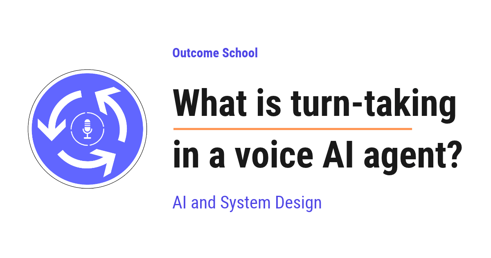

# What is turn-taking in a voice AI agent?

> Archived from <https://outcomeschool.com/blog/what-is-turn-taking-in-a-voice-ai-agent> on 2026-11-25.

Turn-taking in a voice AI agent is the skill of knowing when the user has finished speaking, when the agent should start speaking, and when the agent should stop because the user wants to talk again.

In this blog, we will learn about turn-taking in a voice AI agent. We will also see how humans take turns in a conversation, why this is hard for a machine, how a voice AI agent detects the end of a turn using silence and meaning, how it handles interruptions and short sounds like &quot;uh-huh&quot;, and how full-duplex models take a different path.

We will cover the following:
<ul><li>What is turn-taking?</li><li>How humans take turns</li><li>How a voice AI agent works</li><li>Why turn-taking is hard for a machine</li><li>The two jobs of turn-taking</li><li>Approach 1: Wait for silence</li><li>Approach 2: Understand the meaning</li><li>Handling interruptions</li><li>Not every sound is a new turn</li><li>Half-duplex vs full-duplex agents</li><li>A complete walkthrough</li></ul>
I am <strong>Amit Shekhar</strong>, Founder @ <a target="_blank" rel="noopener noreferrer" href="https://outcomeschool.com">Outcome School</a>, I have taught and mentored many developers, and their efforts landed them high-paying tech jobs, helped many tech companies in solving their unique problems, and created many open-source libraries being used by top companies. I am passionate about sharing knowledge through open-source, blogs, and videos.

I teach <a target="_blank" rel="noopener noreferrer" href="https://outcomeschool.com/program/ai-and-machine-learning">AI and Machine Learning</a> at Outcome School.

Let&#x27;s get started.
<h2 id="what-is-turn-taking">What is turn-taking?</h2>
<strong>Turn-taking is the way two speakers decide who talks and when, so that they do not talk over each other and do not leave long awkward silences.</strong>

A <strong>turn</strong> is one chunk of speech by one speaker. When we say, &quot;What is the weather today?&quot;, that full sentence is one turn. When the other person replies, &quot;It is sunny,&quot; that is the next turn.

So, a conversation is a chain of turns:

<pre><code class="code-highlight">User:  What is the weather today?      (turn 1)
Agent: It is sunny and 28 degrees.     (turn 2)
User:  Should I carry an umbrella?     (turn 3)
Agent: No, you will not need one.      (turn 4)
</code></pre>

A <strong>voice <a target="_blank" rel="noopener noreferrer" href="ai-agent.md">AI agent</a></strong> is a system that talks with us using voice. We speak, it listens, it thinks, and it speaks back. Customer support phone bots, voice assistants, and AI receptionists are all voice AI agents.

For a voice AI agent, turn-taking means answering three questions again and again:
<ul><li>Has the user finished speaking?</li><li>Is it my turn to speak now?</li><li>Has the user started speaking again while I am talking?</li></ul>
If the agent gets these answers right, the conversation feels natural.
<h2 id="how-humans-take-turns">How humans take turns</h2>
Before jumping into the machine side, we must understand how we humans do it.

We humans are very good at turn-taking. A study of conversations in ten languages found that the most common gap between one person finishing and the other person starting is between 0 and 200 milliseconds.

This gap is too short to hear the full sentence, think of an answer, and then start speaking. Means, we start preparing our reply while the other person is still talking. We predict when they are about to finish.

We use many signals for this:
<ul><li><strong>The words:</strong> &quot;I want to book a table for...&quot; is clearly not finished.</li><li><strong>The tone:</strong> our voice usually falls at the end of a statement and often rises at the end of a yes-or-no question.</li><li><strong>The pause:</strong> a short pause in the middle of a thought is different from a pause at the end.</li></ul>
We also do two more things naturally:
<ul><li>We stop talking when the other person cuts in with something important.</li><li>We say small things like &quot;uh-huh&quot;, &quot;right&quot;, and &quot;okay&quot; while the other person is talking, just to show we are listening. These do not take the turn.</li></ul>
A voice AI agent must learn to do all of this, and that too over a phone line where it cannot see the user.
<h2 id="how-a-voice-ai-agent-works">How a voice AI agent works</h2>
Now, let&#x27;s see what is inside a typical voice AI agent, because turn-taking sits right in the middle of it.

Many voice AI agents use a <a target="_blank" rel="noopener noreferrer" href="cascaded-vs-speech-to-speech.md">pipeline of three main parts</a>:

<pre><code class="code-highlight">        User speaks
             ↓
+-------------------------+
| Speech-to-Text (STT)    |
| sound -&gt; text           |
+-------------------------+
             ↓
+-------------------------+
| LLM                     |
| text -&gt; reply text      |
+-------------------------+
             ↓
+-------------------------+
| Text-to-Speech (TTS)    |
| reply text -&gt; sound     |
+-------------------------+
             ↓
       Agent speaks
</code></pre>
<ul><li><strong>Speech-to-Text (STT):</strong> converts the user&#x27;s voice into text. It is also called ASR (Automatic Speech Recognition).</li><li><strong>LLM (Large Language Model):</strong> reads the text and writes a reply.</li><li><strong>Text-to-Speech (TTS):</strong> converts the reply text back into voice.</li></ul>
Here, we can see that something must decide when to send the user&#x27;s words to the LLM. If we send them too early, the LLM answers half a question. If we send them too late, <a target="_blank" rel="noopener noreferrer" href="time-to-first-audio.md">the user waits in silence</a>.

That decision is turn-taking.

To learn AI Agents, LLM Fundamentals, and how to Design a Real-Time Voice AI Agent, check out our <a target="_blank" rel="noopener noreferrer" href="https://outcomeschool.com/program/ai-and-machine-learning">AI and Machine Learning Program</a> at Outcome School.
<h2 id="why-turn-taking-is-hard-for-a-machine">Why turn-taking is hard for a machine</h2>
A machine does not hear a conversation the way we do. It just receives a continuous stream of sound, sliced into tiny pieces, for example, one piece every 20 milliseconds.

The problem is that the same sound can mean different things.

Let&#x27;s say the user is quiet for one full second. This can mean:
<ul><li>The user has finished and is waiting for the answer.</li><li>The user is thinking about what to say next.</li><li>The user is reading their card number from a piece of paper.</li></ul>
The silence looks exactly the same in all three cases. Only the context tells them apart.

Now, the agent can do two kinds of mistakes:
<ul><li><strong>Cutting in too early:</strong> The user says, &quot;My phone number is 98765...&quot; and <a target="_blank" rel="noopener noreferrer" href="unfinished-input-in-voice-agents.md">pauses to check the next digits</a>. The agent jumps in with &quot;Thank you&quot; before the user is done.</li><li><strong>Waiting too long:</strong> The user asks a simple question, and the agent waits two seconds before replying. The user thinks the call has dropped and says &quot;Hello?&quot;</li></ul>
Good turn-taking keeps both mistakes as low as possible.

<strong>Planning your move into AI?</strong>

No matter which tech domain you work in today, with your effort, you can transition to these roles:
<ul><li>AI Engineer</li><li>Forward Deployed Engineer</li><li>AI Agent Engineer</li><li>Harness Engineer</li><li>Voice AI Engineer</li><li>AI Architect</li><li>LLM Engineer</li><li>LLM Inference Engineer</li><li>Gen AI Engineer</li><li>MLOps Engineer</li><li>ML Engineer</li><li>Deep Learning Engineer</li></ul>
Our <a target="_blank" rel="noopener noreferrer" href="https://outcomeschool.com/program/ai-and-machine-learning">AI and Machine Learning Program</a> at Outcome School takes you there.
<h2 id="the-two-jobs-of-turn-taking">The two jobs of turn-taking</h2>
Now, we can split turn-taking into two jobs:
<ul><li><strong>End-of-turn detection:</strong> knowing when the user has finished, so the agent can start speaking.</li><li><strong>Interruption handling:</strong> knowing when the user starts speaking while the agent is talking, so the agent can stop.</li></ul>
End-of-turn detection is also called <strong><a target="_blank" rel="noopener noreferrer" href="endpointing-in-voice-agents.md">endpointing</a></strong>, because it finds the end point of the user&#x27;s speech.

Let&#x27;s start with end-of-turn detection.
<h2 id="approach-1-wait-for-silence">Approach 1: Wait for silence</h2>
The simplest idea is this: if the user stops making sound for some time, their turn is over.

To do this, the agent needs a way to know whether the user is speaking at all. Here comes the <strong>Voice Activity Detection (VAD)</strong> into the picture.

<strong>Voice Activity Detection (VAD) is a small, fast component, usually a small model, that looks at each tiny piece of audio and says whether it contains human speech or not.</strong>

It does not understand words. It only answers &quot;speech&quot; or &quot;no speech&quot; for every piece of sound, as below:

<pre><code class="code-highlight">Audio piece:  1       2       3       4       5       6       7
Sound:        hello   how     are     you     (quiet) (quiet) (quiet)
VAD says:     speech  speech  speech  speech  silent  silent  silent
</code></pre>

Now, we add a rule on top of the VAD:

<strong>If the VAD reports silence for longer than a fixed time, for example, 700 milliseconds, the turn is over.</strong>

This fixed time is called the <strong>silence threshold</strong> or <strong>silence timeout</strong>.

Let&#x27;s see it in action:

<pre><code class="code-highlight">+-------------------------------------------+
| User says &quot;What is the weather today?&quot;    |
+-------------------------------------------+
                      ↓
+-------------------------------------------+
| VAD: speech, speech, speech, then silence |
+-------------------------------------------+
                      ↓
+-------------------------------------------+
| Silence lasts 700 milliseconds            |
+-------------------------------------------+
                      ↓
+-------------------------------------------+
| End of turn detected                      |
+-------------------------------------------+
                      ↓
+-------------------------------------------+
| Text is sent to the LLM                   |
+-------------------------------------------+
</code></pre>

This approach is simple, fast, and cheap.

The problem is that the agent now has to pick one number for the timeout, and no single number works for everyone.
<ul><li>If the timeout is short, for example, 300 milliseconds, the agent replies fast, but it cuts in whenever the user <a target="_blank" rel="noopener noreferrer" href="long-pauses-in-voice-agents.md">pauses to think</a>.</li><li>If the timeout is long, for example, 1500 milliseconds, the agent rarely cuts in, but every reply feels slow.</li></ul>
We have a detailed blog on <a target="_blank" rel="noopener noreferrer" href="voice-agent-latency-budget.md">how to build a latency budget for a voice AI agent</a> that explains how this waiting time fits with every other stage of the reply.

Silence alone does not know whether the sentence is complete. &quot;My number is 98765&quot; followed by a pause looks the same as &quot;Thank you&quot; followed by a pause.

The issue with this approach is that it only listens to the sound, not to the meaning. Let&#x27;s see how the next approach solve this issue.
<h2 id="approach-2-understand-the-meaning">Approach 2: Understand the meaning</h2>
We humans do not wait for a fixed silence. We listen to what is being said. So, the better idea is to give the agent the same ability.

This is called <strong>semantic turn detection</strong>. Semantic means &quot;related to meaning&quot;.

<strong>Semantic turn detection uses a model that reads the words (and sometimes listens to the tone) and predicts the chance that the user has finished their turn.</strong>

The model gives a number between 0 and 1. A number close to 1 means the user has most likely finished. Let&#x27;s take an example. The user stops speaking after each of these:
<table><thead><tr><th>What the user said</th><th>Chance the turn is over</th><th>What the agent does</th></tr></thead><tbody><tr><td>&quot;What time do you open?&quot;</td><td>High, for example 0.95</td><td>Reply quickly</td></tr><tr><td>&quot;I want to book a table for&quot;</td><td>Low, for example 0.05</td><td>Wait longer</td></tr><tr><td>&quot;My card number is 4512 8890&quot;</td><td>Low, for example 0.20</td><td>Wait longer</td></tr><tr><td>&quot;Okay, that is all, thank you.&quot;</td><td>High, for example 0.97</td><td>Reply quickly</td></tr></tbody></table>
Here, we can see that the words tell us a lot. A sentence ending with &quot;for&quot; is clearly unfinished. A complete question like &quot;What time do you open?&quot; is finished.

In practice, the two approaches are combined. The VAD still detects when the user goes silent. Then the <a target="_blank" rel="noopener noreferrer" href="silence-vs-model-based-turn-detection.md">turn detection model</a> decides how long to wait, as below:

<pre><code class="code-highlight">+---------------------------------------------------------------+
| VAD detects silence                                           |
+---------------------------------------------------------------+
                                ↓
+---------------------------------------------------------------+
| Turn detection model reads the words so far                   |
+---------------------------------------------------------------+
                ↓                                ↓
+-------------------------------+ +-----------------------------+
| Sentence looks complete       | | Sentence looks incomplete   |
| wait a short time             | | wait a longer time          |
+-------------------------------+ +-----------------------------+
                ↓                                ↓
+---------------------------------------------------------------+
| End of turn detected                                          |
+---------------------------------------------------------------+
</code></pre>

So, the silence timeout is no longer one fixed number. It becomes short when the user seems done and long when the user seems to be in the middle of a thought.

We have a detailed blog on <a target="_blank" rel="noopener noreferrer" href="speculative-generation-in-voice-agents.md">how speculative LLM generation starts replying before the user finishes</a> that explains how the agent can prepare its reply during this wait.

Some turn detection models only read the text from the STT. Some models listen to the audio directly, so they can also use the tone of the voice, like the falling pitch at the end of a statement.

<strong>A quick note for you</strong>

No matter which tech domain you work in, get familiar with these topics:
<ul><li>LLM</li><li>RAG</li><li>MCP</li><li>Agent</li><li>Fine-tuning</li><li>Quantization</li></ul>
We put it all together in one video:

<a target="_blank" rel="noopener noreferrer" href="https://www.youtube.com/watch?v=lnfWvX66FUk">AI Engineering Explained: LLM, RAG, MCP, Agent, Fine-Tuning, and Quantization</a>

No need to stop reading - bookmark it and watch later when you get time. Future you will thank you.

Now, let&#x27;s get back to the topic.
<h2 id="handling-interruptions">Handling interruptions</h2>
Now, let&#x27;s move to the second job of turn-taking: handling interruptions.

Suppose the agent is reading out a long list of available flights. In the middle, the user says, &quot;Wait, I only want morning flights.&quot; The agent must stop talking and listen.

When the user speaks while the agent is speaking, it is called <strong><a target="_blank" rel="noopener noreferrer" href="what-is-barge-in-in-a-voice-ai-agent.md">barge-in</a></strong>. The user &quot;barges in&quot; on the agent&#x27;s turn.

To handle barge-in, the agent keeps its VAD running even while it is speaking. The flow looks like below:

<pre><code class="code-highlight">+--------------------------------------+
| Agent is speaking                    |
+--------------------------------------+
                    ↓
+--------------------------------------+
| VAD detects user speech              |
+--------------------------------------+
                    ↓
+--------------------------------------+
| Agent stops its audio immediately    |
+--------------------------------------+
                    ↓
+--------------------------------------+
| Agent listens to the user&#x27;s new turn |
+--------------------------------------+
                    ↓
+--------------------------------------+
| LLM replies using the new request    |
+--------------------------------------+
</code></pre>

There are a few important details here.

<strong>First,</strong> the agent must <a target="_blank" rel="noopener noreferrer" href="stopping-speech-on-interruption.md">stop fast</a>. If the agent keeps talking for another two seconds after the user starts, the user feels ignored.

<strong>Second,</strong> the agent must not hear itself. The microphone can pick up the agent&#x27;s own voice coming out of the speaker. If the agent treats its own voice as the user, it will keep interrupting itself. To solve this, voice systems use <strong>echo cancellation</strong>, which removes the agent&#x27;s own voice from the microphone input.

<strong>Third,</strong> the agent must <a target="_blank" rel="noopener noreferrer" href="truncating-context-on-interruption.md">remember what the user actually heard</a>. If the agent planned to say five sentences but was interrupted after two, the <a target="_blank" rel="noopener noreferrer" href="ai-agent-memory.md">conversation history</a> must record only those two. Otherwise, the LLM will assume the user heard information that was never spoken.
<h2 id="not-every-sound-is-a-new-turn">Not every sound is a new turn</h2>
Now, the next big question is: should the agent stop every time the user makes a sound?

The answer is no.

While the agent is speaking, the user can say &quot;uh-huh&quot;, &quot;okay&quot;, &quot;right&quot;, or &quot;mm-hmm&quot;. These are called <a target="_blank" rel="noopener noreferrer" href="backchannels-in-voice-agents.md"><strong>backchannels</strong></a>. They mean &quot;I am listening, please continue.&quot; They are not an attempt to take the turn.

There are also sounds that are not speech from the user at all: a cough, a door closing, a TV in the background, or someone else talking in the room.

If the agent stops for every such sound, it keeps breaking off in the middle of its sentences. So, the agent must <a target="_blank" rel="noopener noreferrer" href="interruption-vs-background-noise.md">tell the difference</a>:
<table><thead><tr><th>Sound while agent is speaking</th><th>What it means</th><th>What the agent does</th></tr></thead><tbody><tr><td>&quot;Uh-huh&quot;, &quot;okay&quot;, &quot;right&quot;</td><td>I am listening</td><td>Keep speaking</td></tr><tr><td>Cough, background noise</td><td>Not a turn at all</td><td>Keep speaking</td></tr><tr><td>&quot;Wait, stop&quot;, &quot;No, I meant Monday&quot;</td><td>I want the turn</td><td>Stop and listen</td></tr></tbody></table>
A common way to do this is to wait a little before stopping. For example, the agent stops only if the user keeps speaking for a minimum time, like half a second, or only if the user&#x27;s words are more than a simple &quot;okay&quot;. Some systems also use a model trained to recognize backchannels.

<strong>Stay updated:</strong> Subscribe to our <a target="_blank" rel="noopener noreferrer" href="https://outcomeschool.substack.com/subscribe">newsletter</a> to get our latest AI and Machine Learning blogs straight to your inbox.
<h2 id="half-duplex-vs-full-duplex-agents">Half-duplex vs full-duplex agents</h2>
Now, it&#x27;s time to learn about a different design.

The pipeline agent we have seen works in a <a target="_blank" rel="noopener noreferrer" href="half-duplex-vs-full-duplex-voice-agents.md"><strong>half-duplex</strong></a> way. Means, it treats the conversation as strict turns. Either it is the user&#x27;s turn, or it is the agent&#x27;s turn. The turn-taking system decides when to switch between the two. A walkie-talkie works this way: one person talks, then the other. Even with barge-in, the agent listens while speaking only to know when to stop.

A <strong>full-duplex</strong> agent works more like a phone call between two people. It listens and speaks at the same time, all the time.

Full-duplex speech models, such as Moshi from Kyutai, take in the user&#x27;s audio and produce the agent&#x27;s audio together, in parallel streams. There is no separate component that says &quot;now the turn is over&quot;. The model itself learns when to speak, when to stay silent, when to say &quot;uh-huh&quot;, and when to stop, by training on large amounts of conversation audio.

Let me tabulate the differences between half-duplex and full-duplex agents for your better understanding.
<table><thead><tr><th>Point</th><th>Half-duplex (pipeline)</th><th>Full-duplex</th></tr></thead><tbody><tr><td>Listening and speaking</td><td>Strict turns, one side at a time</td><td>Both at the same time</td></tr><tr><td>Turn decision</td><td>Separate VAD and turn detection model</td><td>Learned inside the model</td></tr><tr><td>Backchannels</td><td>Must be handled with extra logic</td><td>Learned by the model from conversations</td></tr><tr><td>Control and debugging</td><td>Easier, each part can be checked</td><td>Harder, everything is inside one model</td></tr><tr><td>Typical use</td><td>Many production voice agents</td><td>Research and early products</td></tr></tbody></table>
Here, we can see that the full-duplex approach is closer to how humans talk. But the pipeline approach is easier to build, control, and <a target="_blank" rel="noopener noreferrer" href="how-does-function-calling-work-in-llms.md">connect with tools</a> and business logic. So, many voice AI agents in production use the pipeline with careful turn-taking.

We have a detailed blog on <a target="_blank" rel="noopener noreferrer" href="design-a-real-time-voice-ai-agent.md">Design a Real-Time Voice AI Agent</a> that covers the full system end to end.
<h2 id="a-complete-walkthrough">A complete walkthrough</h2>
Now, let&#x27;s put everything together with one complete example. Suppose a user calls a restaurant&#x27;s voice AI agent.

<strong>Step 1:</strong> The user says, &quot;I want to book a table for...&quot; and pauses to think. The VAD detects silence. The turn detection model sees an unfinished sentence and gives a low score, so the agent keeps waiting instead of cutting in.

<strong>Step 2:</strong> The user continues, &quot;...four people tomorrow at 8 PM.&quot; The VAD detects silence again. This time, the turn detection model sees a complete sentence and gives a high score, so the agent waits only a short time. The end of the turn is detected.

<strong>Step 3:</strong> The text goes to the LLM, which writes a reply. The TTS starts speaking: &quot;Sure. We have tables available at 8 PM in the main hall and on the terrace. The terrace has a view of...&quot;

<strong>Step 4:</strong> While the agent is speaking, the user says &quot;uh-huh&quot;. The agent recognizes this as a backchannel and keeps speaking.

<strong>Step 5:</strong> Then the user says, &quot;Wait, terrace please.&quot; This is a real interruption. The VAD detects continued speech, and the agent stops its audio immediately. The conversation history records only the part of the reply that the user actually heard.

<strong>Step 6:</strong> The agent processes the new turn and replies, &quot;Great, I have booked a terrace table for four people tomorrow at 8 PM.&quot;

Now we must have understood what turn-taking in a voice AI agent is, how the agent decides when to speak and when to stop, and how full-duplex models handle it differently.
<h2 id="frequently-asked-questions">Frequently Asked Questions</h2><h3 id="what-is-endpointing-in-a-voice-ai-agent">What is endpointing in a voice AI agent?</h3>
Endpointing is another name for end-of-turn detection. It finds the end point of the user&#x27;s speech, so the agent knows the user has finished and it can start speaking. A simple version waits for a fixed silence, and a better version also reads the words to judge whether the sentence is complete.
<h3 id="what-is-a-good-silence-timeout-for-a-voice-ai-agent">What is a good silence timeout for a voice AI agent?</h3>
There is no single number that works for everyone. A short timeout, like 300 milliseconds, makes the agent reply fast but cut in when the user pauses to think. A long timeout, like 1500 milliseconds, avoids cutting in but makes every reply feel slow. Semantic turn detection solves this by making the timeout short when the sentence looks complete and long when it does not.
<h3 id="why-does-a-voice-ai-agent-need-echo-cancellation">Why does a voice AI agent need echo cancellation?</h3>
The microphone can pick up the agent&#x27;s own voice coming out of the speaker. If the agent treats its own voice as the user, it keeps interrupting itself. Echo cancellation removes the agent&#x27;s own voice from the microphone input, so only the user&#x27;s speech triggers an interruption.
<h3 id="what-happens-to-the-agents-reply-when-the-user-interrupts-it">What happens to the agent&#x27;s reply when the user interrupts it?</h3>
The agent stops its audio immediately, and the conversation history records only the part of the reply that the user actually heard. If the agent planned five sentences but was interrupted after two, only those two are kept. Otherwise, the LLM would assume the user heard information that was never spoken.
<h3 id="how-fast-do-humans-take-turns-in-a-conversation">How fast do humans take turns in a conversation?</h3>
Very fast. A study of conversations in ten languages found that the most common gap between one person finishing and the other person starting is between 0 and 200 milliseconds. This is too short to hear the full sentence and then think of a reply, so we prepare our reply while the other person is still talking.

That&#x27;s it for now.

Thanks

<strong>Amit Shekhar</strong> Founder @ <a target="_blank" rel="noopener noreferrer" href="https://outcomeschool.com">Outcome School</a>

You can connect with me on:
<ul><li><a target="_blank" rel="noopener noreferrer" href="https://x.com/amitiitbhu">X</a></li><li><a target="_blank" rel="noopener noreferrer" href="https://www.linkedin.com/in/amit-shekhar-iitbhu">LinkedIn</a></li><li><a target="_blank" rel="noopener noreferrer" href="https://github.com/amitshekhariitbhu">GitHub</a></li></ul>
Follow Outcome School on:
<ul><li><a target="_blank" rel="noopener noreferrer" href="https://x.com/outcome_school">X</a></li><li><a target="_blank" rel="noopener noreferrer" href="https://youtube.com/@OutcomeSchool">YouTube</a></li><li><a target="_blank" rel="noopener noreferrer" href="https://www.linkedin.com/company/outcomeschool">LinkedIn</a></li><li><a target="_blank" rel="noopener noreferrer" href="http://github.com/OutcomeSchool">GitHub</a></li></ul>
<a target="_blank" rel="noopener noreferrer" href="https://outcomeschool.com/blog"><strong>Read all of our high-quality blogs here.</strong></a>

