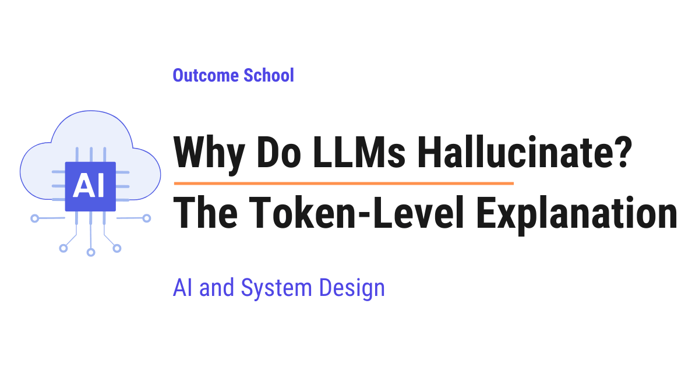

# Why Do LLMs Hallucinate? The Token-Level Explanation

> Archived from <https://outcomeschool.com/blog/why-do-llms-hallucinate-the-token-level-explanation> on 2026-11-25.

LLMs hallucinate because they write an answer one token, a small piece of text, at a time by picking a likely next token, and when they do not know the right token, they still have to pick one, so a confident-looking guess comes out.

In this blog, we will learn about why LLMs hallucinate, explained at the level of tokens. We will also see what a token is, how an LLM picks the next token, how a sharp guess differs from a flat guess, why the model can never skip a token or take one back, how one wrong token leads to a full wrong answer, and how we can reduce hallucinations in the real world.

We will cover the following:
<ul><li>What is a hallucination?</li><li>What is a token?</li><li>How does an LLM pick the next token?</li><li>Easy tokens and fact tokens</li><li>When the model knows: a sharp guess</li><li>When the model does not know: a flat guess</li><li>Picking a token in code</li><li>Reason 1: There is no &quot;skip&quot; option</li><li>Reason 2: Randomness picks a token from the flat guess</li><li>Reason 3: A token cannot be taken back</li><li>Reason 4: One wrong token leads to more wrong tokens</li><li>Reason 5: Likely tokens can combine into something that does not exist</li><li>Reason 6: The final text hides the uncertainty</li><li>How can we reduce hallucinations at the token level?</li></ul>
I am <strong>Amit Shekhar</strong>, Founder @ <a target="_blank" rel="noopener noreferrer" href="https://outcomeschool.com">Outcome School</a>, I have taught and mentored many developers, and their efforts landed them high-paying tech jobs, helped many tech companies in solving their unique problems, and created many open-source libraries being used by top companies. I am passionate about sharing knowledge through open-source, blogs, and videos.

I teach <a target="_blank" rel="noopener noreferrer" href="https://outcomeschool.com/program/ai-and-machine-learning">AI and Machine Learning</a> at Outcome School.

Let&#x27;s get started.
<h2 id="what-is-a-hallucination">What is a hallucination?</h2>
<strong>A hallucination is when an AI gives an answer that sounds correct and confident, but is actually wrong or made up.</strong>

The AI is not lying on purpose. It just produces something that looks like a real answer, and that too with full confidence.

In this blog, AI means an <a target="_blank" rel="noopener noreferrer" href="large-language-model-llm.md">LLM (Large Language Model)</a>.

Let&#x27;s say we ask an AI: &quot;In which year was the author Meera Joshi born?&quot;

For the sake of example, assume that Meera Joshi is a little-known author, and the AI has never read anything about her. A careful human would say &quot;I do not know.&quot; But the AI replies: &quot;Meera Joshi was born in 1962.&quot;

The sentence sounds confident, but the year is a guess. This is a hallucination.

We will look at the exact moment, one token at a time, where the wrong answer is generated. For that, we must first understand what a token is.
<h2 id="what-is-a-token">What is a token?</h2>
<strong>A token is a small piece of text that an LLM reads and writes.</strong>

An LLM does not see full words the way we do. It breaks text into small pieces. A token can be a full word, a part of a word, a number, or even a space with a word.

Let&#x27;s see how our sentence can be broken into tokens, just for the sake of understanding:

<pre><code class="code-highlight">&quot;Meera Joshi was born in 1962&quot;

→ &quot;Me&quot; | &quot;era&quot; | &quot; Joshi&quot; | &quot; was&quot; | &quot; born&quot; | &quot; in&quot; | &quot; 19&quot; | &quot;62&quot;
</code></pre>

Here, we can see that:
<ul><li>&quot;Meera&quot; got broken into two tokens: &quot;Me&quot; and &quot;era&quot;.</li><li>Common words like &quot; was&quot;, &quot; born&quot;, and &quot; in&quot; are one token each.</li><li>The year &quot;1962&quot; got broken into two tokens: &quot; 19&quot; and &quot;62&quot;.</li></ul>
The exact way of breaking depends on the model, but the idea is the same everywhere. The model writes its answer token by token.

We have a detailed blog on <a target="_blank" rel="noopener noreferrer" href="tokenization-in-llms.md">Tokenization in LLMs</a> that explains how this breaking works step by step.

<strong>Note:</strong> In the rest of this blog, we will treat a full year like &quot; 1962&quot; as one token, just for the sake of understanding. The idea stays exactly the same.

Now, let&#x27;s see how the model decides which token comes next.
<h2 id="how-does-an-llm-pick-the-next-token">How does an LLM pick the next token?</h2>
An LLM does only one thing again and again: <strong>it looks at all the text so far and predicts the next token.</strong>

But it does not predict just one token. It gives a score to every token it knows, and these scores become chances. Means, the model creates a list of guesses, where each guess has a percentage.

Let&#x27;s take a simple example. Suppose the text so far is:

&quot;The capital of France is&quot;

The model creates a list of guesses for the next token like below:
<table><thead><tr><th>Next token</th><th>Chance</th></tr></thead><tbody><tr><td>&quot; Paris&quot;</td><td>92%</td></tr><tr><td>&quot; a&quot;</td><td>3%</td></tr><tr><td>&quot; the&quot;</td><td>2%</td></tr><tr><td>&quot; located&quot;</td><td>1%</td></tr><tr><td>All other tokens</td><td>2%</td></tr></tbody></table>
Then, the model picks one token from this list. Here, it picks &quot; Paris&quot;. Now, &quot; Paris&quot; gets added to the text, and the whole process repeats for the next token.

So, writing one answer looks like below:
<ul><li><strong>Step 1:</strong> The model looks at the text so far.</li><li><strong>Step 2:</strong> It creates a list of guesses with chances for the next token.</li><li><strong>Step 3:</strong> It picks one token from the list.</li><li><strong>Step 4:</strong> It adds that token to the text.</li><li><strong>Step 5:</strong> It goes back to Step 1.</li></ul>
This loop runs until the answer is complete.

<strong>Very important:</strong> In this whole loop, there is no step called &quot;check if this is true.&quot; There is only &quot;pick a likely next token.&quot; This is the root of the problem.

To learn LLM Fundamentals, LLM Internals, and Tokenization, and to build a Large Language Model (LLM) from scratch, check out our <a target="_blank" rel="noopener noreferrer" href="https://outcomeschool.com/program/ai-and-machine-learning">AI and Machine Learning Program</a> at Outcome School.
<h2 id="easy-tokens-and-fact-tokens">Easy tokens and fact tokens</h2>
Now, let&#x27;s look closely at our hallucinated sentence again:

&quot;Meera Joshi was born in 1962.&quot;

Not every token in this sentence is equally hard.
<ul><li>&quot; was&quot;, &quot; born&quot;, &quot; in&quot; are <strong>easy tokens</strong>. They follow the rules of language. Any sentence about a birth year will have them. The model is almost always right about them.</li><li>&quot; 1962&quot; is a <strong>fact token</strong>. It carries the actual information. To get it right, the model must truly know the fact.</li></ul>
Most tokens in any answer are easy tokens. Only a few tokens are fact tokens. But those few tokens decide whether the answer is true or false.

<strong>The model uses the exact same loop for both kinds of tokens.</strong> It does not slow down for a fact token. It does not switch to a &quot;careful mode.&quot; It just creates a list of guesses and picks one, the same way it picked &quot; was&quot;.

So, the confident grammar around the fact makes the wrong fact look confident too.
<h2 id="when-the-model-knows-a-sharp-guess">When the model knows: a sharp guess</h2>
When the model has seen a fact many times during training, its list of guesses becomes <strong>sharp</strong>. Means, one token gets almost all the chance.

Let&#x27;s say the text so far is:

&quot;Albert Einstein was born in the year&quot;

The list of guesses for the next token looks like below:
<table><thead><tr><th>Next token</th><th>Chance</th></tr></thead><tbody><tr><td>&quot; 1879&quot;</td><td>95%</td></tr><tr><td>&quot; 1878&quot;</td><td>2%</td></tr><tr><td>&quot; 1880&quot;</td><td>1%</td></tr><tr><td>All other tokens</td><td>2%</td></tr></tbody></table>
Here, we can see that one token is far ahead of all the others. The model has read about Einstein thousands of times. So, the fact is strongly stored inside it.

When the guess is sharp, the model picks the right token almost every time.

<strong>Planning your move into AI?</strong>

No matter which tech domain you work in today, with your effort, you can transition to these roles:
<ul><li>AI Engineer</li><li>Forward Deployed Engineer</li><li>AI Agent Engineer</li><li>Harness Engineer</li><li>Voice AI Engineer</li><li>AI Architect</li><li>LLM Engineer</li><li>LLM Inference Engineer</li><li>Gen AI Engineer</li><li>MLOps Engineer</li><li>ML Engineer</li><li>Deep Learning Engineer</li></ul>
Our <a target="_blank" rel="noopener noreferrer" href="https://outcomeschool.com/program/ai-and-machine-learning">AI and Machine Learning Program</a> at Outcome School takes you there.
<h2 id="when-the-model-does-not-know-a-flat-guess">When the model does not know: a flat guess</h2>
Now, let&#x27;s go back to our little-known author. The text so far is:

&quot;Meera Joshi was born in the year&quot;

The model has never read about her. So, its list of guesses looks like below:
<table><thead><tr><th>Next token</th><th>Chance</th></tr></thead><tbody><tr><td>&quot; 1962&quot;</td><td>14%</td></tr><tr><td>&quot; 1958&quot;</td><td>13%</td></tr><tr><td>&quot; 1971&quot;</td><td>13%</td></tr><tr><td>&quot; 1965&quot;</td><td>12%</td></tr><tr><td>&quot; 1960&quot;</td><td>12%</td></tr><tr><td>&quot; 1968&quot;</td><td>12%</td></tr><tr><td>&quot; 1955&quot;</td><td>12%</td></tr><tr><td>&quot; 1974&quot;</td><td>12%</td></tr></tbody></table>
Here, we can notice that the chances are spread out almost evenly. No token is far ahead. This is called a <strong>flat</strong> guess.

A flat guess is the model&#x27;s way of saying &quot;I am not sure.&quot; The model knows the next token must be a year, because that is how such sentences work. But it has no idea which year.

Let&#x27;s understand this with a simple analogy. Suppose there is a class of 100 students who have all read about Einstein many times. We ask them, &quot;In which year was Einstein born?&quot; Almost all of them shout &quot;1879&quot; together. That is a sharp guess. Now, we ask the same class, &quot;In which year was Meera Joshi born?&quot; Nobody knows, so each student shouts a different year. That is a flat guess.

So, at the token level:
<ul><li><strong>Sharp guess</strong> = the model knows.</li><li><strong>Flat guess</strong> = the model does not know.</li></ul>
The model has some sense of its uncertainty. It is hidden inside these chances. But now, the question is: what does the model do with a flat guess?

The answer is: it still picks one token. Let&#x27;s see it in action.
<h2 id="picking-a-token-in-code">Picking a token in code</h2>
The best way to learn this is by taking an example. Let&#x27;s write Python code that picks a token from a list of guesses, the same way an LLM does.

We can write the code as below:

<pre><code class="code-highlight language-python">import random

sharp_guess = {&quot;1879&quot;: 0.95, &quot;1878&quot;: 0.02, &quot;1880&quot;: 0.01, &quot;other&quot;: 0.02}

flat_guess = {&quot;1962&quot;: 0.14, &quot;1958&quot;: 0.13, &quot;1971&quot;: 0.13, &quot;1965&quot;: 0.12,
              &quot;1960&quot;: 0.12, &quot;1968&quot;: 0.12, &quot;1955&quot;: 0.12, &quot;1974&quot;: 0.12}

def pick_next_token(guesses):
    tokens = list(guesses.keys())
    chances = list(guesses.values())
    # pick one token, where a higher chance means picked more often
    return random.choices(tokens, weights=chances)[0]

print(pick_next_token(sharp_guess))
print(pick_next_token(flat_guess))
</code></pre>

Here, we have:
<ul><li><code>sharp_guess</code>: the list of guesses for Einstein. One token has 95% chance, and &quot;other&quot; stands for all other tokens together.</li><li><code>flat_guess</code>: the list of guesses for Meera Joshi. The chances are spread out.</li><li><code>pick_next_token</code>: a function that picks one token, where a token with a higher chance gets picked more often.</li></ul>
It will print something like the following:

<pre><code class="code-highlight">1879
1971
</code></pre>

If we run this code many times, the first <code>print</code> shows &quot;1879&quot; almost every time. But the second <code>print</code> keeps changing its answer, for example &quot;1962&quot; once, &quot;1971&quot; next time, and &quot;1955&quot; after that.

Here, we can see that <strong>the function always returns a token.</strong> It never returns &quot;I do not know.&quot; Even for the flat guess, it gives us a year. And when that year is written into a sentence, it looks exactly as confident as &quot;1879&quot;.

This is how a hallucination is generated at the level of a single token.

Now, let&#x27;s understand each reason in detail.
<h2 id="reason-1-there-is-no-skip-option">Reason 1: There is no &quot;skip&quot; option</h2>
At every step, the model must pick a token from its list. The list contains tokens like &quot; 1962&quot;, &quot; 1958&quot;, and so on. There is no special button that says &quot;stop, I do not know this one.&quot;

Let&#x27;s say a student is given a fill-in-the-blank test, and the rule is that they must write something in every blank. Even when they have no idea, they must write a word. Many of their answers will look correct but be wrong.

The LLM is in the same situation for every single token.

Now, the question is: the words &quot;I do not know&quot; are also made of tokens, so why does the model not pick them?

The model writes them only if they are the likely next tokens. But there are two problems:
<ul><li>During training, the model has seen far more text where a question is followed by an answer than text where a question is followed by &quot;I do not know.&quot;</li><li>Many training and testing methods often give a better score to a confident guess than to an honest &quot;I do not know.&quot;</li></ul>
So, the &quot;I do not know&quot; tokens usually get a small chance.

Hence, when the guess for a fact token is flat, the model still picks a year, a name, or a number. It fills the blank.

<strong>A quick note for you</strong>

No matter which tech domain you work in, get familiar with these topics:
<ul><li>LLM</li><li>RAG</li><li>MCP</li><li>Agent</li><li>Fine-tuning</li><li>Quantization</li></ul>
We put it all together in one video:

<a target="_blank" rel="noopener noreferrer" href="https://www.youtube.com/watch?v=lnfWvX66FUk">AI Engineering Explained: LLM, RAG, MCP, Agent, Fine-Tuning, and Quantization</a>

No need to stop reading - bookmark it and watch later when you get time. Future you will thank you.

Now, let&#x27;s get back to the topic.
<h2 id="reason-2-randomness-picks-a-token-from-the-flat-guess">Reason 2: Randomness picks a token from the flat guess</h2>
When an LLM picks the next token, there is usually some randomness. It does not always pick the top token. A setting called <strong><a target="_blank" rel="noopener noreferrer" href="how-does-temperature-control-llm-output.md">temperature</a></strong> controls how much randomness is used.

So:
<ul><li><strong>Low temperature</strong> = the model almost always picks the top token.</li><li><strong>High temperature</strong> = the model picks other tokens more often.</li></ul>
With a sharp guess, randomness does not matter much. &quot; 1879&quot; has 95% chance, so it wins almost every time.

But with a flat guess, randomness decides the answer. Every year has about 12% to 14% chance. So, if we ask the same question five times, we can get different years each time, like below:

<pre><code class="code-highlight">Run 1: Meera Joshi was born in 1962.
Run 2: Meera Joshi was born in 1971.
Run 3: Meera Joshi was born in 1955.
Run 4: Meera Joshi was born in 1962.
Run 5: Meera Joshi was born in 1968.
</code></pre>

Here, we can see that every answer is written with full confidence, but the answers do not agree with each other. This disagreement is a strong sign that the model is guessing.

Now, someone can ask: &quot;Then let&#x27;s just set temperature to zero. The model will always pick the top token.&quot;

Yes, it will always pick &quot; 1962&quot; now. But &quot; 1962&quot; had only 14% chance. It is still a guess. Now, it is just the same guess every time.

Hence, a low temperature makes the answer the same every time, but it does not make it correct.
<h2 id="reason-3-a-token-cannot-be-taken-back">Reason 3: A token cannot be taken back</h2>
When we write something by hand and notice a mistake, we use an eraser.

An LLM has no eraser. Once a token is picked and added to the text, it stays there forever. The model can only move forward and add the next token.

Let&#x27;s take an example. Suppose we ask the model:

&quot;Is 3,827 a prime number?&quot;

The very first token of the answer is a big decision. For the sake of example, let say the list of guesses looks like below:
<table><thead><tr><th>Next token</th><th>Chance</th></tr></thead><tbody><tr><td>&quot;Yes&quot;</td><td>52%</td></tr><tr><td>&quot;No&quot;</td><td>48%</td></tr></tbody></table>
The two chances are almost equal. Let&#x27;s say the model picks &quot;Yes&quot;.

But 3,827 is not a prime number. It is 43 * 89.

The model cannot go back and change &quot;Yes&quot; to &quot;No&quot;. The wrong token is already written. Everything that comes after is built on top of this &quot;Yes&quot;.
<h2 id="reason-4-one-wrong-token-leads-to-more-wrong-tokens">Reason 4: One wrong token leads to more wrong tokens</h2>
Remember, at every step, the model looks at <strong>all the text so far</strong>, including the tokens it wrote itself. It does not go back to doubt its own tokens. It simply treats them as part of the text that it must continue.

So, after writing &quot;Yes&quot;, the text so far is:

&quot;Is 3,827 a prime number? Yes&quot;

Now, the model predicts the next token based on this. And the most likely continuation of &quot;Yes&quot; is a reason that supports &quot;Yes&quot;. So, it writes something like:

&quot;Yes, 3,827 is a prime number because it cannot be divided by any number other than 1 and itself.&quot;

Each new token is a good, likely token given the text before it. The grammar is correct. The explanation sounds logical. But the whole answer is built on one wrong token at the start.

The same happens with our author:

&quot;Meera Joshi was born in 1962. She grew up in the 1970s and published her first book in the late 1980s.&quot;

Here, we can see that the model did not stop at one wrong year. It used &quot; 1962&quot; to build more details: she grew up in the 1970s, published in the late 1980s. All of these follow nicely from 1962, and all of them are made up.

<strong>One wrong fact token becomes the base for the next tokens, and a small guess grows into a full made-up story.</strong>

If we want to go deep into LLM Internals and the Transformer Architecture, which decide how every new token is built on top of the tokens before it, check out our <a target="_blank" rel="noopener noreferrer" href="https://outcomeschool.com/program/ai-and-machine-learning">AI and Machine Learning Program</a> at Outcome School to learn them in depth.
<h2 id="reason-5-likely-tokens-can-combine-into-something-that-does-not-exist">Reason 5: Likely tokens can combine into something that does not exist</h2>
Now, let&#x27;s see a special type of hallucination: fake names, fake titles, and fake references.

Suppose we ask the model to suggest a research paper on a topic. The model writes something like below:

&quot;Sharma, A. and Patel, R. (2019). Using AI to Detect Crop Diseases. Journal of Agricultural AI.&quot;

Let&#x27;s look at it token by token:
<ul><li>&quot;Sharma&quot; is a common author name. A likely token.</li><li>&quot;Patel&quot; is also a common author name. A likely token.</li><li>&quot;2019&quot; is a common year for such papers. A likely token.</li><li>&quot;Using AI to Detect Crop Diseases&quot; is a natural title for this topic. Each token in it is likely.</li><li>&quot;Journal of Agricultural AI&quot; sounds like a real journal name. Likely tokens.</li></ul>
Each token, on its own, is a reasonable pick. But assume that this exact paper, with these exact authors, this exact year, and this exact journal, does not exist anywhere.

The only thing that mattered to the model was that each token fits well with the tokens before it. Nothing in the loop checked that the full combination exists in the real world. Hence, it combined likely tokens into a reference that does not exist.

This is why LLMs are very good at producing references that look real, but are not.

<strong>Stay updated:</strong> Subscribe to our <a target="_blank" rel="noopener noreferrer" href="https://outcomeschool.substack.com/subscribe">newsletter</a> to get our latest AI and Machine Learning blogs straight to your inbox.
<h2 id="reason-6-the-final-text-hides-the-uncertainty">Reason 6: The final text hides the uncertainty</h2>
We already learned that the model has some sense of its uncertainty. A flat guess means &quot;I am not sure.&quot;

After the model picks a token, only the token remains in the text. The chance behind it is thrown away.

So, when we read the final answer, both of these look exactly the same:
<ul><li>&quot; 1879&quot;, which had 95% chance.</li><li>&quot; 1962&quot;, which had 14% chance.</li></ul>
Both are just numbers in a sentence. Both are written in the same confident tone. There is no small &quot;14%&quot; written next to the second one.

Means, the model was unsure inside, but its words look sure outside. As readers, we see only the words. Hence, we have no way to tell the sure parts from the guessed parts just by reading.
<h2 id="how-can-we-reduce-hallucinations-at-the-token-level">How can we reduce hallucinations at the token level?</h2>
Now, let&#x27;s see how we can reduce hallucinations. Each fix addresses one of the reasons we learned.

<strong>Fix 1: Give the model the fact.</strong>

If we put the correct information inside the question itself, for example by pasting a document, the fact is now part of the text so far. The model can see it. So, the flat guess becomes a sharp guess.

Here comes the <strong><a target="_blank" rel="noopener noreferrer" href="retrieval-augmented-generation-rag.md">RAG</a></strong> into the picture. RAG stands for Retrieval-Augmented Generation. In simple words, first find the right information, then give it to the model along with the question.

<strong>Fix 2: Make &quot;I do not know&quot; a likely token.</strong>

The companies that build these models can train them to say &quot;I do not know&quot; when they are unsure, and give a better score to an honest &quot;I do not know&quot; than to a confident wrong guess. Then, the &quot;I do not know&quot; tokens get a bigger chance when the guess for a fact token is flat. This addresses Reason 1.

<strong>Fix 3: Look at the chances behind the tokens.</strong>

Many AI tools can <a target="_blank" rel="noopener noreferrer" href="logprobs-in-llms.md">show the chance behind each token</a>. If a fact token like a year or a name was picked with a low chance, we can flag it as &quot;likely a guess.&quot; This brings back the uncertainty that the final text was hiding.

Similarly, we can ask the same question a few times, like we saw in Reason 2. If the fact tokens keep changing between the answers, the model is guessing. This addresses Reason 6.

<strong>Fix 4: Ask the model to think before answering.</strong>

If the model first <a target="_blank" rel="noopener noreferrer" href="how-does-chain-of-thought-prompting-work.md">writes its thinking step by step</a>, the important decision does not depend on a single uncertain token at the very start. For example, the model can first try dividing 3,827 by small numbers, find 43 * 89, and only then write &quot;No&quot;. It does not fully solve the problem, but it gives the model a better chance to reach the right token. This addresses Reason 3 and Reason 4.

<strong>Fix 5: Use low temperature for facts.</strong>

For factual tasks, a low temperature reduces random jumps to unlikely tokens. But remember, it makes the answer the same every time, not correct. So, use it along with the other fixes, not alone. This addresses Reason 2.

<strong>Fix 6: Always verify fact tokens.</strong>

As users, we now know that names, numbers, dates, and references are the fact tokens. Hallucinations mostly appear in these tokens. So, these are the places we must double-check before trusting the answer.

<strong>Note:</strong> None of these fixes remove hallucinations completely. As long as a model writes by picking the next likely token, there will always be some chance of a confident guess.

Now we must have understood why LLMs hallucinate at the token level: the model picks one likely token at a time, and when it does not know the answer, it still has to pick one.
<h2 id="frequently-asked-questions">Frequently Asked Questions</h2><h3 id="is-an-llm-lying-when-it-hallucinates">Is an LLM lying when it hallucinates?</h3>
No. An LLM is not lying on purpose when it hallucinates. It picks a likely next token at every step, and when it does not know the right token, it still has to pick one. The result is a guess that sounds correct and confident, but is actually wrong or made up.
<h3 id="which-parts-of-an-llm-answer-are-most-likely-to-be-hallucinated">Which parts of an LLM answer are most likely to be hallucinated?</h3>
The fact tokens, such as names, numbers, dates, and references, are the most likely to be hallucinated. Easy tokens like &quot; was&quot; and &quot; in&quot; follow the rules of language, so the model is almost always right about them. Fact tokens need the model to truly know the fact, so these are the places we must double-check.
<h3 id="how-can-we-tell-when-an-llm-is-guessing">How can we tell when an LLM is guessing?</h3>
We can look at the chance behind each token, because many AI tools can show it. If a fact token like a year or a name was picked with a low chance, it is likely a guess. We can also ask the same question a few times, and if the fact tokens keep changing between the answers, the model is guessing.
<h3 id="does-setting-temperature-to-zero-stop-hallucinations">Does setting temperature to zero stop hallucinations?</h3>
No. Setting temperature to zero makes the model always pick the top token, so the answer is the same every time. But if the top token had only a small chance, it is still a guess, just the same guess every time. A low temperature makes the answer the same, not correct.
<h3 id="can-we-remove-hallucinations-completely">Can we remove hallucinations completely?</h3>
No. Fixes like RAG, training the model to say &quot;I do not know&quot;, and checking the chances behind tokens reduce hallucinations, but none of them remove hallucinations completely. As long as a model writes by picking the next likely token, there will always be some chance of a confident guess.

That&#x27;s it for now.

Thanks

<strong>Amit Shekhar</strong> Founder @ <a target="_blank" rel="noopener noreferrer" href="https://outcomeschool.com">Outcome School</a>

You can connect with me on:
<ul><li><a target="_blank" rel="noopener noreferrer" href="https://x.com/amitiitbhu">X</a></li><li><a target="_blank" rel="noopener noreferrer" href="https://www.linkedin.com/in/amit-shekhar-iitbhu">LinkedIn</a></li><li><a target="_blank" rel="noopener noreferrer" href="https://github.com/amitshekhariitbhu">GitHub</a></li></ul>
Follow Outcome School on:
<ul><li><a target="_blank" rel="noopener noreferrer" href="https://x.com/outcome_school">X</a></li><li><a target="_blank" rel="noopener noreferrer" href="https://youtube.com/@OutcomeSchool">YouTube</a></li><li><a target="_blank" rel="noopener noreferrer" href="https://www.linkedin.com/company/outcomeschool">LinkedIn</a></li><li><a target="_blank" rel="noopener noreferrer" href="http://github.com/OutcomeSchool">GitHub</a></li></ul>
<a target="_blank" rel="noopener noreferrer" href="https://outcomeschool.com/blog"><strong>Read all of our high-quality blogs here.</strong></a>

