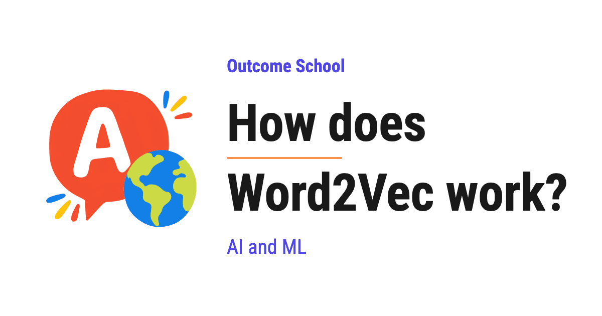

# How does Word2Vec work?

> Archived from <https://outcomeschool.com/blog/word2vec> on 2026-11-25.

Word2Vec is a technique that turns each word into a list of numbers, in such a way that words with similar meaning get similar numbers.

In this blog, we will learn about how Word2Vec works. We will also see why we need Word2Vec, how a computer turns a word into a vector, how it learns these vectors through CBOW and Skip-gram, how word math works, what its limitations are, and where it is used in the real world.

We will cover the following:
<ul><li>What is Word2Vec?</li><li>Why do we need Word2Vec?</li><li>How does a computer represent a word?</li><li>The core idea: a word is known by the company it keeps</li><li>What is a word vector?</li><li>The two architectures: CBOW and Skip-gram</li><li>A step-by-step walk-through of Skip-gram</li><li>How Word2Vec learns the vectors</li><li>Word math (king - man + woman = queen)</li><li>A simple code example</li><li>Limitations of Word2Vec</li><li>Where Word2Vec is used</li></ul>
I am <strong>Amit Shekhar</strong>, Founder @ <a target="_blank" rel="noopener noreferrer" href="https://outcomeschool.com">Outcome School</a>, I have taught and mentored many developers, and their efforts landed them high-paying tech jobs, helped many tech companies in solving their unique problems, and created many open-source libraries being used by top companies. I am passionate about sharing knowledge through open-source, blogs, and videos.

I teach <a target="_blank" rel="noopener noreferrer" href="https://outcomeschool.com/program/ai-and-machine-learning">AI and Machine Learning</a> at Outcome School.

Let&#x27;s get started.
<h3 id="what-is-word2vec">What is Word2Vec?</h3>
<strong>Word2Vec is a technique that turns each word into a list of numbers, in such a way that words with similar meaning get similar numbers.</strong>

The name Word2Vec means &quot;Word to Vector&quot;. We take a <strong>word</strong>, and we convert it to a <strong>vector</strong>. A <strong>vector</strong> is a list of numbers.

Let&#x27;s say we give the word &quot;king&quot; a list of numbers and the word &quot;queen&quot; another list of numbers. With Word2Vec, these two lists will be very close, because the two words are related. The word &quot;banana&quot; will get a list of numbers that is very far away, because it has nothing to do with kings and queens.
<h3 id="why-do-we-need-word2vec">Why do we need Word2Vec?</h3>
A computer does not understand words. A computer only understands numbers. So, before a computer can work with language, we must turn words into numbers.

Now, the question is: how do we turn a word into numbers?

The simplest idea is to give every word a unique number. For example, &quot;cat&quot; becomes 1, &quot;dog&quot; becomes 2, &quot;king&quot; becomes 3, and so on. But this has a big problem. These numbers are random. The number 1 for &quot;cat&quot; and the number 2 for &quot;dog&quot; do not tell us that a cat and a dog are both animals. The numbers carry no meaning.

So, here comes a slightly better idea called <a target="_blank" rel="noopener noreferrer" href="one-hot-encoding.md"><strong>one-hot encoding</strong></a>.

In <strong>one-hot encoding</strong>, we make a long list with one slot for every word in our vocabulary. For a single word, we put a 1 in its own slot and 0 everywhere else.

Let&#x27;s say our whole vocabulary has only four words: &quot;cat&quot;, &quot;dog&quot;, &quot;king&quot;, and &quot;queen&quot;. Then one-hot encoding looks like below:

<pre><code class="code-highlight">cat    = [ 1, 0, 0, 0 ]
dog    = [ 0, 1, 0, 0 ]
king   = [ 0, 0, 1, 0 ]
queen  = [ 0, 0, 0, 1 ]
</code></pre>

Here, we can see that each word gets its own slot. The word &quot;cat&quot; has a 1 in the first slot, &quot;dog&quot; has a 1 in the second slot, and so on.

But this still has two big problems.

<strong>Problem 1:</strong> The lists are huge. A real language has hundreds of thousands of words. So, each word becomes a list with hundreds of thousands of slots, where all of them are 0 except one. This wastes a lot of space.

<strong>Problem 2:</strong> Every word is equally far from every other word. In one-hot encoding, &quot;king&quot; and &quot;queen&quot; are just as different as &quot;king&quot; and &quot;banana&quot;. The encoding does not capture any meaning. It does not know that &quot;king&quot; and &quot;queen&quot; are related.

So, here comes Word2Vec to the rescue.

Word2Vec gives each word a short list of numbers, for example 100 or 300 numbers, where the numbers actually carry meaning. Words with similar meaning get similar numbers. This is exactly what one-hot encoding could not do.
<h3 id="how-does-a-computer-represent-a-word">How does a computer represent a word?</h3>
Before we go deeper, we must understand what we are aiming for. We want every word to become a short list of numbers that captures its meaning.

Let&#x27;s say we decide that each word will be a list of 4 numbers, just for the sake of understanding. Then a few words will look like below:

<pre><code class="code-highlight">king   = [ 0.9,  0.7,  0.1,  0.8 ]
queen  = [ 0.9,  0.1,  0.1,  0.8 ]
man    = [ 0.5,  0.9,  0.2,  0.1 ]
woman  = [ 0.5,  0.2,  0.2,  0.1 ]
apple  = [ 0.1,  0.1,  0.9,  0.0 ]
</code></pre>

Here, we can see that &quot;king&quot; and &quot;queen&quot; have very similar numbers, because they are related. &quot;man&quot; and &quot;woman&quot; also look similar to each other. But &quot;apple&quot; looks completely different from all of them, because it is a fruit and has nothing to do with the others.

We do not decide these numbers ourselves. Word2Vec learns them on its own from large amounts of text, and that too without being explicitly programmed.

This short list of numbers that represents a word is called a <a target="_blank" rel="noopener noreferrer" href="what-are-embeddings.md"><strong>word embedding</strong></a> or a <strong>word vector</strong>. Both names mean the same thing.

So, our goal is clear. We want to learn a good word vector for every word. Now, let&#x27;s understand the key idea that makes this possible.
<h3 id="the-core-idea-a-word-is-known-by-the-company-it-keeps">The core idea: a word is known by the company it keeps</h3>
Now, let&#x27;s understand the core idea behind Word2Vec. As the linguist J. R. Firth said:
<blockquote>
You shall know a word by the company it keeps.
</blockquote>
In simple words, the meaning of a word comes from the other words that appear around it.

Let&#x27;s say we read these sentences:
<ul><li>&quot;The cat drank the milk.&quot;</li><li>&quot;The dog drank the milk.&quot;</li></ul>
Here, both &quot;cat&quot; and &quot;dog&quot; appear in very similar surroundings. Both of them &quot;drank the milk&quot;. Because they keep similar company, we can guess that &quot;cat&quot; and &quot;dog&quot; must be similar kinds of things.

Now consider another example. The words &quot;coffee&quot; and &quot;tea&quot; often appear near words like &quot;drink&quot;, &quot;hot&quot;, &quot;cup&quot;, and &quot;morning&quot;. Because they share so much company, Word2Vec learns that &quot;coffee&quot; and &quot;tea&quot; are similar.

So, if two words appear in similar contexts, they often have similar meanings. Word2Vec uses exactly this rule. It looks at millions of sentences and learns which words tend to appear together. From this, it figures out which words are similar.

We can picture the idea of a context window like below:

<pre><code class="code-highlight">Sentence:       The quick brown fox jumps over the dog

Left context:   quick, brown
Target word:    fox
Right context:  jumps, over
</code></pre>

Here, we can see that the target word is &quot;fox&quot;. The words around it, like &quot;quick&quot;, &quot;brown&quot;, &quot;jumps&quot;, and &quot;over&quot;, are called the <strong>context</strong>. The group of words we look at around the target is called the <strong>context window</strong>. In this picture, the window covers two words on the left and two words on the right of the target. This is how Word2Vec learns meaning, by studying the company each word keeps.

<strong>Planning your move into AI?</strong>

No matter which tech domain you work in today, with your effort, you can transition to these roles:
<ul><li>AI Engineer</li><li>Forward Deployed Engineer</li><li>AI Agent Engineer</li><li>Harness Engineer</li><li>Voice AI Engineer</li><li>AI Architect</li><li>LLM Engineer</li><li>LLM Inference Engineer</li><li>Gen AI Engineer</li><li>MLOps Engineer</li><li>ML Engineer</li><li>Deep Learning Engineer</li></ul>
Our <a target="_blank" rel="noopener noreferrer" href="https://outcomeschool.com/program/ai-and-machine-learning">AI and Machine Learning Program</a> at Outcome School takes you there.
<h3 id="what-is-a-word-vector">What is a word vector?</h3>
Now, let&#x27;s understand the word vector in more detail.

A <strong>word vector</strong> is a list of numbers that represents a word as a point in space.

Let&#x27;s keep it very simple. Suppose each word has only 2 numbers. Then we can draw every word as a point on a flat sheet of paper. The first number is the position from left to right, and the second number is the position from bottom to top.

Let&#x27;s say we plot a few words like below:

<pre><code class="code-highlight">        ^
        |                  queen *      * king
        |
        |
        |        woman *      * man
        |
        |
        |   apple *   * banana
        |
        +--------------------------------------&gt;
</code></pre>

Here, we can see that the related words sit close together. &quot;king&quot; and &quot;queen&quot; are near each other in the top area. &quot;man&quot; and &quot;woman&quot; are near each other in the middle. &quot;apple&quot; and &quot;banana&quot;, both fruits, sit together at the bottom.

So, a word vector turns each word into a point in space. Words with similar meaning end up close together, and words with different meaning end up far apart.

In real Word2Vec, we do not use 2 numbers. We use many more, often 100 or 300 numbers per word. We cannot draw 300 numbers on paper, but the idea stays exactly the same. Similar words sit close together in that space.

This closeness is what lets a computer understand that &quot;king&quot; and &quot;queen&quot; are related. We have a detailed blog on <a target="_blank" rel="noopener noreferrer" href="cosine-similarity.md">Cosine Similarity</a> that explains how we measure how close two vectors are.
<h3 id="the-two-architectures-cbow-and-skip-gram">The two architectures: CBOW and Skip-gram</h3>
Now, let&#x27;s learn how Word2Vec actually learns these vectors. Word2Vec has two ways of doing it, and we call them two <strong>architectures</strong>. An architecture is the structure of the small network we use for learning.

The two architectures are <strong>CBOW</strong> and <strong>Skip-gram</strong>. Let&#x27;s understand both.

<strong>CBOW</strong> stands for <strong>Continuous Bag of Words</strong>. In CBOW, we take the context words around a target word, and we try to predict the target word in the middle.

CBOW looks at the neighbors and guesses the missing word. For example, given &quot;The ___ drank the milk&quot;, CBOW tries to predict that the missing word is &quot;cat&quot;.

<strong>Skip-gram</strong> does the exact opposite. In Skip-gram, we take one target word, and we try to predict the context words around it.

Skip-gram looks at one word and guesses its neighbors. For example, given the word &quot;cat&quot;, Skip-gram tries to predict that words like &quot;drank&quot; and &quot;milk&quot; appear around it.

We can picture the difference between the two like below:

<pre><code class="code-highlight">CBOW (predict the middle word)        Skip-gram (predict the neighbors)
-------------------------------       ---------------------------------

   the   ---\                                 /---&gt; the
   quick ----\                               /----&gt; quick
              ---&gt; [ FOX ]              [ FOX ] ----&gt; jumps
   jumps ----/                               \----&gt; over
   over  ---/                                 \---&gt; ...

  context words -&gt; target word         target word -&gt; context words
</code></pre>

Here, we can see the difference. CBOW takes many context words and predicts the one target word in the middle. Skip-gram takes the one target word and predicts the many context words around it.

Both architectures learn good word vectors. CBOW is faster and works well for frequent words. Skip-gram is slower but works better for rare words and is often the more popular choice. We pick one based on our use case.

Now, let&#x27;s understand one of them step by step. We will use Skip-gram, because it makes the idea very clear.
<h3 id="a-step-by-step-walk-through-of-skip-gram">A step-by-step walk-through of Skip-gram</h3>
Now, let&#x27;s take a small example to make Skip-gram concrete.

Suppose we have this single sentence:

<pre><code class="code-highlight">&quot;The cat drank the milk&quot;
</code></pre>

Let&#x27;s say our target word is &quot;drank&quot;. We will use a context window of size 1, which means we look at one word on the left and one word on the right of the target.

<strong>Step 1:</strong> We pick the target word and find its context words.

<pre><code class="code-highlight">The   cat   drank   the   milk
      left  TARGET  right
</code></pre>

Here, the target word is &quot;drank&quot;. The word on its left is &quot;cat&quot; and the word on its right is &quot;the&quot;. So, our context words are &quot;cat&quot; and &quot;the&quot;.

So, from this one position, we create training pairs like below:

<pre><code class="code-highlight">( drank, cat )
( drank, the )
</code></pre>

Here, we can see that each pair says: &quot;when the target word is drank, a context word is cat&quot;, and &quot;when the target word is drank, a context word is the&quot;.

<strong>Step 2:</strong> We slide the window forward and repeat. Now the target becomes &quot;the&quot;, and we collect its neighbors. We keep doing this for every word in every sentence, across millions of sentences. In the end, we get a huge list of these word pairs.

<strong>Step 3:</strong> We feed these pairs into a small network. The network takes the target word as input and tries to predict its context words as output.

So, the whole flow of Skip-gram is as below:

<pre><code class="code-highlight">Target word: &quot;drank&quot;
        ↓
Small network (learns the vectors)
        ↓
Predicted context words: &quot;cat&quot;, &quot;the&quot;
</code></pre>

Here, we can see that we give the network a word, and it learns to predict the words that usually surround it. While doing this prediction task again and again, the network slowly adjusts the numbers inside the word vectors.

We do not actually care about the prediction itself. What we really want are the word vectors that the network learns along the way.

This is how Skip-gram sets up the learning.

<strong>A quick note for you</strong>

No matter which tech domain you work in, get familiar with these topics:
<ul><li>LLM</li><li>RAG</li><li>MCP</li><li>Agent</li><li>Fine-tuning</li><li>Quantization</li></ul>
We put it all together in one video:

<a target="_blank" rel="noopener noreferrer" href="https://www.youtube.com/watch?v=lnfWvX66FUk">AI Engineering Explained: LLM, RAG, MCP, Agent, Fine-Tuning, and Quantization</a>

No need to stop reading - bookmark it and watch later when you get time. Future you will thank you.

Now, let&#x27;s get back to the topic.
<h3 id="how-word2vec-learns-the-vectors">How Word2Vec learns the vectors</h3>
Now, let&#x27;s understand how the actual numbers inside the vectors get learned. The process is called <strong>training</strong>, and it works step by step.

<strong>Step 1:</strong> In the very beginning, every word gets a vector full of random numbers. So at the start, the vectors are meaningless. &quot;king&quot; and &quot;queen&quot; are not close yet, because everything is random.

<strong>Step 2:</strong> We take a training pair, for example (&quot;drank&quot;, &quot;cat&quot;). We feed the target word &quot;drank&quot; into the network. The network uses the current vector of &quot;drank&quot; to predict which words appear around it.

<strong>Step 3:</strong> Since the vectors are still random, the first prediction is mostly wrong. We measure how wrong the prediction is. This measure of wrongness is called the <strong>loss</strong>, also called the <strong>error</strong>. A big loss means the network is very wrong.

<strong>Step 4:</strong> Now comes the important part. The network uses a method called <a target="_blank" rel="noopener noreferrer" href="math-behind-backpropagation.md"><strong>backpropagation</strong></a> together with <a target="_blank" rel="noopener noreferrer" href="math-behind-gradient-descent.md"><strong>gradient descent</strong></a>. The network looks at its error and nudges the numbers inside the word vectors a tiny bit, in the direction that makes the prediction better next time.

<strong>Step 5:</strong> We repeat Steps 2 to 4 millions of times, for all the word pairs. With each round, the loss gets a little smaller, and the vectors get a little better. Slowly, the random vectors turn into meaningful vectors, where similar words sit close together.

We can picture this learning loop like below:

<pre><code class="code-highlight">Pick a word pair          &lt;------+
        ↓                        |
Predict the context words        |
        ↓                        |
Measure the loss                 |
        ↓                        |
Nudge the vectors        --------+
</code></pre>

Here, we can see that the network repeats this loop millions of times. Each time, the word vectors improve a little. After enough training, words that keep similar company end up with similar vectors. This is how Word2Vec learns the meaning of words on its own.

<strong>Note:</strong> Real Word2Vec uses a few speed tricks, such as <strong>negative sampling</strong>, to make this training fast on huge amounts of text. These tricks help the network train quickly without checking every single word every time.

If we want to go deep into Backpropagation, Gradient Descent, and Loss Functions, and even build a Neural Network from scratch, we cover all of it in our <a target="_blank" rel="noopener noreferrer" href="https://outcomeschool.com/program/ai-and-machine-learning">AI and Machine Learning Program</a> at Outcome School.
<h3 id="word-math-king---man--woman--queen">Word math (king - man + woman = queen)</h3>
Now, let&#x27;s see the most famous result of Word2Vec. After training, the word vectors capture meaning so well that we can do actual math with words.

The most famous example is below:

<pre><code class="code-highlight">king - man + woman = queen
</code></pre>

Let&#x27;s understand what this means in plain words. We take the vector of &quot;king&quot;, we subtract the vector of &quot;man&quot;, and then we add the vector of &quot;woman&quot;. The result lands very close to the vector of &quot;queen&quot;.

Why does this happen? Because Word2Vec learned that the difference between &quot;king&quot; and &quot;man&quot; is roughly the idea of &quot;royalty&quot;. When we remove &quot;man&quot; from &quot;king&quot; and add &quot;woman&quot; instead, we get &quot;the royal version of woman&quot;, which is &quot;queen&quot;.

We can picture this like below:

<pre><code class="code-highlight">        ^
        |          king *--------------* queen
        |              |               |
        |       (same direction = royalty difference)
        |              |               |
        |          man *--------------* woman
        |
        +---------------------------------------&gt;
</code></pre>

Here, we can see that the arrow from &quot;man&quot; to &quot;king&quot; points in the same direction and length as the arrow from &quot;woman&quot; to &quot;queen&quot;. This is why the word math works. The relationship between words became a direction in space.

Here are a few more examples that Word2Vec captures:
<ul><li>&quot;Paris&quot; is to &quot;France&quot; as &quot;Tokyo&quot; is to &quot;Japan&quot;, because the capital-to-country relationship becomes a direction.</li><li>&quot;walking&quot; is to &quot;walked&quot; as &quot;swimming&quot; is to &quot;swam&quot;, because the present-to-past relationship becomes a direction.</li></ul>
So, Word2Vec did not just store words as numbers. It captured the relationships between words as directions in space.

<strong>Stay updated:</strong> Subscribe to our <a target="_blank" rel="noopener noreferrer" href="https://outcomeschool.substack.com/subscribe">newsletter</a> to get our latest AI and Machine Learning blogs straight to your inbox.
<h3 id="a-simple-code-example">A simple code example</h3>
Now, let&#x27;s see how to use Word2Vec in code. We will use Python with a library called Gensim. The code is as below:

<pre><code class="code-highlight language-python">from gensim.models import Word2Vec

# Our training data: a list of sentences, each split into words
sentences = [
    [&quot;the&quot;, &quot;cat&quot;, &quot;drank&quot;, &quot;the&quot;, &quot;milk&quot;],
    [&quot;the&quot;, &quot;dog&quot;, &quot;drank&quot;, &quot;the&quot;, &quot;milk&quot;],
    [&quot;the&quot;, &quot;king&quot;, &quot;ruled&quot;, &quot;the&quot;, &quot;land&quot;],
    [&quot;the&quot;, &quot;queen&quot;, &quot;ruled&quot;, &quot;the&quot;, &quot;land&quot;]
]

# Train the Word2Vec model
model = Word2Vec(sentences, vector_size=100, window=2, min_count=1, sg=1)

# Get the vector for the word &quot;king&quot;
king_vector = model.wv[&quot;king&quot;]

# Find the words most similar to &quot;king&quot;
similar_words = model.wv.most_similar(&quot;king&quot;)
</code></pre>

Here, we have trained a small Word2Vec model.
<ul><li><code>sentences</code> is our training data. It is a list of sentences, where each sentence is split into a list of words.</li><li><code>Word2Vec(...)</code> trains the model. Here, <code>vector_size=100</code> means each word will become a list of 100 numbers. <code>window=2</code> means the context window looks at 2 words on each side. <code>min_count=1</code> keeps every word, even if it appears only once, which we need for our tiny data. <code>sg=1</code> means we use the Skip-gram architecture. If we set <code>sg=0</code>, it would use CBOW instead.</li><li><code>model.wv[&quot;king&quot;]</code> gives us the learned vector of 100 numbers for the word &quot;king&quot;.</li><li><code>model.wv.most_similar(&quot;king&quot;)</code> finds the words whose vectors are closest to &quot;king&quot;.</li></ul>
The library handles all the training, backpropagation, and gradient descent behind the scenes. We just provide the sentences and let it learn.

<strong>Note:</strong> With only four sentences, the vectors will not be meaningful. In practice, we train on millions of sentences.
<h3 id="limitations-of-word2vec">Limitations of Word2Vec</h3>
Word2Vec was a huge step forward, but it is not perfect. Now, let&#x27;s understand its main limitations.

<strong>One vector per word.</strong> Word2Vec gives each word exactly one vector. But many words have more than one meaning. Consider the word &quot;bank&quot;. It can mean a river bank or a money bank. Word2Vec mixes both meanings into a single vector, so it cannot tell them apart.

<strong>It ignores the sentence around the word.</strong> The vector for &quot;bank&quot; is always the same, no matter the sentence. A word&#x27;s meaning often depends on its full sentence, but plain Word2Vec does not look at the sentence at prediction time.

<strong>It cannot handle new words.</strong> If a word was not in the training data, Word2Vec has no vector for it at all. It simply does not know that word.

So, here come newer methods to the rescue. Modern systems use <strong>contextual embeddings</strong>, where the vector of a word changes based on the full sentence around it. These come from models built on the <a target="_blank" rel="noopener noreferrer" href="decoding-transformer-architecture.md"><strong>Transformer</strong></a> architecture, which is also used in today&#x27;s <a target="_blank" rel="noopener noreferrer" href="large-language-model-llm.md">LLMs (Large Language Models)</a>. In these models, the word &quot;bank&quot; gets a different vector in &quot;river bank&quot; than in &quot;money bank&quot;, because the model reads the whole sentence first.

<strong>Note:</strong> Even today, Word2Vec is still used, because it is simple, fast, and works very well for many tasks. The newer methods build on the same core idea that Word2Vec introduced, which is representing words as meaningful vectors.

To learn Embeddings, Transformer Architecture, and Large Language Models (LLMs) in depth, check out our <a target="_blank" rel="noopener noreferrer" href="https://outcomeschool.com/program/ai-and-machine-learning">AI and Machine Learning Program</a> at Outcome School.
<h3 id="where-word2vec-is-used">Where Word2Vec is used</h3>
Now, let&#x27;s see where Word2Vec is used in the real world.
<ul><li><strong><a target="_blank" rel="noopener noreferrer" href="how-does-semantic-search-work.md">Search engines</a>:</strong> When we search for &quot;cheap phone&quot;, a search engine can also find pages about an &quot;affordable mobile&quot;, because the word vectors of these words are close.</li><li><strong><a target="_blank" rel="noopener noreferrer" href="recommendation-system.md">Recommendations</a>:</strong> When a shopping app suggests similar products, it can use word vectors to understand which items are related.</li><li><strong>Spam detection:</strong> Word vectors help a system understand the meaning of an email, so it can better catch spam.</li><li><strong>Translation:</strong> Word vectors help map words from one language to another by matching their meanings.</li><li><strong>Text grouping:</strong> Word2Vec helps group similar articles, reviews, or documents together based on their meaning.</li></ul>
Now we must have understood how Word2Vec works.
<h2 id="frequently-asked-questions">Frequently Asked Questions</h2><h3 id="should-we-use-cbow-or-skip-gram">Should we use CBOW or Skip-gram?</h3>
It depends on our use case. Both architectures learn good word vectors. CBOW is faster and works well for frequent words. Skip-gram is slower, but it works better for rare words, and it is often the more popular choice. In Gensim, we pick Skip-gram with <code>sg=1</code> and CBOW with <code>sg=0</code>.
<h3 id="how-many-numbers-are-there-in-a-word2vec-word-vector">How many numbers are there in a Word2Vec word vector?</h3>
Usually 100 or 300 numbers. Word2Vec gives each word a short list of numbers, unlike one-hot encoding, which needs one slot for every word in the vocabulary. In Gensim, we set this size with the <code>vector_size</code> parameter, for example <code>vector_size=100</code>.
<h3 id="can-word2vec-handle-a-word-it-has-never-seen">Can Word2Vec handle a word it has never seen?</h3>
No. If a word was not in the training data, Word2Vec has no vector for it at all. It simply does not know that word. This is one of the main limitations of Word2Vec, along with giving each word exactly one vector.
<h3 id="what-is-the-difference-between-word2vec-and-contextual-embeddings">What is the difference between Word2Vec and contextual embeddings?</h3>
Word2Vec gives each word one fixed vector, no matter the sentence. Contextual embeddings change the vector of a word based on the full sentence around it. So, the word &quot;bank&quot; gets a different vector in &quot;river bank&quot; than in &quot;money bank&quot;, because the model reads the whole sentence first.
<h3 id="is-word2vec-still-used-today">Is Word2Vec still used today?</h3>
Yes. Word2Vec is still used, because it is simple, fast, and works very well for many tasks. Even the newer methods build on the same core idea that Word2Vec introduced, which is representing words as meaningful vectors.

That&#x27;s it for now.

Thanks

<strong>Amit Shekhar</strong> Founder @ <a target="_blank" rel="noopener noreferrer" href="https://outcomeschool.com">Outcome School</a>

You can connect with me on:
<ul><li><a target="_blank" rel="noopener noreferrer" href="https://x.com/amitiitbhu">X</a></li><li><a target="_blank" rel="noopener noreferrer" href="https://www.linkedin.com/in/amit-shekhar-iitbhu">LinkedIn</a></li><li><a target="_blank" rel="noopener noreferrer" href="https://github.com/amitshekhariitbhu">GitHub</a></li></ul>
Follow Outcome School on:
<ul><li><a target="_blank" rel="noopener noreferrer" href="https://x.com/outcome_school">X</a></li><li><a target="_blank" rel="noopener noreferrer" href="https://youtube.com/@OutcomeSchool">YouTube</a></li><li><a target="_blank" rel="noopener noreferrer" href="https://www.linkedin.com/company/outcomeschool">LinkedIn</a></li><li><a target="_blank" rel="noopener noreferrer" href="http://github.com/OutcomeSchool">GitHub</a></li></ul>
<a target="_blank" rel="noopener noreferrer" href="https://outcomeschool.com/blog"><strong>Read all of our high-quality blogs here.</strong></a>

